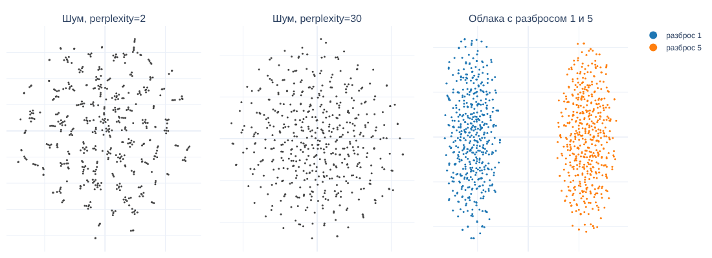
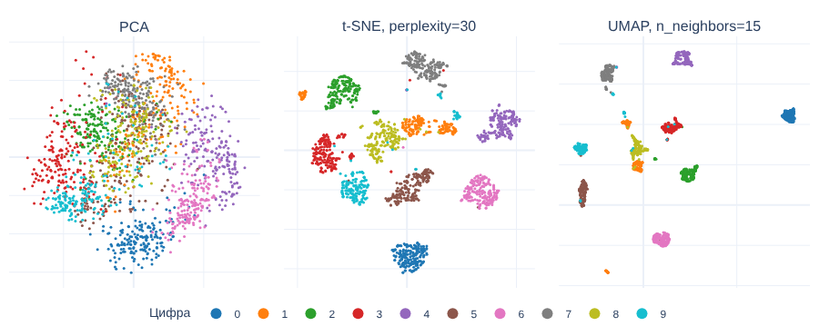

# Урок 2.4.2: Визуализация высокоразмерных данных (t-SNE, UMAP)

> **Модуль 2:** Data-Centric Machine Learning · **Тема 2.4:** Продвинутая визуализация
> **Тип:** теория · **Время:** 120 минут + 90 минут на домашнее задание

## Цели урока

После урока вы сможете:

- объяснить, чем PCA, t-SNE и UMAP отличаются по идее и что каждый из них сохраняет;
- подбирать `perplexity`, `n_neighbors`, `min_dist` и понимать, что именно они меняют;
- отличать на картинке то, чему можно верить, от артефактов метода;
- оценивать качество проекции числом, а не на глаз;
- использовать проекцию по назначению: для поиска ошибок разметки и ошибок модели.

## Зачем это нужно

Таблицу с двумя признаками можно нарисовать. Эмбеддинг текста — это 768 чисел, картинка 8×8 — 64 числа,
строка с признаками клиента — сотни столбцов. Посмотреть на такие данные «целиком» можно только одним
способом: сжать до двух координат, потеряв часть информации. Зачем это делают на практике:

- **эмбеддинги** — проверить, что модель разносит разные классы и сближает похожие объекты;
- **качество разметки** — точка одного цвета в глубине чужого облака часто оказывается ошибкой разметчика;
- **ошибки модели** — увидеть, сосредоточены ли они на границе классов или образуют отдельную группу;
- **сдвиг данных** — наложить новые данные на обучающие и увидеть, попадают ли они в те же области.

Проблема в том, что картинка из t-SNE или UMAP выглядит убедительнее, чем она есть. Методы нелинейные,
и многое из того, что бросается в глаза, — размеры «островов», расстояния между ними, а иногда и сами
острова — создано алгоритмом, а не данными. Половина урока — о том, как не обмануться.

## 1. Данные и базовая линия: PCA

```bash
uv add scikit-learn umap-learn plotly
```

Примеры проверены на Python 3.12, scikit-learn 1.9.1, umap-learn 0.6.0 (numba 0.68.1, pynndescent 0.7.0),
numpy 2.5.4, plotly 7.1.0. Данные — рукописные цифры, встроенные в scikit-learn: сеть не нужна.

```python
import numpy as np
from sklearn.datasets import load_digits
from sklearn.decomposition import PCA
from sklearn.manifold import TSNE, trustworthiness

digits = load_digits()
X, y = digits.data, digits.target          # X: (1797, 64) — картинки 8x8, яркость от 0 до 16; y — цифра
```

Любое исследование начинается с PCA: он линейный, мгновенный и не имеет параметров, которые можно
подкрутить.

```python
pca = PCA(n_components=2, random_state=0)
emb_pca = pca.fit_transform(X)
pca.explained_variance_ratio_              # [0.149, 0.136] — вместе 28.5 % дисперсии

cumulative = np.cumsum(PCA().fit(X).explained_variance_ratio_)
np.searchsorted(cumulative, 0.9) + 1       # 21 компонента объясняет 90 % дисперсии
```

Две компоненты сохраняют 28.5 % дисперсии — остальные 71.5 % на картинке не видны. Это честное число:
PCA сам сообщает, сколько он потерял. У t-SNE и UMAP такого показателя нет.

Свойства PCA, важные для сравнения: оси — линейные комбинации исходных признаков, расстояния на картинке
имеют смысл, новые точки проецируются тем же преобразованием (`pca.transform`). Плата за это — линейность:
если классы разделяются нелинейно, на проекции они сольются (левая панель рисунка в разделе 5).

**Как измерить качество проекции.** `trustworthiness` из scikit-learn отвечает на вопрос: если две точки
оказались соседями на картинке, были ли они соседями в исходном пространстве? Значение 1 — соседству
на картинке можно полностью доверять.

```python
trustworthiness(X, emb_pca, n_neighbors=10)      # 0.830
```

## 2. t-SNE

**Идея.** Для каждой точки t-SNE превращает расстояния до остальных в вероятности «быть соседом»: близкие
точки получают высокую вероятность, далёкие — почти нулевую. Затем он расставляет точки на плоскости так,
чтобы такие же вероятности на плоскости были как можно ближе к исходным (минимизирует расхождение
Кульбака — Лейблера градиентным спуском). Следствие: метод сохраняет **локальное соседство** и почти
ничего не знает о дальних расстояниях.

```python
tsne = TSNE(n_components=2, perplexity=30, random_state=42)
emb_tsne = tsne.fit_transform(X)
tsne.kl_divergence_, tsne.n_iter_                # (0.754, 999)
trustworthiness(X, emb_tsne, n_neighbors=10)     # 0.993 против 0.830 у PCA
```

| Параметр | Что делает | Как выбирать |
|---|---|---|
| `perplexity` (30) | эффективное число соседей каждой точки | 5–50; обязательно меньше числа точек; смотреть несколько значений |
| `learning_rate` (`"auto"`) | шаг градиентного спуска | оставить `"auto"`: для наших данных это 50 |
| `max_iter` (1000) | число итераций | не уменьшать; при 250 итерациях оптимизация не выходит из начальной фазы |
| `init` (`"pca"`) | начальное расположение точек | `"pca"` — воспроизводимо; `"random"` — каждый запуск даёт новую картинку |
| `random_state` | затравка генератора | фиксировать всегда |

Влияние `perplexity` на цифрах. Вторая числовая колонка — точность классификатора пяти ближайших соседей
на двумерных координатах: простая мера того, насколько хорошо классы разделены на картинке (в исходном
64-мерном пространстве она равна 0.963).

| `perplexity` | `trustworthiness` | Точность 5-NN на плоскости |
|---|---|---|
| 2 | 0.983 | 0.954 |
| 5 | 0.991 | 0.975 |
| 30 | 0.993 | 0.976 |
| 100 | 0.991 | 0.966 |
| 500 | 0.980 | 0.950 |

При слишком маленьком значении метод видит только ближайших соседей и дробит классы на осколки, при
слишком большом — начинает сливать соседние классы. Диапазон 5–100 даёт близкое качество, но картинки
при этом выглядят по-разному: вывод, который виден только при одном значении `perplexity`, — не вывод.

**У t-SNE нет `transform`.** Метод не строит функцию «точка → координаты», он подбирает координаты для
конкретного набора точек: `AttributeError: 'TSNE' object has no attribute 'transform'`. Новые данные
нельзя добавить на готовую картинку — только пересчитать всё заново и получить другую картинку.

## 3. Что на картинке t-SNE можно читать, а что нельзя

Три эксперимента на данных, где ответ известен заранее.

**Размеры кластеров ничего не значат.** Два облака по 500 точек в 50-мерном пространстве: у одного
стандартное отклонение 1, у другого 5.

```python
rng = np.random.default_rng(0)
tight = rng.normal(0, 1, size=(500, 50))
wide = rng.normal(0, 5, size=(500, 50)) + 100 * np.eye(50)[0]
blobs = np.vstack([tight, wide])

def spread(points):
    return np.linalg.norm(points - points.mean(axis=0), axis=1).mean()

emb = TSNE(perplexity=30, random_state=0).fit_transform(blobs)
spread(blobs[500:]) / spread(blobs[:500])        # 5.05 — в исходных данных второе облако в 5 раз шире
spread(emb[500:]) / spread(emb[:500])            # 1.00 — на картинке облака одинаковые
```

t-SNE подстраивает масштаб под локальную плотность, поэтому плотный и разреженный кластеры выглядят
одинаково (правая панель рисунка ниже). Вывод «этот класс разнообразнее» по размеру пятна сделать нельзя.

**Расстояния между кластерами ничего не значат.** Три облака на одной прямой с центрами в точках 0, 20
и 200: третье в десять раз дальше от первого, чем второе.

```python
three = np.vstack([rng.normal(0, 1, size=(300, 50)) + c * np.eye(50)[0] for c in [0, 20, 200]])

def far_to_near(points):
    a, b, c = (points[i * 300 : (i + 1) * 300].mean(axis=0) for i in range(3))
    return np.linalg.norm(a - c) / np.linalg.norm(a - b)

far_to_near(three)                                                                        # 10.0
far_to_near(TSNE(perplexity=30, random_state=0, init="random").fit_transform(three))      # 0.96
far_to_near(TSNE(perplexity=30, random_state=1, init="random").fit_transform(three))      # 1.52
```

Отношение 10 превратилось в 0.96 при одной затравке и в 1.52 при другой: дальнее облако оказалось
то ближе ближнего, то чуть дальше. На цифрах то же самое: при `init="random"` ближайшим соседом кластера
нулей в четырёх запусках с разными затравками оказались кластеры двоек, семёрок, троек и пятёрок.
Фраза «нули похожи на семёрки, потому что кластеры рядом» ничем не подкреплена.

**Кластеры появляются и в шуме.** 500 точек из одного 50-мерного нормального распределения — структуры
нет по построению. Проверим алгоритмом кластеризации HDBSCAN, сколько плотных групп он найдёт в исходных
данных и на картинках:

```python
from sklearn.cluster import HDBSCAN

noise = rng.normal(size=(500, 50))
# copy=True задан явно: без него scikit-learn 1.9 выдаёт FutureWarning о смене значения по умолчанию
HDBSCAN(min_cluster_size=10, copy=True).fit(noise).labels_.max() + 1         # 0 кластеров

for perplexity in [2, 5, 30]:
    emb = TSNE(perplexity=perplexity, random_state=0).fit_transform(noise)
    labels = HDBSCAN(min_cluster_size=10, copy=True).fit(emb).labels_
    print(perplexity, labels.max() + 1, f"{np.mean(labels >= 0):.0%}")
```

```
2 10 63%
5 5 17%
30 0 0%
```

При `perplexity=2` на картинке чистого шума нашлось 10 «кластеров», в которые попало 63 % точек; при
`perplexity=30` — ни одного. Маленькое значение заставляет метод склеивать случайно близкие точки.



Итог:

| Можно читать | Нельзя читать |
|---|---|
| какие точки — соседи: объекты внутри одного плотного пятна действительно похожи | размер и плотность пятна |
| наличие хорошо разделённых групп — если они устойчивы при разных `perplexity` и затравках | расстояния между пятнами и их взаимное расположение |
| отдельные точки «не в своём» кластере — кандидаты на ошибку разметки | форму пятна: вытянутость, «хвосты», «мосты» |
| | оси: у координат нет смысла, картинку можно повернуть и отразить |

**О воспроизводимости.** В актуальном scikit-learn `init="pca"` стоит по умолчанию, и на цифрах запуски
с затравками 0, 1, 2 и 3 дали одинаковые координаты с точностью до последнего знака. Это удобно, но
не делает картинку «правильной»: одна и та же картинка при каждом запуске — всё ещё одна из многих
возможных. Устойчивость вывода проверяют, меняя `perplexity` и запуская метод с `init="random"`.

## 4. UMAP

**Идея.** UMAP строит граф ближайших соседей в исходном пространстве, приписывает рёбрам веса и затем
раскладывает граф на плоскости так, чтобы соединённые точки притягивались, а несоединённые отталкивались.
Как и t-SNE, он опирается на локальное соседство, но граф строится приближённо и быстро, а готовая модель
умеет размещать новые точки.

```python
import umap

reducer = umap.UMAP(n_neighbors=15, min_dist=0.1, random_state=42, n_jobs=1, compatibility_layout=True)
emb_umap = reducer.fit_transform(X)
trustworthiness(X, emb_umap, n_neighbors=10)     # 0.988
```

Три параметра в этом вызове появились не от хорошей жизни — без них версия 0.6 выдаёт предупреждения:

- `random_state` делает результат воспроизводимым, но отключает параллельность; без `n_jobs=1` библиотека
  сообщает об этом: `n_jobs value -1 overridden to 1 by setting random_state`. Без затравки UMAP считает
  в несколько потоков, и каждый запуск даёт немного другую картинку;
- `compatibility_layout`: в версии 0.6 идёт переход на новый алгоритм укладки точек. Пока параметр
  не задан, появляется `FutureWarning`. `True` — прежний алгоритм, описанный в документации; `False` —
  новый. На цифрах разница невелика: `trustworthiness` 0.988 и 0.986, но координаты другие. Задавайте
  значение явно, иначе картинки изменятся после обновления библиотеки.

Первый вызов UMAP в процессе занимает заметно больше последующих (здесь — 12.7 с против 2.3 с): numba
компилирует код библиотеки. Это не зависание.

| Параметр | Что делает | Замер на цифрах |
|---|---|---|
| `n_neighbors` (15) | размер окрестности: меньше — мелкая локальная структура, больше — общая картина | 5, 15, 50, 200 → `trustworthiness` 0.989, 0.988, 0.986, 0.983 |
| `min_dist` (0.1) | насколько плотно точки могут лежать на картинке | 0.0 → плотные комки; 0.99 → расстояние до ближайшего соседа в 5.6 раза больше |
| `metric` (`"euclidean"`) | как измеряется расстояние в исходном пространстве | точность 5-NN на плоскости: евклидова 0.977, косинусная 0.987, манхэттенская 0.970 |

`min_dist` меняет внешний вид, а не структуру: при 0.0 кластеры сжимаются в точки (удобно для последующей
кластеризации), при больших значениях видно распределение внутри кластера. Для эмбеддингов текстов
и изображений обычно берут `metric="cosine"`.

**Новые точки.** Главное практическое отличие от t-SNE:

```python
from sklearn.model_selection import train_test_split

X_train, X_test, y_train, y_test = train_test_split(X, y, test_size=0.2, random_state=0, stratify=y)
reducer = umap.UMAP(random_state=42, n_jobs=1, compatibility_layout=True).fit(X_train)
emb_train = reducer.embedding_               # (1437, 2)
emb_test = reducer.transform(X_test)         # (360, 2) — те же оси, что у обучающих точек
```

Классификатор пяти ближайших соседей, обученный на `emb_train`, даёт на `emb_test` точность 0.975 — почти
как в исходных 64 измерениях (0.978): новые точки попадают в «свои» области. Так проверяют сдвиг данных:
обучают проекцию на старых данных и смотрят, куда лягут новые.

Всё сказанное в разделе 3 относится и к UMAP: размеры пятен и расстояния между далёкими кластерами
на его картинках тоже не несут надёжной информации.

## 5. Сравнение



| | PCA | t-SNE | UMAP |
|---|---|---|---|
| Время на 1797 точках, один поток | 0.002 с | 7.4 с | 2.3 с (плюс компиляция при первом вызове) |
| `trustworthiness` (10 соседей) | 0.830 | 0.993 | 0.988 |
| Точность 5-NN на плоскости | 0.603 | 0.976 | 0.977 |
| Новые точки (`transform`) | да | нет | да |
| Смысл расстояний и осей | есть | нет | нет |
| Параметры, меняющие картинку | нет | `perplexity`, `init`, затравка | `n_neighbors`, `min_dist`, затравка |

На больших данных разрыв растёт. Синтетические данные из 200 признаков, один поток, загруженная машина
(относитесь к числам как к порядку величины):

| Точек | t-SNE | UMAP |
|---|---|---|
| 2 000 | 8.9 с | 2.9 с |
| 10 000 | 87–129 с (два запуска) | 19 с |
| 30 000 | не запускали | 24 с |

Выбор: PCA — всегда первым; UMAP — когда точек больше нескольких тысяч, нужны новые точки или много
запусков; t-SNE — на небольших данных он даёт чуть более аккуратное локальное соседство.

## 6. Практические рецепты

**Стандартизация.** Оба метода работают с расстояниями, а в расстоянии побеждает признак с самым большим
масштабом. В digits все признаки — яркости пикселей в одной шкале, масштабировать нечего. В данных о винах
(`load_wine`) стандартное отклонение признака `proline` равно 314, признака `hue` — 0.23:

| Данные wine | Точность 5-NN на плоскости: t-SNE | UMAP |
|---|---|---|
| без масштабирования | 0.663 | 0.669 |
| после `StandardScaler` | 0.961 | 0.933 |

Без масштабирования обе картинки отражают, по сути, один признак.

**PCA перед t-SNE.** Распространённый совет — сначала сжать данные до 50 компонент. На плотных данных
из 2000 признаков (5000 строк) выигрыша во времени для t-SNE не получилось: 33.2 с без PCA против
35.6 с с ним; UMAP ускорился с 7.9 до 5.7 с. Приём полезен другим: он убирает шумовые направления
и снижает расход памяти на данных из десятков тысяч признаков. Число компонент выбирайте по накопленной
доле дисперсии.

**Подвыборка.** Больше 10–20 тысяч точек на одной картинке глаз не различает, а браузер рисует с трудом
(урок 2.4.1). Берите случайную подвыборку, стратифицированную по классу; редкие классы сохраняйте целиком.

**Раскраска — главный инструмент.** Одна и та же проекция отвечает на разные вопросы в зависимости
от цвета: истинная метка — разделимы ли классы; предсказание модели — где она ошибается; источник или
дата — есть ли сдвиг; значение признака — что отличает кластер от соседей.

**Интерактивный разбор ошибок.** Обучим простую модель и покажем тестовые точки на проекции UMAP:

```python
import pandas as pd
import plotly.express as px
from sklearn.linear_model import LogisticRegression
from sklearn.pipeline import make_pipeline
from sklearn.preprocessing import StandardScaler

model = make_pipeline(StandardScaler(), LogisticRegression(max_iter=1000)).fit(X_train, y_train)
pred = model.predict(X_test)                 # точность 0.967: 12 ошибок на 360 объектах

points = pd.DataFrame(
    {
        "x": emb_test[:, 0],
        "y": emb_test[:, 1],
        "index": np.arange(len(X_test)),
        "true": y_test.astype(str),
        "pred": pred.astype(str),
        "confidence": model.predict_proba(X_test).max(axis=1).round(2),
        "result": np.where(pred == y_test, "верно", "ошибка"),
    }
)
fig = px.scatter(
    points, x="x", y="y", color="true", symbol="result",
    symbol_map={"верно": "circle", "ошибка": "x"},
    hover_data=["index", "true", "pred", "confidence"],
    category_orders={"true": [str(d) for d in range(10)]},
)
fig.update_traces(marker_size=11, selector=lambda trace: trace.marker.symbol == "x")
fig.write_html("errors.html", include_plotlyjs="directory")
```

Наведя курсор на крестик, вы видите номер объекта в тестовой выборке, истинную метку, предсказание
и уверенность модели — и можете открыть сам объект: `X_test[179].reshape(8, 8)`. Что показал разбор:
из 12 ошибок семь —
предсказание «1», четыре из них — восьмёрки, принятые за единицы. Объект 179 (единица, названная
восьмёркой) модель классифицировала с уверенностью 0.99 — первый кандидат на проверку разметки.
Картинка здесь — не результат, а способ быстро добраться до конкретных объектов.

## Типичные ошибки

| Симптом | Причина | Решение |
|---|---|---|
| Вывод о «разнообразии» класса по размеру пятна | t-SNE и UMAP выравнивают плотность | сравнивать разброс в исходном пространстве |
| Вывод о сходстве классов по близости пятен | дальние расстояния не сохраняются | считать расстояния между центрами классов в исходном пространстве |
| На картинке десятки мелких островков | слишком маленькие `perplexity` или `n_neighbors` | увеличить; проверить, сохраняется ли структура |
| Каждый запуск даёт новую картинку | не зафиксирована затравка; у UMAP — параллельный режим | `random_state`; для UMAP ещё `n_jobs=1` |
| После обновления библиотеки картинки UMAP изменились | сменился алгоритм укладки по умолчанию | задать `compatibility_layout` явно |
| Картинка отражает один признак | признаки в разных масштабах | `StandardScaler` перед проекцией |
| `AttributeError: 'TSNE' object has no attribute 'transform'` | t-SNE не умеет размещать новые точки | UMAP или PCA |
| Первый вызов UMAP длится десятки секунд | компиляция numba | подождать; повторные вызовы быстрые |
| `UserWarning: Graph is not fully connected` у UMAP | данные распадаются на несвязанные группы | увеличить `n_neighbors` или принять: группы действительно изолированы |
| Скрипт с `python -W error` падает на `import umap` | `ImportWarning` о том, что не установлен TensorFlow | TensorFlow нужен только для `ParametricUMAP`; предупреждение можно отфильтровать |
| Проекцию используют как признаки для модели | координаты t-SNE нельзя получить для новых данных | для признаков — PCA или UMAP с `transform`, обученные только на train |

## Контрольные вопросы

1. Что означает число 28.5 % для двумерной проекции PCA? Почему у t-SNE нет похожего показателя?
2. Что сохраняет t-SNE и чего он не сохраняет? Как это следует из его идеи?
3. Что показывает `trustworthiness`? Может ли проекция с высоким значением вводить в заблуждение?
4. На картинке t-SNE один кластер вдвое крупнее другого. Что можно сказать о данных?
5. Как проверить, что группа точек на картинке — настоящая структура, а не артефакт?
6. Чем UMAP удобнее t-SNE при работе с новыми данными? Какие три параметра определяют его картинку?
7. Почему перед проекцией нужно стандартизировать признаки? Когда этого делать не нужно?
8. Какие четыре раскраски одной проекции вы построите, разбирая ошибки классификатора?

## Домашнее задание

Работайте в ноутбуке `homework/m02/hw_2_4_2.ipynb`. Данные — `load_digits()` и `load_wine()`.

1. **Три проекции.** Постройте PCA, t-SNE и UMAP для digits, раскрасьте по цифре. Для каждой посчитайте
   `trustworthiness` и время. Сравните с таблицей из раздела 5.
2. **Устойчивость.** Постройте t-SNE при `perplexity` 5, 30 и 100 и при трёх затравках с `init="random"`.
   Найдите на картинках одну закономерность, которая повторяется во всех запусках, и одну, которая
   не повторяется. Запишите обе.
3. **Проверка вывода.** По картинке UMAP выберите два класса, которые выглядят соседними, и два, которые
   выглядят далёкими. Посчитайте расстояния между центрами этих классов в исходном 64-мерном пространстве.
   Подтвердилось ли впечатление от картинки?
4. **Шум.** Повторите эксперимент с шумом из раздела 3 для UMAP при `n_neighbors` 2, 5 и 15. Находит ли
   HDBSCAN кластеры на его картинках?
5. **Масштаб.** Для wine постройте UMAP без масштабирования и после `StandardScaler`, раскрасьте по классу
   и по признаку `proline`. Объясните, что видно на первой картинке.
6. **Ошибки модели.** Обучите на digits любой классификатор, постройте интерактивный график тестовых точек
   с подсказкой (номер, истинная метка, предсказание, уверенность). Найдите три самые уверенные ошибки,
   выведите их изображения (`digits.images`) и решите для каждой: ошиблась модель или разметка спорная.

**Критерии приёмки:**

- [ ] во всех вызовах t-SNE и UMAP задан `random_state`; у UMAP заданы `n_jobs=1` и `compatibility_layout`;
- [ ] в задании 2 записаны устойчивая и неустойчивая закономерности;
- [ ] в задании 3 приведены четыре расстояния и вывод;
- [ ] в задании 6 показаны изображения трёх объектов и по каждому сделан вывод;
- [ ] проекция для задания 6 обучена на train, тестовые точки получены через `transform`;
- [ ] ноутбук выполняется целиком сверху вниз; HTML-файлы графиков не закоммичены.

## Дополнительные материалы

- scikit-learn, раздел «Manifold learning»: https://scikit-learn.org/stable/modules/manifold.html
- scikit-learn, описание `TSNE`: https://scikit-learn.org/stable/modules/generated/sklearn.manifold.TSNE.html
- Документация UMAP: https://umap-learn.readthedocs.io/
- UMAP, параметры и их влияние: https://umap-learn.readthedocs.io/en/latest/parameters.html

**Следующий урок:** 2.4.3 — Создание отчетов с помощью Pandas Profiling.
