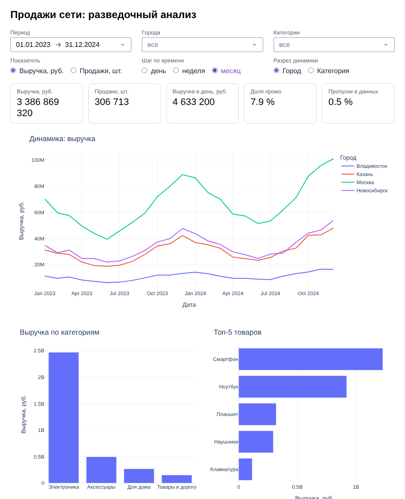

# Урок 2.4.4: ПРАКТИКА: Создание интерактивного дашборда для EDA

> **Модуль 2:** Data-Centric Machine Learning · **Тема 2.4:** Продвинутая визуализация
> **Тип:** практика · **Время:** 5–6 часов

## Задача

К вам пришёл категорийный менеджер сети из восьми магазинов. Раз в неделю он просит аналитиков «посмотреть
продажи»: то по Казани, то по электронике, то за последний квартал. Каждый раз это новый ноутбук и полдня
работы. Нужно закрыть эти просьбы одним инструментом — дашбордом, в котором менеджер сам выбирает период,
города и категории и видит ответ.

Пользователь дашборда не программист. Он не будет читать код, не простит сырых имён столбцов на осях
и закроет вкладку, если после смены фильтра страница покажет ошибку. Вопросы, на которые дашборд должен
отвечать за несколько щелчков:

1. Сколько продали за период и как продажи менялись во времени — по городам и по категориям?
2. Какие категории и товары дают основную выручку? А основной объём в штуках?
3. Как продажи зависят от дня недели и одинакова ли эта зависимость для разных категорий?
4. Работает ли промо: насколько продажи товара в дни акций выше обычных?
5. Можно ли доверять цифрам: какая доля данных за выбранный период потеряна?

Последний вопрос — про качество данных — отличает дашборд для разведочного анализа от витрины с красивыми
числами. Пропуски должны быть видны на первом экране.

## Материалы

Папка [`practice/`](practice/):

| Файл | Назначение |
|---|---|
| `dashboard_data.py` | фильтрация и агрегаты: таблица на входе, таблица на выходе |
| `dashboard_figures.py` | графики: таблица на входе, `plotly.graph_objects.Figure` на выходе |
| `app.py` | рабочий каркас приложения Dash: макет, фильтры, один готовый callback |
| `tests/` | 81 тест — исполняемая спецификация |
| `pyproject.toml`, `README.md` | зависимости и инструкция по запуску |

Скопируйте папку `practice/` и файл [`sales_data.py`](../topic_2_1/sales_data.py) в свой репозиторий,
сохранив взаимное расположение: `projects/p_2_4_dashboard/sales_data.py`
и `projects/p_2_4_dashboard/practice/...`.

```bash
cd projects/p_2_4_dashboard/practice
uv sync
uv run pytest -q             # на заготовке: 19 тестов проходят, 62 падают
uv run python app.py         # http://127.0.0.1:8050/
```

Каркас работает сразу: страница открывается, фильтры действуют на график «по категориям». На месте
остальных графиков — заглушки с надписью «Здесь будет график».

## Архитектура: три слоя

```
фильтры в браузере ──> app.py ──> dashboard_data.py ──> dashboard_figures.py ──> браузер
                     (callback)   (таблица -> таблица)   (таблица -> Figure)
```

| Слой | Что знает | Чего не знает |
|---|---|---|
| `dashboard_data` | pandas, структуру данных о продажах | что существуют Plotly и Dash |
| `dashboard_figures` | Plotly, названия столбцов готовых таблиц | как таблицы получены; что существует Dash |
| `app` | компоненты Dash, идентификаторы, порядок вызова функций | как считать агрегаты и как рисовать |

Зачем так делить. Callback, в котором подряд идут фильтрация, группировка и рисование, можно проверить
только руками в браузере. Функцию «таблица → таблица» проверяет обычный тест за миллисекунды, а саму
функцию можно вызвать в ноутбуке. Когда менеджер попросит «то же самое, но в Excel», слой данных
переедет в новый инструмент без изменений. Тот же принцип — отделять вычисления от интерфейса —
пригодится, когда вы будете оборачивать модели в сервисы.

Образец в комплекте — полный путь одного графика через все три слоя: `filter_sales` и `totals_by_category`
в данных, `category_bar` в графиках, `update_category` в приложении. Остальное делается по аналогии.

## Макет

```
+--------------------------------------------------------------------------------------+
| Продажи сети: разведочный анализ                                                     |
+--------------------------------------------------------------------------------------+
| Период [01.01.2023 -> 31.12.2024]   Города [все v]          Категории [все v]        |
| Показатель (*) выручка ( ) штуки    Шаг ( ) день (*) неделя ( ) месяц                |
| Разрез динамики (*) город ( ) категория                                              |
+--------------------------------------------------------------------------------------+
| [ Выручка ] [ Продано, шт. ] [ Выручка в день ] [ Доля промо ] [ Пропуски ]          |  kpi-row
+--------------------------------------------------------------------------------------+
|                                                                                      |
| Динамика показателя: линия на каждый город или категорию                             |  graph-timeseries
|                                                                                      |
+------------------------------------------+-------------------------------------------+
| Показатель по категориям (образец)       | Топ-5 товаров                             |  graph-category,
|                                          |                                           |  graph-top-products
+------------------------------------------+-------------------------------------------+
| Тепловая карта: категория x день недели  | Эффект промо по товарам                   |  graph-weekday,
|                                          |                                           |  graph-promo
+------------------------------------------+-------------------------------------------+
```

Макет уже собран в `app.py`. Идентификаторы компонентов менять нельзя: на них опираются тесты. Так
выглядит верхняя часть готового дашборда (шаг по времени — месяц):



| Фильтр | Идентификатор | На что влияет |
|---|---|---|
| Период | `filter-dates` | на всё |
| Города, категории | `filter-cities`, `filter-categories` | на всё; пустой выбор означает «все» |
| Показатель | `filter-metric` | на динамику, категории, топ товаров, тепловую карту |
| Шаг по времени, разрез | `filter-freq`, `filter-by` | только на динамику |

## Часть 1. Данные

Реализуйте в `dashboard_data.py` пять функций. Точное поведение описано в docstring каждой.

| Функция | Что возвращает | На что обратить внимание |
|---|---|---|
| `kpi_summary` | словарь из пяти показателей | пустая выборка даёт нули, а не `NaN` и не деление на ноль |
| `time_series` | динамику по дням, неделям или месяцам | дата строки — начало периода; неделя начинается с понедельника |
| `top_products` | не более `n` товаров-лидеров | товаров в выборке может быть меньше `n` |
| `weekday_profile` | таблицу «категория × день недели» | среднее от дневных сумм, а не от строк; всегда семь столбцов |
| `promo_effect` | продажи с промо и без него по товарам | у товара может не быть строк с промо |

```bash
uv run pytest -q -k TestKpiSummary       # работайте над одной функцией за раз
```

Два места, где ошибаются чаще всего:

- **Среднее от чего?** В `weekday_profile` нужна средняя выручка категории за день: сначала сумма по паре
  «дата — категория», затем среднее по датам. Среднее по строкам исходной таблицы — это средняя выручка
  одного товара в одном магазине, она в разы меньше и на вопрос менеджера не отвечает. Тест
  `test_value_is_mean_of_daily_sums` ловит именно эту подмену.
- **Исходную таблицу менять нельзя.** Функции получают глобальную таблицу приложения. Строка вида
  `sales["weekday"] = ...` изменит её для всех следующих вызовов и всех пользователей. Тесты
  `test_source_is_not_modified` это проверяют. Используйте `assign` или группируйте по вычисленному ряду.

## Часть 2. Графики

Реализуйте в `dashboard_figures.py` четыре функции. Тесты строят для них маленькие таблицы вручную,
поэтому графиками можно заниматься до того, как готова часть 1.

| Функция | График | Проверяется |
|---|---|---|
| `time_series_figure` | линии по времени | трасса на каждую группу, подписи осей, заголовок легенды |
| `top_products_figure` | горизонтальные столбцы | порядок товаров, лидер наверху |
| `weekday_heatmap` | тепловая карта | оси, форма матрицы |
| `promo_figure` | сгруппированные столбцы | две трассы с нужными именами, `barmode="group"` |

Общее требование: для пустой таблицы каждая функция возвращает `empty_figure()` — фигуру без трасс
с понятным сообщением. Пустая выборка — обычная ситуация: пользователь выбрал город и категорию, которых
нет в выбранном периоде. График в этот момент должен объяснить, что произошло, а не показать пустые оси.

Тесты проверяют структуру фигуры, а не внешний вид. Глазами проверьте сами: откройте фигуру в ноутбуке
(`fig.show()`) и убедитесь, что подписи читаются, а подсказка при наведении содержит понятный текст.

## Часть 3. Приложение

Допишите в `app.py` callback-функции для карточек показателей и четырёх графиков — по образцу
`update_category`. Список выходов и нужных для них функций перечислен в комментарии в конце файла.

- Один callback может обновлять несколько компонентов: `Output` перечисляются подряд, функция возвращает
  кортеж. Объединять имеет смысл графики с одинаковым набором входов.
- Карточки показателей: callback возвращает в `kpi-row.children` список из пяти `kpi_card(...)`. Числа
  форматируйте готовыми `format_number` и `format_share`.
- Callback-функция должна быть короткой: отфильтровать, вызвать функцию данных, вызвать функцию графика.
  Если в ней появился `groupby` — он должен переехать в `dashboard_data`.

```bash
uv run pytest -q tests/test_app.py
```

Тесты приложения работают без браузера: они запрашивают у приложения описание макета и список
callback-функций, а затем вызывают каждую функцию тем же HTTP-запросом, который отправляет браузер, —
с исходными значениями фильтров и с периодом, в котором данных нет.

## Пошаговый план

1. Запустите каркас, пощёлкайте фильтрами, прочитайте `app.py` и образцы в двух модулях.
2. Часть 1: пять функций данных, каждая — до зелёных тестов своего класса.
3. Часть 2: четыре функции графиков. Каждый график посмотрите глазами в ноутбуке.
4. Часть 3: callback-функции. После каждой — перезагрузка страницы и проверка в браузере.
5. Проверка поведения: пустая выборка, один день, один город, переключение показателя и шага.
6. `uv run pytest -q`, `uv run ruff check .`, `uv run ruff format --check .`.
7. Ответы на вопросы раздела ниже — в файл `ANSWERS.md`.

## Вопросы к готовому дашборду

Дашборд сделан, чтобы им пользоваться. Ответьте письменно, по одному-два предложения, пользуясь только
дашбордом:

1. В каком месяце выручка сети была максимальной? Одинаков ли ответ для всех четырёх городов?
2. Какая категория лидирует по выручке, а какая — по числу проданных единиц? Какой товар первый в каждом
   из этих рейтингов в Казани?
3. Во сколько примерно раз субботние продажи выше продаж в среду? Есть ли категория, где это не так?
4. Одинаков ли эффект промо для дорогих и дешёвых товаров?
5. Выберите шаг «неделя» и посмотрите на края графика динамики. Почему первая и последняя точки ниже
   соседних? Как это исправить и нужно ли?
6. Что показывает дашборд, если выбрать период из одного дня? Все ли графики остаются осмысленными?

Для самопроверки: при фильтрах по умолчанию суммарная выручка равна 3 386 869 320 руб., продано
306 713 единиц, доля промо — 7.9 %, пропуски — 0.5 %; выручка одной Казани — 730 077 800 руб. В генератор
данных заложены коэффициент выходных 1.35 и эффект промо 1.8.

## Критерии приёмки

- [ ] `uv run pytest -q` — все 81 тест проходят;
- [ ] `uv run ruff check .` и `uv run ruff format --check .` проходят без ошибок;
- [ ] `uv run python app.py` запускает приложение; в терминале и в панели ошибок браузера нет сообщений
      об ошибках ни при загрузке, ни при смене любого фильтра;
- [ ] при выборе, не содержащем данных, все графики показывают сообщение, а карточки — нули;
- [ ] в `app.py` нет вызовов `groupby`, `pivot_table` и создания трасс: только фильтрация и вызовы функций
      из двух модулей;
- [ ] ни одна функция не изменяет исходную таблицу; в callback-функциях нет записи в глобальные переменные;
- [ ] на осях, в легендах и подсказках нет сырых имён столбцов (`revenue`, `units`, `city`);
- [ ] в `ANSWERS.md` есть ответы на шесть вопросов;
- [ ] в репозитории нет `.venv`, HTML-файлов и снимков данных.

## Как оценить свою работу

| Уровень | Признаки |
|---|---|
| Базовый | тесты проходят, дашборд работает при любых фильтрах |
| Уверенный | подсказки и форматы чисел продуманы; ответы на вопросы объясняют причины; callback-функции — по три-четыре строки |
| Продвинутый | выполнено одно-два задания из раздела ниже, и новые функции покрыты собственными тестами |

## Идеи для усложнения

1. **Перекрёстная фильтрация.** Щелчок по столбцу категории (`clickData` графика `graph-category`)
   оставляет на остальных графиках только эту категорию. Подумайте, где хранить выбор и как его сбросить.
2. **Кнопка вместо мгновенной реакции.** Замените входы фильтров на `State` и добавьте кнопку
   «Применить». Когда такой вариант лучше для пользователя, а когда хуже?
3. **Один расчёт вместо пяти.** Сейчас каждый callback фильтрует таблицу заново. Измерьте время фильтрации
   и решите, стоит ли кэшировать результат по значениям фильтров (`functools.lru_cache` требует хешируемых
   аргументов — списки придётся превратить в кортежи).
4. **Сравнение с прошлым периодом.** Добавьте в карточки изменение показателя относительно предыдущего
   периода той же длины: «+12.4 %». Что показывать, если предыдущего периода в данных нет?
5. **Неполные периоды.** Отмечайте на графике динамики неполные первую и последнюю неделю или месяц —
   другим видом маркера или подписью.
6. **Выгрузка.** Кнопка «Скачать CSV» для таблицы, по которой построен график динамики
   (`dcc.Download`).
7. **Большие данные.** Сгенерируйте продажи за 20 лет (`make_sales(start="2005-01-01")`) и добейтесь,
   чтобы дашборд реагировал на фильтр быстрее чем за полсекунды. Что вы измените: типы столбцов,
   предварительные агрегаты, способ фильтрации?

## Что дальше

Модуль 2 закончен: вы умеете готовить данные, считать быстро, строить признаки и показывать результат.
В модуле 3 начинаются модели — и первым делом вам понадобится всё перечисленное, чтобы понять, на чём
модель ошибается.

**Следующий урок:** 3.1.1 — Математика линейных моделей + регуляризация.
