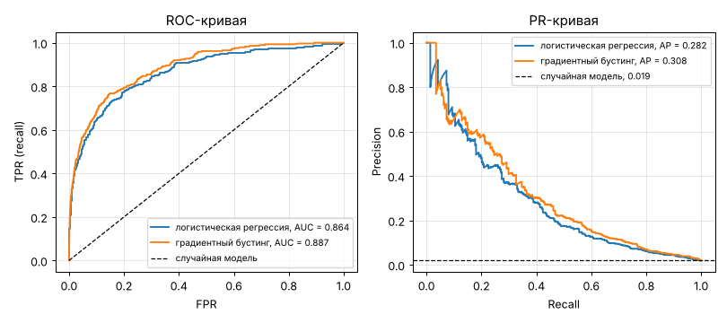

# Урок 3.2.1: Метрики классификации: от Accuracy до PR-AUC

> **Модуль 3:** Classical ML: Algorithms & Production Thinking · **Тема 3.2:** Классификация и метрики
> **Тип:** теория · **Время:** 150 минут + 120 минут на домашнее задание

## Цели урока

После урока вы сможете:

- вывести любую метрику бинарной классификации из матрицы ошибок и объяснить её словами заказчика;
- показать числами, почему accuracy бесполезна при дисбалансе классов;
- отделять предсказание вероятности от выбора порога и подбирать порог под нужный баланс ошибок;
- читать ROC- и PR-кривые и объяснить, почему при редком положительном классе ROC-AUC выглядит
  оптимистично;
- считать метрики в топе списка, усреднять метрики по классам и оценивать их погрешность бутстрепом;
- выбрать метрику под задачу, исходя из цены ошибок.

## Зачем это нужно

Модель поиска мошенничества с accuracy 98 % звучит отлично — пока не выяснится, что такую же accuracy
даёт модель, которая не находит ни одного мошенника. Метрика — это формулировка задачи на языке чисел:
под неё подбирают признаки, гиперпараметры и саму модель. Если метрика не отражает то, что нужно бизнесу,
вся дальнейшая работа оптимизирует не то.

Второй источник ошибок — погрешность. На тысячу операций приходится два десятка мошеннических, и метрика,
посчитанная по двум десяткам примеров, от выборки к выборке меняется в разы. Без оценки разброса нельзя
сказать, действительно ли новая модель лучше старой.

## 1. Данные и модель

Данные темы — операции по банковским картам. Скопируйте [`fraud_data.py`](fraud_data.py).

```python
import numpy as np
import pandas as pd
from fraud_data import TARGET, make_features, make_transactions
from sklearn.linear_model import LogisticRegression
from sklearn.model_selection import train_test_split
from sklearn.pipeline import make_pipeline
from sklearn.preprocessing import StandardScaler

transactions = make_transactions()  # 60 000 операций за 180 дней
X = make_features(transactions)  # 14 числовых признаков
y = transactions[TARGET]
y.sum(), y.mean()  # (1150, 0.0192)
```

| Столбец | Смысл |
|---|---|
| `client_id`, `timestamp` | клиент и время операции |
| `amount` | сумма операции, руб. |
| `client_avg_amount` | обычная сумма операции этого клиента, руб. |
| `account_age_days` | сколько дней назад открыт счёт |
| `merchant_category` | категория продавца: продукты, электроника, снятие наличных и другие |
| `is_online`, `is_foreign`, `new_device` | операция в интернете; за границей; с нового устройства |
| `tx_last_24h` | число операций клиента за предыдущие сутки |
| `is_fraud` | операция мошенническая: 1 или 0 |

Мошеннических операций 1.92 % — типичный для таких задач сильный дисбаланс. Функция `make_features`
логарифмирует суммы, добавляет признак «ночь» и кодирует категорию индикаторами. Делим данные и обучаем
логистическую регрессию (урок 3.1.3):

```python
X_train, X_test, y_train, y_test = train_test_split(X, y, test_size=0.25, stratify=y, random_state=0)
model = make_pipeline(StandardScaler(), LogisticRegression(max_iter=1000))
model.fit(X_train, y_train)
proba = model.predict_proba(X_test)[:, 1]  # вероятность мошенничества
```

В тестовой выборке 15 000 операций, из них 288 мошеннических. Параметр `stratify` сохраняет долю класса
в обеих частях; почему это важно и когда такое разбиение не годится — в уроке 3.2.3.

## 2. Матрица ошибок

У бинарного классификатора четыре исхода. Положительным классом называют тот, который ищем, — у нас
это мошенничество.

| | Предсказано: мошенничество | Предсказано: обычная операция |
|---|---|---|
| **На деле мошенничество** | TP, true positive — поймали | FN, false negative — пропустили |
| **На деле обычная операция** | FP, false positive — ложная тревога | TN, true negative — верно пропустили |

```python
from sklearn.metrics import confusion_matrix

y_pred = model.predict(X_test)  # порог 0.5
tn, fp, fn, tp = confusion_matrix(y_test, y_pred).ravel()
tn, fp, fn, tp  # (14704, 8, 265, 23)
```

Все метрики этого урока — разные способы свернуть четыре числа в одно. Когда метрика ведёт себя странно,
возвращайтесь к матрице: она ничего не скрывает. Из 288 мошеннических операций модель с порогом 0.5
поймала 23.

## 3. Accuracy и дисбаланс

**Accuracy** — доля правильных ответов: $(TP + TN) / n$.

| Модель | Accuracy | Поймано мошенников |
|---|---|---|
| Константа «мошенников нет» | 0.9808 | 0 из 288 |
| Логистическая регрессия, порог 0.5 | 0.9818 | 23 из 288 |

Модель, которая не делает ничего, получает 98 %. Accuracy почти целиком определяется большим классом:
14 712 обычных операций перевешивают 288 мошеннических при любом качестве их распознавания. Вывод:
при дисбалансе accuracy не используют. Она уместна, когда классы примерно равны и ошибки обоих видов
стоят одинаково.

## 4. Precision, recall, specificity, FPR

| Метрика | Формула | Вопрос, на который отвечает | Порог 0.5 |
|---|---|---|---|
| Precision (точность) | $\frac{TP}{TP + FP}$ | какая доля тревог — настоящие мошенники? | 23 / 31 = 0.742 |
| Recall (полнота, TPR) | $\frac{TP}{TP + FN}$ | какую долю мошенников мы поймали? | 23 / 288 = 0.080 |
| Specificity (TNR) | $\frac{TN}{TN + FP}$ | какую долю обычных операций мы не тронули? | 14704 / 14712 = 0.9995 |
| FPR | $\frac{FP}{FP + TN}$ | какую долю обычных операций мы зря остановили? | 8 / 14712 = 0.0005 |

Знаменатели подсказывают, от чего зависит метрика. Recall и FPR считаются внутри одного настоящего
класса, поэтому не зависят от соотношения классов. В знаменателе precision — объекты обоих классов,
поэтому она **зависит от доли положительного класса**: чем реже мошенничество, тем больше ложных тревог
на одну настоящую при том же качестве модели. Этим свойством объясняется половина урока.

Precision и recall тянут в разные стороны. Поймать всех мошенников легко — объявить мошенническими все
операции: recall 1.0, precision 0.019. Никогда не ошибаться в тревогах тоже легко — поднимать тревогу раз
в год. Содержательная модель — компромисс, и место на этой шкале выбирает порог.

## 5. Порог — отдельное решение

Модель выдаёт вероятность. Решение «блокировать или пропустить» принимается сравнением вероятности
с порогом. Это два разных шага: первый определяется данными и алгоритмом, второй — ценой ошибок.
Метод `predict` молча подставляет порог 0.5, и для редкого класса он почти всегда неудачен: у нас лишь
у 1 % операций вероятность выше 0.26.

```python
from sklearn.metrics import precision_score, recall_score

for threshold in [0.5, 0.2, 0.1, 0.05, 0.02]:
    flagged = proba >= threshold
    print(threshold, flagged.sum(), precision_score(y_test, flagged), recall_score(y_test, flagged))
```

| Порог | TP | FP | FN | Precision | Recall | FPR | Accuracy |
|---|---|---|---|---|---|---|---|
| 0.50 | 23 | 8 | 265 | 0.742 | 0.080 | 0.0005 | 0.982 |
| 0.30 | 57 | 60 | 231 | 0.487 | 0.198 | 0.004 | 0.981 |
| 0.20 | 84 | 142 | 204 | 0.372 | 0.292 | 0.010 | 0.977 |
| 0.10 | 128 | 466 | 160 | 0.216 | 0.444 | 0.032 | 0.958 |
| 0.05 | 167 | 1 119 | 121 | 0.130 | 0.580 | 0.076 | 0.917 |
| 0.02 | 214 | 2 589 | 74 | 0.076 | 0.743 | 0.176 | 0.823 |

Одна и та же модель при пороге 0.5 ловит 8 % мошенников, при пороге 0.05 — 58 %, расплачиваясь тысячей
ложных тревог. Обратите внимание на последний столбец: accuracy **падает**, когда модель становится
полезнее. Какая строка лучше, из таблицы понять нельзя — это зависит от того, сколько стоит пропущенное
мошенничество и сколько — напрасная проверка. Выбору порога по цене ошибок посвящена практика 3.2.4.

Правило: модели сравнивают метриками, не зависящими от порога (разделы 7–8), а порог подбирают отдельно,
на отложенных данных, и фиксируют до финальной проверки.

## 6. F1 и F-beta

Чтобы свернуть precision и recall в одно число, берут их гармоническое среднее:

$$F_1 = \frac{2 \cdot P \cdot R}{P + R}, \qquad F_\beta = \frac{(1 + \beta^2) \cdot P \cdot R}{\beta^2 \cdot P + R}$$

Гармоническое среднее близко к меньшему из двух чисел. При precision 0.9 и recall 0.1 арифметическое
среднее равно 0.5, а $F_1$ — всего 0.18: высокой одной метрикой нельзя компенсировать провал другой.

Параметр $\beta$ показывает, во сколько раз recall важнее precision:

| $\beta$ | Когда | Лучший порог | Precision | Recall | Тревог | $F_\beta$ |
|---|---|---|---|---|---|---|
| 0.5 | ложная тревога дороже пропуска: блокировка клиента, спам-фильтр | 0.342 | 0.567 | 0.177 | 90 | 0.394 |
| 1 | ошибки сопоставимы | 0.181 | 0.363 | 0.330 | 262 | 0.346 |
| 2 | пропуск дороже ложной тревоги: скрининг болезней, мошенничество | 0.127 | 0.274 | 0.413 | 435 | 0.375 |

```python
from sklearn.metrics import fbeta_score, precision_recall_curve

precision, recall, thresholds = precision_recall_curve(y_test, proba)
f1 = 2 * precision[:-1] * recall[:-1] / np.maximum(precision[:-1] + recall[:-1], 1e-12)
thresholds[f1.argmax()], f1.max()  # (0.181, 0.346)
fbeta_score(y_test, proba >= 0.127, beta=2)  # 0.375
```

Ограничения F-меры: она не учитывает TN, зависит от порога и от доли класса, а $\beta$ — грубая замена
настоящей цене ошибок. Здесь порог подобран по тестовой выборке только для иллюстрации; в работе его
подбирают на валидационной.

## 7. ROC-кривая и ROC-AUC

Переберём все пороги и для каждого отложим точку: по горизонтали FPR, по вертикали TPR (recall).
Получится **ROC-кривая**. Порог выше любой вероятности даёт точку (0, 0), порог ниже любой — точку (1, 1);
случайное угадывание даёт диагональ.

```python
from sklearn.metrics import roc_auc_score, roc_curve

fpr, tpr, roc_thresholds = roc_curve(y_test, proba)
roc_auc_score(y_test, proba)  # 0.864
```

| FPR | TPR | Порог | Ложных тревог | Поймано |
|---|---|---|---|---|
| 0.1 % | 0.104 | 0.449 | 14 | 30 |
| 1 % | 0.299 | 0.197 | 145 | 86 |
| 5 % | 0.524 | 0.072 | 726 | 151 |
| 10 % | 0.646 | 0.039 | 1 446 | 186 |
| 20 % | 0.774 | 0.018 | 2 928 | 223 |
| 50 % | 0.938 | 0.004 | 7 347 | 270 |

**ROC-AUC** — площадь под этой кривой: 0.5 у случайной модели, 1.0 у идеальной. У неё есть прямая
вероятностная интерпретация: это вероятность того, что случайно выбранный положительный объект получит
оценку выше, чем случайно выбранный отрицательный. Проверим на 200 000 случайных пар:

```python
rng = np.random.default_rng(0)
positive, negative = proba[y_test == 1], proba[y_test == 0]
pairs = 200_000
(rng.choice(positive, pairs) > rng.choice(negative, pairs)).mean()  # 0.863
```

Свойства, которые из этого следуют:

- ROC-AUC оценивает только **порядок** объектов. Любое монотонное преобразование оценок (возвести
  вероятности в квадрат, взять логарифм) его не меняет. О том, верны ли сами вероятности, он не говорит;
- ROC-AUC **не зависит от доли положительного класса**: и TPR, и FPR считаются внутри своего класса;
- он не зависит от порога и описывает модель целиком, включая те участки кривой, где никто не работает.

## 8. PR-кривая и average precision

**PR-кривая** строится так же, но в осях recall (по горизонтали) и precision (по вертикали).

```python
from sklearn.metrics import average_precision_score

average_precision_score(y_test, proba)  # 0.282
```

| Recall не меньше | Precision | Тревог на одного пойманного |
|---|---|---|
| 0.10 | 0.682 | 1.5 |
| 0.25 | 0.450 | 2.2 |
| 0.50 | 0.176 | 5.7 |
| 0.75 | 0.072 | 13.8 |
| 0.90 | 0.044 | 22.9 |

Площадь под PR-кривой называют PR-AUC. В scikit-learn её считает `average_precision_score` (AP) —
взвешенная сумма precision по порогам, где вес — прирост recall. Линейной интерполяции между точками
(`auc(recall, precision)`) избегают: она даёт завышенную оценку.

**Базовая линия PR-AUC — доля положительного класса.** У случайной модели precision при любом пороге
равна доле мошенников. Проверка: для случайных оценок в среднем по 20 запускам ROC-AUC равен 0.503,
AP — 0.0199 при доле класса 0.0192. Поэтому AP 0.28 — это не «плохо, меньше половины», а в 15 раз лучше
случайного выбора. И наоборот: AP 0.6 при доле класса 0.5 — слабый результат.



## 9. ROC-AUC против PR-AUC при дисбалансе

Вернёмся к строке таблицы ROC с FPR 1 %. Звучит отлично — «ошибаемся на одной операции из ста». Но
обычных операций в 50 раз больше, чем мошеннических, и этот один процент — 145 ложных тревог на 86
пойманных мошенников. ROC-кривая откладывает ложные тревоги как долю огромного отрицательного класса
и поэтому почти не замечает их; precision сравнивает их с числом найденных мошенников.

Эксперимент: возьмём **ту же модель и те же предсказания** и изменим только долю мошенничества
в тестовой выборке. Чтобы не вносить шум случайным отбором, перевзвесим классы:

```python
def reweight(y_true, share):
    """Веса объектов, при которых доля положительного класса равна share."""
    odds = share / (1 - share) * (y_true == 0).sum() / (y_true == 1).sum()
    return np.where(y_true == 1, odds, 1.0)


for share in [0.5, 0.1, 0.0192, 0.001]:
    weights = reweight(y_test, share)
    print(
        share,
        roc_auc_score(y_test, proba, sample_weight=weights),
        average_precision_score(y_test, proba, sample_weight=weights),
    )
```

| Доля мошенничества | ROC-AUC | AP | Precision при recall 0.5 | AP / доля класса |
|---|---|---|---|---|
| 50 % | 0.864 | 0.876 | 0.916 | 1.8 |
| 20 % | 0.864 | 0.698 | 0.731 | 3.5 |
| 10 % | 0.864 | 0.562 | 0.548 | 5.6 |
| 5 % | 0.864 | 0.434 | 0.365 | 8.7 |
| 1.92 % (как в данных) | 0.864 | 0.282 | 0.176 | 14.7 |
| 0.5 % | 0.864 | 0.134 | 0.052 | 26.9 |
| 0.1 % | 0.864 | 0.049 | 0.011 | 49.2 |

ROC-AUC не изменился ни на тысячную. А для пользователя модели картина меняется радикально: при доле 50 %
из ста тревог 92 настоящие, при доле 0.1 % — одна. ROC-AUC 0.86 одинаково описывает и удобный инструмент,
и поток ложных срабатываний. Именно в этом смысле говорят, что при сильном дисбалансе ROC-AUC
«оптимистичен»: число не врёт, но отвечает не на тот вопрос, который задаёт бизнес.

Обратная сторона: AP нельзя сравнивать между выборками с разной долей класса. AP 0.28 при доле 1.92 %
и AP 0.43 при доле 5 % — одна и та же модель.

То же видно при сравнении моделей на одних данных. Слабая модель — логистическая регрессия на трёх
признаках (суммы и число операций за сутки); сильная — градиентный бустинг
`HistGradientBoostingClassifier(max_depth=3, early_stopping=False)`, ансамбль решающих деревьев, который
сам находит нелинейности и взаимодействия признаков (подробно — в модуле 4).

| Модель | ROC-AUC | AP | Precision при recall 0.5 |
|---|---|---|---|
| Логистическая регрессия, 3 признака | 0.747 | 0.111 | 0.070 |
| Логистическая регрессия, все признаки | 0.864 | 0.282 | 0.176 |
| Градиентный бустинг | 0.887 | 0.309 | 0.218 |

Переход от регрессии к бустингу меняет ROC-AUC на 3 %, AP — на 9 %, а precision при recall 0.5 —
на 24 %: чтобы поймать половину мошенников, нужно разобрать 660 тревог вместо 820. Достаточно ли этого,
чтобы назвать бустинг лучшим, выясним в разделе 13.

Когда что использовать:

- **PR-AUC** — положительный класс редкий, и важен именно он: мошенничество, дефекты, поиск;
- **ROC-AUC** — классы сравнимы по размеру или одинаково важны; нужна метрика, сопоставимая между
  выборками с разной долей класса; оценивается качество ранжирования в целом.

## 10. Метрики в топе: precision@k, recall@k, lift

Часто ограничен не порог, а ресурс: аналитики успевают проверить 150 операций в день, маркетинг может
позвонить 5 % клиентов. Тогда объекты сортируют по убыванию оценки и смотрят на первые $k$:

- **precision@k** — доля положительных среди первых $k$;
- **recall@k** — доля всех положительных, попавшая в первые $k$;
- **lift@k** — во сколько раз precision@k выше доли класса, то есть выше случайного выбора.

```python
order = np.argsort(-proba)
y_sorted = y_test.to_numpy()[order]
k = 150
y_sorted[:k].mean(), y_sorted[:k].sum() / y_sorted.sum(), y_sorted[:k].mean() / y_sorted.mean()
# (0.433, 0.226, 22.6)
```

| $k$ | Доля выборки | Precision@k | Recall@k | Lift |
|---|---|---|---|---|
| 50 | 0.3 % | 0.640 | 0.111 | 33.3 |
| 150 | 1 % | 0.433 | 0.226 | 22.6 |
| 300 | 2 % | 0.327 | 0.340 | 17.0 |
| 750 | 5 % | 0.185 | 0.483 | 9.7 |
| 1 500 | 10 % | 0.119 | 0.618 | 6.2 |

Фраза «проверив 1 % операций, находим 23 % мошенничества — в 23 раза эффективнее случайной проверки»
понятна заказчику без объяснения ROC-кривых. Ту же логику вы применяли к оттоку в практике 3.1.4.

## 11. Многоклассовый случай

При нескольких классах precision, recall и F1 считают для каждого класса по схеме «этот класс против
остальных», а затем усредняют. Пример: три класса с долями 85, 12 и 3 % (`make_classification`),
логистическая регрессия, 3 000 объектов в тесте.

| Класс | Precision | Recall | F1 | Объектов |
|---|---|---|---|---|
| 0 | 0.955 | 0.989 | 0.972 | 2 511 |
| 1 | 0.890 | 0.811 | 0.849 | 381 |
| 2 | 0.944 | 0.472 | 0.630 | 108 |

| Усреднение | Как считается | Precision | Recall | F1 |
|---|---|---|---|---|
| `macro` | простое среднее по классам: все классы равноправны | 0.930 | 0.757 | 0.817 |
| `weighted` | среднее с весами по числу объектов класса | 0.947 | 0.948 | 0.944 |
| `micro` | TP, FP и FN суммируются по всем классам | 0.948 | 0.948 | 0.948 |

```python
from sklearn.metrics import classification_report, f1_score

# print(classification_report(y_true, y_pred))  — таблица по классам и все три усреднения
# f1_score(y_true, y_pred, average="macro")
```

Micro-усреднение в задаче с одним ответом на объект совпадает с accuracy и наследует её недостатки.
Weighted близко к нему. Только macro показывает, что редкий класс распознаётся плохо: его recall 0.47
тонет в остальных усреднениях. Усреднения расходятся именно при дисбалансе — и чем он сильнее, тем больше.
Если редкие классы важны, берите macro и обязательно смотрите таблицу по классам. Для сравнения: та же
модель с `class_weight="balanced"` поднимает recall редкого класса до 0.62, а accuracy при этом падает
с 0.948 до 0.908.

## 12. Log loss: качество вероятностей

ROC-AUC и AP оценивают порядок. Но если вероятность будут умножать на сумму операции или сравнивать
со стоимостью проверки, нужны сами значения. Их оценивает **log loss** — функция потерь логистической
регрессии из урока 3.1.3, посчитанная на отложенных данных.

```python
from sklearn.metrics import log_loss

log_loss(y_test, proba)  # 0.0707
log_loss(y_test, np.full(len(y_test), y_train.mean()))  # 0.0949 — всем одна и та же вероятность
log_loss(y_test, proba**2)  # 0.1095
```

| Предсказание | ROC-AUC | AP | Log loss | Средняя вероятность |
|---|---|---|---|---|
| Доля класса для всех | 0.500 | 0.019 | 0.0949 | 0.0192 |
| Логистическая регрессия | 0.864 | 0.282 | 0.0707 | 0.0189 |
| Те же вероятности в квадрате | 0.864 | 0.282 | 0.1095 | 0.0031 |

Возведение в квадрат сохранило порядок — ROC-AUC и AP не изменились, — но вероятности стали
бессмысленными: модель обещает 0.3 % мошенничества при настоящих 1.9 %. Log loss это видит: он стал хуже,
чем у константы. У самого log loss нет понятной шкалы, поэтому его всегда сравнивают с базовой линией —
предсказанием доли класса. Проверке вероятностей посвящён следующий урок.

## 13. Доверительные интервалы: бутстреп

В тесте 288 мошеннических операций. Насколько можно доверять третьему знаку метрики? Бутстреп (урок 3.1.2):
многократно набираем из тестовой выборки объекты с возвращением и каждый раз пересчитываем метрику.
Модель заново не обучается — оценивается только шум из-за конечного размера теста.

```python
def bootstrap_interval(y_true, scores, metric, n_boot=1000, seed=0):
    rng = np.random.default_rng(seed)
    y_true, scores = np.asarray(y_true), np.asarray(scores)
    values = []
    for _ in range(n_boot):
        index = rng.integers(0, len(y_true), len(y_true))
        values.append(metric(y_true[index], scores[index]))
    return np.percentile(values, [2.5, 97.5])


bootstrap_interval(y_test, proba, average_precision_score)  # [0.228, 0.341]
```

| Тест | Мошеннических | ROC-AUC | AP | Recall при пороге 0.2 |
|---|---|---|---|---|
| 15 000 операций | 288 | 0.864 [0.840, 0.887] | 0.282 [0.228, 0.341] | 0.292 [0.237, 0.346] |
| 5 000 операций | 96 | 0.889 [0.857, 0.918] | 0.260 [0.182, 0.362] | 0.250 [0.163, 0.345] |
| 1 500 операций | 29 | 0.932 [0.893, 0.968] | 0.342 [0.188, 0.527] | 0.345 [0.174, 0.531] |

Что отсюда следует:

- погрешность определяется **числом положительных примеров**, а не размером выборки. Полторы тысячи
  операций — это всего 29 мошеннических, и AP известен с точностью «от 0.19 до 0.53». Среди 200 случайных
  подвыборок по 1 500 операций AP одной и той же модели менялся от 0.12 до 0.50;
- метрики, зависящие от precision, шумнее, чем ROC-AUC;
- даже на 288 положительных примерах второй знак AP ненадёжен.

Вернёмся к сравнению из раздела 9. Сравнивать две модели по перекрытию их интервалов нельзя: обе
посчитаны на одних объектах, и их ошибки связаны. Правильно — **парный бутстреп**: на каждой подвыборке
считать разность метрик.

| Сравнение | Разность AP | 95 % интервал | Доля подвыборок, где бустинг лучше |
|---|---|---|---|
| Бустинг минус логистическая регрессия | 0.026 | [−0.007, 0.056] | 94 % |

Интервал включает ноль: по этому тесту нельзя уверенно утверждать, что бустинг лучше. Разница в 0.03 AP,
которую легко принять за победу, лежит в пределах шума.

## 14. Как выбрать метрику

Сначала ответьте на три вопроса: что дороже — пропуск или ложная тревога; будет ли использоваться порог,
топ списка или сама вероятность; насколько редок положительный класс.

| Задача | Цена ошибок | Что смотреть |
|---|---|---|
| Мошенничество, дефекты на производстве | пропуск дорог, проверка недорога, класс редкий | PR-AUC для сравнения моделей; recall при заданной precision; в итоге — деньги (3.2.4) |
| Скрининг болезни | пропуск очень дорог | recall при допустимом FPR, $F_2$ |
| Спам-фильтр, автоматическая блокировка | ложная тревога дороже пропуска | precision при заданном recall, $F_{0.5}$ |
| Отбор для ручной проверки, обзвон, рекомендации | ограничен ресурс | precision@k, recall@k, lift |
| Кредитный скоринг, ранжирование по риску | важен порядок, доля класса меняется | ROC-AUC (в банках — Gini = 2·AUC − 1) |
| Расчёт ожидаемых потерь, ставки, страховые тарифы | важны сами вероятности | log loss, Brier score, калибровка (3.2.2) |
| Классы сбалансированы, ошибки равноценны | — | accuracy, F1 |
| Много классов, редкие важны | — | macro-F1 и таблица по классам |

Практические правила:

- одна метрика для отбора моделей, несколько — для отчёта. Рядом с любой сводной метрикой показывайте
  матрицу ошибок при рабочем пороге;
- всегда приводите базовую линию (константа, случайный выбор, текущее правило) и доверительный интервал;
- метрика модели — приближение к метрике бизнеса. Если можно посчитать деньги, считайте деньги.

## Типичные ошибки

| Симптом | Причина | Решение |
|---|---|---|
| Accuracy 98 %, а модель никого не находит | дисбаланс: метрику определяет большой класс | precision, recall, PR-AUC; сравнение с константой |
| `predict` почти никогда не выдаёт класс 1 | порог 0.5 для редкого класса | `predict_proba` и собственный порог |
| ROC-AUC 0.9, а аналитики жалуются на ложные тревоги | FPR считается от огромного отрицательного класса | PR-кривая, precision при рабочем recall |
| AP 0.3 воспринимается как «хуже монетки» | базовая линия AP — доля класса, а не 0.5 | сравнивать с долей класса, считать lift |
| AP модели «упал» на новых данных | изменилась доля положительного класса | сравнивать на выборках с одинаковой долей; смотреть ROC-AUC |
| ROC-AUC посчитан от `predict`, а не от `predict_proba` | в метрику переданы метки 0 и 1 | передавать вероятности или `decision_function` |
| PR-AUC посчитан через `auc(recall, precision)` | линейная интерполяция завышает площадь | `average_precision_score` |
| Порог подобран на тесте, и результат на новых данных хуже | тест использован для настройки | подбирать порог на валидации, тест — один раз |
| Новая модель «лучше на 0.01», но в бою разницы нет | разница в пределах шума | парный бутстреп разности |
| Отличный F1 в отчёте не подтверждается | F1 посчитан при пороге, подобранном на тех же данных; либо выбрано micro-усреднение | раздельные выборки; macro-F1 и таблица по классам |
| Модель с лучшим ROC-AUC даёт худшие вероятности | ROC-AUC оценивает только порядок | log loss, калибровка |

## Контрольные вопросы

1. Запишите precision, recall, specificity и FPR через элементы матрицы ошибок. Какие из них зависят
   от доли положительного класса и почему?
2. В данных 0.5 % положительных объектов. Какую accuracy получит модель, всегда отвечающая «нет»?
3. Чем предсказание вероятности отличается от принятия решения? Почему порог 0.5 неудачен для редкого
   класса?
4. Когда уместна мера $F_2$, а когда $F_{0.5}$? Почему используют гармоническое среднее?
5. Сформулируйте вероятностную интерпретацию ROC-AUC. Что произойдёт с ROC-AUC, если все оценки модели
   возвести в куб?
6. Чему равна PR-AUC случайной модели? Что означает AP 0.3 при доле класса 1 % и при доле 30 %?
7. Модель применяют в регионе, где мошенничество встречается в десять раз реже. Как изменятся ROC-AUC,
   recall и precision при том же пороге?
8. Чем macro-усреднение отличается от micro и weighted? Какое из них совпадает с accuracy?
9. Две модели имеют одинаковый ROC-AUC, но разный log loss. Что это значит?
10. В тесте 25 положительных примеров. Что можно сказать о модели с AP 0.40 по сравнению с моделью
    с AP 0.35? Как сравнить их корректно?

## Домашнее задание

Работайте в ноутбуке `homework/m03/hw_3_2_1.ipynb` с данными `make_transactions()` и разбиением из урока.

1. **Метрики вручную.** Напишите функцию, которая по `y_true`, вероятностям и порогу возвращает TP, FP,
   FN, TN, precision, recall, FPR и $F_\beta$, не используя `sklearn.metrics`. Сверьте с библиотечными
   функциями на пяти порогах.
2. **ROC-AUC тремя способами.** Посчитайте ROC-AUC: функцией `roc_auc_score`; как площадь под кривой
   методом трапеций; как долю правильно упорядоченных пар (все пары, а не случайные). Сравните.
3. **Кривые.** Постройте ROC- и PR-кривые логистической регрессии и градиентного бустинга
   с настройками из урока. Отметьте на обеих кривых точки, соответствующие порогам 0.5, 0.2 и 0.05.
4. **Доля класса.** Повторите эксперимент раздела 9 не весами, а случайным отбором мошеннических операций
   из теста (доли 1 %, 0.5 %, 0.1 %; по 50 повторов). Постройте распределения ROC-AUC и AP. Что
   происходит со средним и с разбросом?
5. **Ограниченный ресурс.** Аналитики проверяют 200 операций из тестовой выборки. Посчитайте
   precision@200, recall@200 и lift для обеих моделей. Какую долю **суммы** мошеннических операций
   удаётся поймать? Изменится ли она, если сортировать операции по произведению вероятности на сумму?
6. **Погрешность.** Постройте бутстреп-интервалы precision@200 и recall@200. Парным бутстрепом оцените
   разность recall@200 двух моделей.
7. **Три класса.** Разделите операции на три класса: обычная, мошенничество на сумму до 3 000 рублей,
   мошенничество на большую сумму. Обучите многоклассовую логистическую регрессию, выведите
   `classification_report` и объясните различие между macro-, micro- и weighted-F1.

**Критерии приёмки:**

- [ ] функция из задания 1 совпадает с scikit-learn с точностью 10⁻⁹; три значения ROC-AUC из задания 2
      совпадают с точностью 10⁻⁶;
- [ ] в задании 4 есть письменный вывод: какая метрика устойчива к изменению доли класса, а какая нет;
- [ ] в задании 5 результат записан одной фразой для заказчика, без терминов precision и recall;
- [ ] в задании 6 сделан вывод, можно ли по этим данным назвать одну модель лучше другой;
- [ ] все метрики посчитаны на тестовой выборке, порог нигде не подбирался по ней;
- [ ] ноутбук выполняется целиком (Restart Kernel and Run All Cells).

## Дополнительные материалы

- Руководство scikit-learn, метрики классификации:
  https://scikit-learn.org/stable/modules/model_evaluation.html
- Руководство scikit-learn, настройка порога принятия решения:
  https://scikit-learn.org/stable/modules/classification_threshold.html
- J. Davis, M. Goadrich. The Relationship Between Precision-Recall and ROC Curves (ICML, 2006).
- T. Saito, M. Rehmsmeier. The Precision-Recall Plot Is More Informative than the ROC Plot When Evaluating
  Binary Classifiers on Imbalanced Datasets (PLOS ONE, 2015).

**Следующий урок:** 3.2.2 — Калибровка вероятностей, Brier score.
