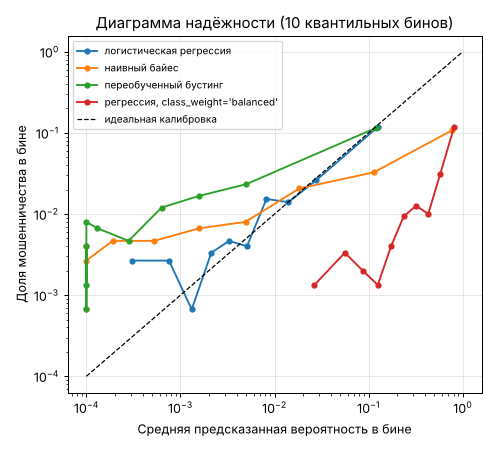

# Урок 3.2.2: Калибровка вероятностей, Brier score

> **Модуль 3:** Classical ML: Algorithms & Production Thinking · **Тема 3.2:** Классификация и метрики
> **Тип:** теория · **Время:** 150 минут + 120 минут на домашнее задание

## Цели урока

После урока вы сможете:

- объяснить, что такое откалиброванная вероятность и чем калибровка отличается от качества ранжирования;
- построить диаграмму надёжности и посчитать Brier score, log loss и ECE, понимая их ограничения;
- предсказать, какие модели выдают искажённые вероятности, и проверить это на данных;
- исправить вероятности после `class_weight` и ресэмплинга формулой поправки априорной вероятности;
- откалибровать модель методом Платта и изотонической регрессией через `CalibratedClassifierCV`
  и не допустить при этом утечки.

## Зачем это нужно

В уроке 3.2.1 возведение вероятностей в квадрат не изменило ни ROC-AUC, ни PR-AUC. Пока модель нужна,
чтобы отсортировать объекты, это не страшно. Но чаще вероятность используют как число:

- **ожидаемые потери.** Операция на 20 000 рублей с вероятностью мошенничества 0.02 — это 400 рублей
  ожидаемого убытка. Если проверка стоит 150 рублей, проверять выгодно — но только если 0.02
  действительно означает «две из ста»;
- **доверие.** Аналитик, которому модель сто раз сказала «90 %» и ошиблась в шестидесяти случаях,
  перестаёт смотреть на её оценки.

## 1. Что такое откалиброванная вероятность

Модель **откалибрована**, если среди объектов, которым она предсказала вероятность $p$, доля
положительных действительно равна $p$:

$$P(y = 1 \mid \hat{p} = p) = p \quad \text{для всех } p$$

Проверить это для одного объекта нельзя — операция либо мошенническая, либо нет. Проверяют группами:
собирают объекты с близкими предсказаниями и сравнивают среднее предсказание с фактической долей.

```python
import numpy as np
import pandas as pd
from fraud_data import TARGET, make_features, make_transactions
from sklearn.linear_model import LogisticRegression
from sklearn.model_selection import train_test_split
from sklearn.pipeline import make_pipeline
from sklearn.preprocessing import StandardScaler

transactions = make_transactions()
X, y = make_features(transactions), transactions[TARGET]
X_train, X_test, y_train, y_test = train_test_split(X, y, test_size=0.25, stratify=y, random_state=0)
y_true = y_test.to_numpy()

logreg = make_pipeline(StandardScaler(), LogisticRegression(max_iter=1000)).fit(X_train, y_train)
proba = logreg.predict_proba(X_test)[:, 1]
```

| Предсказание | Операций | Среднее предсказание | Фактическая доля мошенничества |
|---|---|---|---|
| 0 – 0.01 | 10 382 | 0.003 | 0.005 |
| 0.01 – 0.02 | 1 815 | 0.014 | 0.015 |
| 0.02 – 0.05 | 1 517 | 0.031 | 0.031 |
| 0.05 – 0.1 | 692 | 0.070 | 0.056 |
| 0.1 – 0.2 | 368 | 0.138 | 0.120 |
| 0.2 – 0.4 | 163 | 0.277 | 0.282 |
| 0.4 – 1 | 63 | 0.546 | 0.603 |

Логистическая регрессия откалибрована хорошо: предсказание и факт близки во всех группах (в последней
всего 63 операции, расхождение — в пределах шума).

Калибровка и ранжирование — разные свойства. Модель, которая всем предсказывает 0.0192, идеально
откалибрована и бесполезна. Модель с вероятностями в квадрате идеально ранжирует и не откалибрована.

## 2. Диаграмма надёжности

Если отложить по горизонтали среднее предсказание в группе, а по вертикали — фактическую долю,
получится **диаграмма надёжности** (reliability diagram). У откалиброванной модели точки лежат
на диагонали. Точки ниже диагонали — модель завышает вероятность (слишком уверена), выше — занижает.

```python
from sklearn.calibration import calibration_curve

actual, predicted = calibration_curve(y_true, proba, n_bins=10, strategy="quantile")
np.histogram(proba, bins=10, range=(0, 1))[0]
# [14406, 368, 109, 54, 32, 15, 5, 4, 6, 1]
```

Главное решение — как резать на группы (бины):

| Способ | Что получается на наших данных | Когда применять |
|---|---|---|
| `strategy="uniform"`: равные по ширине | 96 % операций в первом бине, в последних — по 1–6 штук, точки скачут | классы сбалансированы, предсказания по всей шкале |
| `strategy="quantile"`: равные по числу объектов | по 1 500 операций в бине, но девять бинов из десяти лежат ниже 0.03 | редкий класс; смотреть в логарифмических осях |
| свои границы, как в таблице выше | подробно там, где принимаются решения | известна рабочая область вероятностей |

Чем больше бинов, тем подробнее картина и тем сильнее шум в каждом. Ориентир: в бине должно быть хотя бы
несколько десятков положительных примеров, иначе фактическая доля — случайное число.



## 3. Brier score

**Brier score** — средний квадрат отклонения предсказанной вероятности от исхода:

$$BS = \frac{1}{n}\sum_{i=1}^{n}(p_i - y_i)^2$$

Это обычная MSE, применённая к вероятностям: 0 у идеального предсказания, меньше — лучше.

```python
from sklearn.metrics import brier_score_loss

brier = brier_score_loss(y_true, proba)  # 0.01595
brier_const = brier_score_loss(y_true, np.full(len(y_true), y_train.mean()))  # 0.01883
1 - brier / brier_const  # 0.153
```

Число 0.016 выглядит прекрасно, пока не посчитана базовая линия: предсказание доли класса для всех даёт
0.0188 — это просто $\bar{y}(1 - \bar{y})$. При редком классе Brier score любой разумной модели близок
к нулю, поэтому его сравнивают с константой. Относительное улучшение называется **Brier skill score**:
у нашей модели 0.153, то есть она на 15 % лучше константы.

### Разложение

Разобьём предсказания на бины и заменим каждое средним по бину. Для таких предсказаний Brier score
точно раскладывается на три слагаемых (разложение Мёрфи):

$$BS = \underbrace{\sum_k \frac{n_k}{n}(\bar{p}_k - \bar{y}_k)^2}_{\text{калибровка}}
 - \underbrace{\sum_k \frac{n_k}{n}(\bar{y}_k - \bar{y})^2}_{\text{разрешающая способность}}
 + \underbrace{\bar{y}(1 - \bar{y})}_{\text{неопределённость}}$$

**Калибровка** (reliability) равна нулю у откалиброванной модели. **Разрешающая способность** (resolution)
показывает, насколько доля положительных различается между бинами, то есть умеет ли модель отделять
рискованные объекты от безопасных; чем она больше, тем лучше. **Неопределённость** — свойство данных.

Численная проверка для логистической регрессии на 50 квантильных бинах: калибровка 0.00004, разрешающая
способность 0.00231, неопределённость 0.01883. Сумма 0.00004 − 0.00231 + 0.01883 = 0.01657 совпадает
с Brier score предсказаний, усреднённых по бинам. Исходный Brier score чуть меньше (0.01595): внутри
бинов модель тоже различает объекты.

Слагаемое калибровки у логистической регрессии почти нулевое, всё улучшение относительно константы даёт
разрешающая способность. Калибровка исправляет только первое слагаемое — плохое ранжирование она не спасёт.

## 4. Log loss против Brier score

Обе метрики — **собственные оценочные правила** (proper scoring rules): в среднем их минимизирует
только истинная вероятность, поэтому они одновременно награждают и калибровку, и разрешающую способность.
Различаются они отношением к уверенным ошибкам. Штраф за один объект положительного класса:

| Предсказанная вероятность | Log loss: $-\ln p$ | Brier: $(1 - p)^2$ |
|---|---|---|
| 0.5 | 0.69 | 0.25 |
| 0.1 | 2.30 | 0.81 |
| 0.01 | 4.61 | 0.98 |
| 0.001 | 6.91 | 0.998 |

Brier score ограничен единицей, log loss растёт неограниченно: предсказание ровно 0 для объекта класса 1
даёт бесконечность. Log loss выбирают, когда уверенная ошибка действительно катастрофична; Brier score —
когда нужна устойчивость к единичным выбросам и понятная шкала. В отчёте полезно приводить обе метрики
и обязательно базовую линию.

## 5. ECE

**Expected calibration error** — средневзвешенное расстояние от точек диаграммы надёжности до диагонали:

$$ECE = \sum_k \frac{n_k}{n}\,\bigl|\bar{p}_k - \bar{y}_k\bigr|$$

В scikit-learn готовой функции нет:

```python
def expected_calibration_error(y_true, proba, n_bins=10, strategy="quantile"):
    quantiles = np.linspace(0, 1, n_bins + 1)
    edges = quantiles if strategy == "uniform" else np.quantile(proba, quantiles)
    bins = np.clip(np.searchsorted(edges, proba, side="right") - 1, 0, n_bins - 1)
    stats = pd.DataFrame({"p": proba, "y": y_true}).groupby(bins).agg(n=("y", "size"), p=("p", "mean"), y=("y", "mean"))
    return (stats["n"] / len(y_true) * (stats["p"] - stats["y"]).abs()).sum()

expected_calibration_error(y_true, proba)  # 0.0025
```

ECE удобна тем, что измеряет только калибровку и выражена в единицах вероятности. Но она зависит от
способа разбиения:

| Число бинов | ECE, равная ширина | ECE, квантили | ECE идеально откалиброванной модели, квантили |
|---|---|---|---|
| 10 | 0.0013 | 0.0025 | 0.0020 |
| 50 | 0.0050 | 0.0046 | 0.0041 |
| 200 | 0.0080 | 0.0091 | 0.0083 |

Последний столбец получен так: метки сгенерированы заново **из самих предсказаний** (объект положителен
с вероятностью `proba`), то есть модель откалибрована идеально по построению. ECE всё равно не ноль
и растёт с числом бинов — это шум оценки доли в каждом бине. ECE нашей регрессии едва превышает этот
уровень. Поэтому ECE сравнивают только при одинаковом разбиении, при редком классе берут квантильные бины
и помнят, что полезность она не оценивает: у константы ECE нулевая.

## 6. Какие модели откалиброваны

Обучим несколько моделей на одних данных. Последние два столбца — самый наглядный тест: что модель
обещает для 150 операций (1 %) с наибольшей оценкой и что там на самом деле.

```python
from sklearn.ensemble import HistGradientBoostingClassifier
from sklearn.naive_bayes import GaussianNB

overfit = HistGradientBoostingClassifier(max_iter=300, learning_rate=0.2, early_stopping=False, random_state=0)
```

| Модель | ROC-AUC | Log loss | Brier | ECE | Среднее предсказание | Топ-1 %: обещано | Топ-1 %: факт |
|---|---|---|---|---|---|---|---|
| Константа | 0.500 | 0.0949 | 0.0188 | 0 | 0.0192 | — | — |
| Логистическая регрессия, `C=1` | 0.864 | 0.0707 | 0.0159 | 0.003 | 0.019 | 0.41 | 0.43 |
| Логистическая регрессия, `C=0.0001` | 0.855 | 0.0893 | 0.0186 | 0.019 | 0.019 | 0.03 | 0.41 |
| Бустинг, `max_depth=3`, 100 деревьев | 0.887 | 0.0671 | 0.0156 | 0.002 | 0.019 | 0.49 | 0.49 |
| Бустинг, переобученный (`overfit`) | 0.845 | 0.0935 | 0.0180 | 0.007 | 0.013 | 0.65 | 0.35 |
| Наивный байес (`GaussianNB`) | 0.844 | 0.2961 | 0.0662 | 0.077 | 0.091 | 0.9996 | 0.21 |
| Линейный SVM, оценки растянуты на [0, 1] | 0.865 | 0.5443 | 0.1793 | 0.393 | 0.412 | 0.76 | 0.43 |

Почему так:

- **логистическая регрессия** минимизирует log loss. В точке минимума градиент $X^\top(p - y)$ равен нулю
  (урок 3.1.3), а строка для свободного члена означает $\sum p_i = \sum y_i$: среднее предсказание
  на обучении в точности равно доле класса. Калибровка встроена в способ обучения;
- **сильная регуляризация** прижимает веса к нулю, а предсказания — к доле класса. Среднее верное, но самым
  опасным операциям модель обещает 3 % при фактических 41 %. Ранжирование почти не пострадало;
- **бустинг** тоже минимизирует log loss и при умеренных настройках откалиброван не хуже регрессии.
  Утверждение «бустинг плохо откалиброван» относится к переобученным моделям: 300 деревьев с большим шагом
  идеально разделяют обучающую выборку (ROC-AUC на ней 1.0) и переносят эту уверенность на новые данные;
- **наивный байес** считает признаки независимыми и перемножает свидетельства. У нас признаки связаны
  (сумма и её отношение к обычной; категория и признак «в интернете»), одно свидетельство учитывается
  несколько раз, и вероятности уходят к 0 и 1;
- **SVM** выдаёт не вероятность, а расстояние до разделяющей границы; любое «естественное» преобразование
  расстояния в отрезок [0, 1] вероятностью не является.

Общее правило: калибровку не угадывают по названию алгоритма, а проверяют на отложенных данных.

## 7. Ловушка: веса классов и ресэмплинг

Стандартные приёмы борьбы с дисбалансом (подробно — в уроке 3.2.3) меняют соотношение классов
на обучении: `class_weight="balanced"` увеличивает вес редкого класса, undersampling выбрасывает часть
большого класса, oversampling дублирует объекты редкого. Модель после этого обучается в мире, где
мошенничества 50 %, и выдаёт вероятности для этого мира.

```python
balanced = make_pipeline(StandardScaler(), LogisticRegression(class_weight="balanced", max_iter=1000))
proba_balanced = balanced.fit(X_train, y_train).predict_proba(X_test)[:, 1]
proba_balanced.mean(), (proba_balanced > 0.5).mean()  # (0.284, 0.195)
```

| Обучение | ROC-AUC | Log loss | Brier | Среднее предсказание | Топ-1 %: обещано | Топ-1 %: факт |
|---|---|---|---|---|---|---|
| Обычное | 0.864 | 0.0707 | 0.0159 | 0.019 | 0.41 | 0.43 |
| `class_weight="balanced"` | 0.865 | 0.4159 | 0.1326 | 0.284 | 0.96 | 0.45 |
| Undersampling 1:1 | 0.867 | 0.4167 | 0.1325 | 0.286 | 0.96 | 0.43 |
| Oversampling 1:1 | 0.865 | 0.4138 | 0.1318 | 0.282 | 0.96 | 0.45 |

Ранжирование не изменилось, а вероятности завышены в 15 раз: средняя 0.28 при фактических 0.019. Каждая
пятая операция получила оценку выше 0.5; среди операций с оценкой от 0.5 до 0.7 мошеннических на деле
3 %. Log loss в четыре раза хуже, чем у константы. Умножать такую «вероятность» на сумму нельзя.

### Поправка априорной вероятности

Перевзвешивание классов умножает шансы на известный коэффициент, и его можно убрать. Пусть $\pi$ —
настоящая доля положительного класса, $\pi_s$ — доля в (перевзвешенной) обучающей выборке, $p_s$ —
предсказание модели. Тогда исправленная вероятность $p$ находится из равенства шансов:

$$\frac{p}{1 - p} = \frac{p_s}{1 - p_s} \cdot \frac{\pi / (1 - \pi)}{\pi_s / (1 - \pi_s)}$$

Для undersampling, при котором оставлена доля $\beta$ отрицательных объектов, это то же самое, что
$p = \dfrac{\beta p_s}{\beta p_s + 1 - p_s}$.

```python
def prior_correction(proba_sampled, true_share, sampled_share):
    odds = proba_sampled / (1 - proba_sampled)
    odds *= (true_share / (1 - true_share)) / (sampled_share / (1 - sampled_share))
    return odds / (1 + odds)

share = y_train.mean()
prior_correction(np.array([0.5, 0.9]), share, 0.5)  # [0.019, 0.149]
proba_corrected = prior_correction(proba_balanced, share, 0.5)
```

Оценка 0.5 модели с балансировкой — это 1.9 %, то есть средняя операция; оценка 0.9 — это 15 %.

После поправки log loss всех трёх вариантов — 0.0708–0.0709, как у обычной модели (0.0707). Формула точна
для логистической регрессии; для других моделей это хорошее первое приближение, после которого можно
применить калибровку из следующего раздела. Для бустинга с `class_weight="balanced"` на наших данных:
log loss 0.356 до поправки и 0.068 после.

## 8. Методы калибровки

Калибровка — отдельная маленькая модель, которая преобразует оценку исходной модели $s$ в вероятность.
Она обучается на парах «оценка — исход».

| Метод | Преобразование | Параметров | Особенности |
|---|---|---|---|
| Платта (`method="sigmoid"`) | $p = \sigma(a \cdot s + b)$ — логистическая регрессия на одном признаке | 2 | устойчив на малых данных; исправляет только искажения сигмоидной формы |
| Изотоническая регрессия (`method="isotonic"`) | любая неубывающая ступенчатая функция | много | исправляет искажение любой монотонной формы; переобучается на малых данных |

```python
from sklearn.calibration import CalibratedClassifierCV
from sklearn.metrics import log_loss

calibrated = CalibratedClassifierCV(GaussianNB(), method="isotonic", cv=5).fit(X_train, y_train)
log_loss(y_true, calibrated.predict_proba(X_test)[:, 1])  # 0.0776
```

`CalibratedClassifierCV` с `cv=5` делит обучающую выборку на пять частей: модель учится на четырёх,
калибровка — на пятой. По умолчанию (`ensemble=True`) итог — усреднение пяти пар «модель + калибровка».
С `ensemble=False` калибровка обучается на предсказаниях вне фолдов, а модель — на всех данных; это
одна модель вместо пяти, быстрее при применении.

| Модель | Калибровка | ROC-AUC | Log loss | Brier | ECE |
|---|---|---|---|---|---|
| Наивный байес | нет | 0.844 | 0.2961 | 0.0662 | 0.077 |
| | Платта | 0.844 | 0.0805 | 0.0178 | 0.006 |
| | изотоническая | 0.844 | 0.0776 | 0.0178 | 0.002 |
| Бустинг, переобученный | нет | 0.845 | 0.0935 | 0.0180 | 0.007 |
| | Платта | 0.851 | 0.0725 | 0.0164 | 0.004 |
| | изотоническая | 0.850 | 0.0724 | 0.0164 | 0.004 |
| Регрессия, `class_weight="balanced"` | нет | 0.865 | 0.4159 | 0.1326 | 0.265 |
| | Платта | 0.865 | 0.0708 | 0.0160 | 0.003 |
| | изотоническая | 0.866 | 0.0706 | 0.0160 | 0.003 |

Что видно:

- калибровка исправляет вероятности наивного байеса и модели с балансировкой: log loss падает в 4–6 раз;
- она не улучшает ранжирование: откалиброванный наивный байес (0.078) всё равно хуже логистической
  регрессии (0.071). ROC-AUC переобученного бустинга вырос не из-за калибровки, а потому что
  `ensemble=True` усредняет пять моделей;
- откалиброванной модели калибровка ничего не даёт: у обычной логистической регрессии log loss 0.0707
  до калибровки и 0.0706 после метода Платта.

## 9. Калибровать на данных, которых модель не видела

На обучающей выборке переобученная модель выглядит идеальной: её оценки почти точно разделяют классы.
Калибровка, обученная на тех же данных, «узнает», что оценкам можно верить, и сделает их ещё увереннее.

Для заранее обученной модели используется обёртка `FrozenEstimator`: она запрещает переобучать модель,
и `CalibratedClassifierCV` обучает только калибровку на переданных данных. (Вариант `cv="prefit"`
из старых руководств удалён из библиотеки.)

```python
from sklearn.frozen import FrozenEstimator

X_fit, X_calib, y_fit, y_calib = train_test_split(
    X_train, y_train, test_size=0.4, stratify=y_train, random_state=0
)
overfit.fit(X_fit, y_fit)  # 27 000 операций на обучение, 18 000 — на калибровку

seen = CalibratedClassifierCV(FrozenEstimator(overfit), method="sigmoid").fit(X_fit, y_fit)
unseen = CalibratedClassifierCV(FrozenEstimator(overfit), method="sigmoid").fit(X_calib, y_calib)
log_loss(y_true, seen.predict_proba(X_test)[:, 1])  # 0.199
log_loss(y_true, unseen.predict_proba(X_test)[:, 1])  # 0.076
```

| Калибровка переобученного бустинга | ROC-AUC | Log loss | Топ-1 %: обещано | Топ-1 %: факт |
|---|---|---|---|---|
| Без калибровки | 0.820 | 0.112 | 0.68 | 0.39 |
| Платта, на обучающих данных | 0.820 | 0.199 | 0.82 | 0.39 |
| Платта, на отложенных данных | 0.820 | 0.076 | 0.35 | 0.39 |
| Изотоническая, на обучающих данных | 0.601 | 0.650 | 0.84 | 0.39 |
| Изотоническая, на отложенных данных | 0.815 | 0.085 | 0.38 | 0.39 |

Калибровка на данных, которые модель видела, сделала вероятности **хуже**, чем без неё, а изотоническая
ещё и разрушила ранжирование: на обучении классы разделены идеально, ступенчатая функция превратилась
в одну ступеньку, и почти все тестовые объекты получили одинаковую оценку.

Итого данные делятся на три части: обучение модели, калибровка, тест. И после внедрения за калибровкой
нужно следить: при изменении доли класса вероятности «уплывают» первыми. В наших данных доля мошенничества
выросла с 1.3 % в январе до 2.3 % в июне — модель, обученная на первых месяцах, занижает риск (урок 3.2.3).

## 10. Сколько данных нужно для калибровки

Наивный байес обучен на 27 000 операций; калибровочная выборка разного размера, среднее по 20 случайным
подвыборкам:

| Размер калибровочной выборки | Мошеннических | Log loss: Платта | Log loss: изотоническая | ROC-AUC: изотоническая |
|---|---|---|---|---|
| 500 | 10 | 0.0806 | 0.1671 | 0.812 |
| 2 000 | 38 | 0.0803 | 0.0926 | 0.832 |
| 5 000 | 96 | 0.0802 | 0.0846 | 0.836 |
| 18 000 | 345 | 0.0801 | 0.0776 | 0.838 |

ROC-AUC до калибровки и после метода Платта — 0.841 при любом размере выборки.

Методу Платта хватает десятка положительных примеров: у него два параметра. Изотоническая регрессия
на малой выборке переобучается: целые диапазоны оценок получают вероятность ровно 0 (при 500 объектах —
в среднем 6 600 тестовых операций из 15 000), и каждая мошенническая операция среди них даёт огромный
штраф. Лишь при нескольких сотнях положительных примеров она обходит метод Платта — потому что искажение
наивного байеса не похоже на сигмоиду. Правило: считайте не объекты, а положительные примеры. Меньше ста —
метод Платта; несколько сотен и больше — сравните оба метода на отложенных данных.

## 11. Калибровка и ранжирование

Метод Платта — строго возрастающее преобразование: порядок объектов сохраняется, а с ним ROC-AUC и PR-AUC.
Для переобученного бустинга из раздела 9 ROC-AUC до и после — 0.82048, AP — 0.2167. Изотоническая
регрессия — неубывающее преобразование: объекты с разными оценками могут получить одинаковую вероятность.
После неё 15 000 операций получили всего 43 различных значения, внутри каждой ступени порядок потерян:
ROC-AUC снизился до 0.81548, AP — до 0.1922, на 11 %. Если после калибровки объекты нужно сортировать
(топ-k, очередь на проверку), сортируйте по исходной оценке или используйте метод Платта.

## Типичные ошибки

| Симптом | Причина | Решение |
|---|---|---|
| Средняя предсказанная вероятность в разы больше доли класса | `class_weight`, undersampling или oversampling | поправка априорной вероятности или калибровка |
| Brier score 0.02 принят за отличный результат | при редком классе константа даёт столько же | сравнивать с $\bar{y}(1-\bar{y})$, считать Brier skill score |
| После калибровки вероятности стали хуже | калибровка обучена на тех же данных, что и модель | отдельная выборка или `cv` в `CalibratedClassifierCV` |
| `InvalidParameterError` для `cv="prefit"` | параметр удалён из scikit-learn | `CalibratedClassifierCV(FrozenEstimator(model))` |
| Откалиброванная модель через полгода завышает или занижает риск | изменилась доля класса | мониторинг среднего предсказания и доли класса, повторная калибровка |

## Контрольные вопросы

1. Дайте определение откалиброванной модели. Приведите пример откалиброванной, но бесполезной модели
   и пример полезной, но неоткалиброванной.
2. Что означают три слагаемых разложения Brier score? Какое из них меняет калибровка?
3. Почему логистическая регрессия откалибрована «по построению», а наивный байес — нет?
4. Модель обучена на выборке, где отрицательный класс прорежен в 20 раз. Она выдала 0.6. Какова
   исправленная вероятность?
5. Когда выбрать метод Платта, а когда изотоническую регрессию?
6. Почему нельзя калибровать на обучающей выборке? Что делает `FrozenEstimator`?
7. Может ли калибровка изменить ROC-AUC? Рассмотрите метод Платта и изотоническую регрессию.

## Домашнее задание

Работайте в ноутбуке `homework/m03/hw_3_2_2.ipynb` с данными и разбиением из урока.

1. **Диаграмма надёжности.** Постройте диаграммы для логистической регрессии и наивного байеса: 10 бинов
   равной ширины, 10 квантильных, свои границы; оси логарифмические. Какой способ информативнее и почему?
2. **Brier score.** Реализуйте разложение Brier score и проверьте тождество для 10, 20 и 50 бинов.
   Сравните слагаемые для логистической регрессии, наивного байеса и модели с `class_weight="balanced"`.
3. **Поправка априорной вероятности.** Обучите логистическую регрессию на выборках, где отрицательный
   класс прорежен в 5, 20 и 50 раз. Для каждой посчитайте среднее предсказание, log loss и Brier score
   до и после поправки. Проверьте, что формулы через шансы и через $\beta$ дают одно и то же.
4. **Калибровка.** Для переобученного бустинга сравните: без калибровки, метод Платта, изотоническую
   регрессию (через `FrozenEstimator` и отдельную калибровочную выборку). Таблица: ROC-AUC, AP, log loss,
   Brier, ECE. Затем обучите калибровку на тех же данных, что и модель, и объясните, что изменилось.
5. **Ожидаемые потери.** Просуммируйте по тесту произведения вероятности на сумму операции для обычной
   модели и для модели с `class_weight="balanced"` до и после поправки; сравните с фактической суммой.

**Критерии приёмки:**

- [ ] в задании 2 сумма слагаемых совпадает с Brier score усреднённых по бинам предсказаний (`np.isclose`);
- [ ] в задании 3 после поправки log loss не превышает 0.075 при любом прореживании;
- [ ] в задании 4 калибровочная и тестовая выборки не пересекаются (`assert` на пересечение индексов);
- [ ] в задании 5 есть вывод: во сколько раз модель без поправки ошибается в сумме ожидаемых потерь.

## Дополнительные материалы

- Руководство scikit-learn, калибровка вероятностей: https://scikit-learn.org/stable/modules/calibration.html
- A. Niculescu-Mizil, R. Caruana. Predicting Good Probabilities with Supervised Learning (ICML, 2005).

**Следующий урок:** 3.2.3 — Стратификация, cross-validation для несбалансированных данных.
