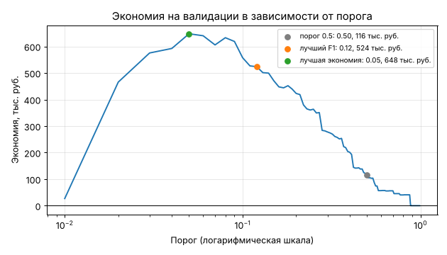

# Урок 3.2.4: ПРАКТИКА: Классификация с оптимизацией под бизнес-метрики

> **Модуль 3:** Classical ML: Algorithms & Production Thinking · **Тема 3.2:** Классификация и метрики
> **Тип:** практика · **Время:** 5–6 часов

## Задача

Банк хочет автоматически останавливать подозрительные операции по картам. Остановленную операцию
проверяет аналитик: звонит клиенту и либо подтверждает мошенничество, либо разблокирует платёж.
Руководитель антифрод-службы формулирует задачу не в терминах ROC-AUC:

1. Сколько денег сэкономит модель по сравнению с работой без неё?
2. Какие операции блокировать, чтобы экономия была максимальной?
3. Насколько этой оценке можно верить?

В уроках 3.2.1–3.2.3 вы научились измерять качество модели, проверять её вероятности и честно оценивать
её на отложенных данных. Здесь всё это сводится к одному числу в рублях. Главная мысль практики: модель
выдаёт вероятность, а решение принимается отдельно — и хорошее решение учитывает, что ошибка на операции
в 50 000 рублей и ошибка на операции в 300 рублей стоят по-разному.

Результат работы — модуль с функциями (проверяется автотестами), ноутбук с анализом и короткая записка
для руководителя.

## Экономика решения

Базовая линия — работа без контроля: ни одна операция не блокируется, банк возмещает клиентам все
мошеннические списания. Экономия считается относительно неё.

| | Операция заблокирована | Операция пропущена |
|---|---|---|
| **Мошенническая** | сумма операции спасена, проверка оплачена: `+amount − 100` | 0: убыток уже в базовой линии |
| **Честная** | проверка и недовольный клиент: `−100 − 400` | 0 |

- проверка одной операции стоит 100 рублей (`Costs.review`);
- ложная блокировка дополнительно обходится в 400 рублей (`Costs.friction`): часть клиентов после неё
  реже пользуется картой или уходит.

Из матрицы следует правило для отдельной операции. Если вероятность мошенничества равна $p$, ожидаемая
экономия от блокировки — $p \cdot (\text{amount} - 100) - (1 - p) \cdot 500$. Она положительна, когда

$$p > \frac{\text{review} + \text{friction}}{\text{amount} + \text{friction}} = \frac{500}{\text{amount} + 400}$$

| Сумма операции, руб. | 100 | 600 | 1 500 | 4 600 | 20 000 | 99 600 |
|---|---|---|---|---|---|---|
| Порог безубыточности | 1.0 | 0.50 | 0.26 | 0.10 | 0.025 | 0.005 |

Единого «правильного» порога не существует: операцию на 20 000 рублей выгодно проверять уже при
вероятности 2.5 %, а операцию на 600 рублей — только при 50 %. Это правило работает лишь с
откалиброванными вероятностями (урок 3.2.2): модель, завышающая вероятности в 15 раз, заблокирует
почти половину операций.

## Материалы

| Файл | Назначение |
|---|---|
| [`fraud_data.py`](fraud_data.py) | генератор данных и признаков: `make_transactions()`, `make_features()` |
| [`practice/business_metrics.py`](practice/business_metrics.py) | заготовка: семь функций с описанием поведения |
| [`practice/tests/test_business_metrics.py`](practice/tests/test_business_metrics.py) | 37 тестов — исполняемая спецификация |
| [`practice/README.md`](practice/README.md) | как запустить |

Скопируйте `fraud_data.py` и папку `practice/` в свой репозиторий, сохранив взаимное расположение:
`projects/p_3_2_fraud/fraud_data.py` и `projects/p_3_2_fraud/practice/...`. Описание столбцов данных —
в уроке 3.2.1.

## Часть 1. Модуль бизнес-метрик

Реализуйте функции в `business_metrics.py`. Точное поведение — в docstring каждой функции.

| Функция | Что делает | Материал |
|---|---|---|
| `savings` | экономия в рублях для заданных решений | раздел «Экономика решения» |
| `savings_curve` | экономия, precision, recall и F1 для сетки порогов | урок 3.2.1, разделы 5–6 |
| `best_threshold` | порог с лучшей экономией или лучшей F1 | урок 3.2.1, раздел 5 |
| `break_even_threshold` | индивидуальный порог безубыточности по сумме операции | формула выше |
| `expected_value_decision` | решение по ожидаемой выгоде для каждой операции | формула выше; урок 3.2.2 |
| `bootstrap_savings_interval` | доверительный интервал экономии и разности экономий | урок 3.2.1, раздел 13 |
| `compare_strategies` | таблица сравнения пяти стратегий | всё вместе |

```bash
uv add pandas numpy scikit-learn
uv add --dev pytest
cd projects/p_3_2_fraud/practice
uv run pytest -q                       # сначала падают все тесты
uv run pytest -q -k TestSavingsCurve   # работайте над одной функцией за раз
```

Советы:

- начните с вспомогательной функции, которая возвращает вклад **каждой** операции в экономию. На ней
  строятся и `savings`, и бутстреп;
- в бутстрепе не пересчитывайте решения на каждой подвыборке: достаточно один раз посчитать вклады
  операций и суммировать их по случайным индексам. Для парного сравнения выбирайте одни и те же
  индексы для обеих стратегий — проще всего сразу взять разность вкладов;
- порог сравнивается нестрого (`proba >= threshold`), а решение по ожидаемой выгоде — строго
  (`proba > порог безубыточности`): при нулевой ожидаемой экономии блокировать незачем;
- в `compare_strategies` пороги подбираются на валидации и применяются к тесту. Тест
  `test_thresholds_come_from_validation_data` проверяет именно это.

## Часть 2. Анализ в ноутбуке

В ноутбуке `analysis.ipynb` проведите анализ с помощью своих функций. Данные делите **по времени**:
обучение — январь–март, валидация — апрель, тест — май–июнь.

**Модель и её вероятности**

1. Обучите логистическую регрессию на признаках `make_features`. Посчитайте на тесте ROC-AUC, AP
   и log loss; сравните log loss с константой.
2. Проверьте калибровку на валидации и на тесте: таблица надёжности, среднее предсказание рядом
   с фактической долей. Что происходит с долей мошенничества во времени и как это сказывается
   на вероятностях?

**От вероятности к решению**

3. Постройте кривую экономии на валидации. Отметьте пороги 0.5, лучший по F1 и лучший по экономии.
   Почему кривая несимметрична? Сколько операций блокируется при каждом пороге?
4. Сравните стратегии функцией `compare_strategies`. Во сколько раз экономия при пороге 0.5 меньше, чем
   при пороге, подобранном по экономии? Какую долю достижимого максимума даёт лучшая стратегия?
5. Изучите решение по ожидаемой выгоде: какие операции оно блокирует, а единый порог — нет, и наоборот?
   Сравните распределения сумм и вероятностей в этих двух группах.
6. Постройте доверительный интервал экономии лучшей стратегии и интервал **разности** между решением
   по ожидаемой выгоде и лучшим единым порогом. Значима ли разница?

**Проверка на прочность**

7. Обучите модель с `class_weight="balanced"` и примените к ней решение по ожидаемой выгоде без
   изменений. Что получилось? Исправьте вероятности двумя способами: поправкой априорной вероятности
   и методом Платта на валидации (`CalibratedClassifierCV` с `FrozenEstimator`). Сравните экономию.
8. Откалибруйте методом Платта на валидации исходную модель. Изменилась ли экономия? Объясните,
   опираясь на пункт 2.
9. Замените модель на `HistGradientBoostingClassifier(max_depth=3, early_stopping=False, random_state=0)`.
   Насколько выросли AP и экономия? Парным бутстрепом оцените, значим ли прирост экономии.
10. Анализ чувствительности: пересчитайте лучшую стратегию для `friction` 100, 400 и 1 500 рублей. Как
    меняются число блокировок и экономия? Какой вывод для заказчика, если точная цена недовольства
    клиента неизвестна?



## Часть 3. Записка для руководителя

Файл `REPORT.md`, не больше страницы, без терминов ROC-AUC, precision и recall:

1. **Главное в трёх предложениях:** сколько экономит модель за два тестовых месяца, сколько операций
   в день при этом придётся проверять, какая доля мошеннических сумм остаётся непойманной.
2. **Рекомендуемое правило блокировки** и чем оно лучше единого порога.
3. **Неопределённость:** интервал экономии и то, от каких допущений о ценах зависит вывод.
4. **Риски после внедрения:** что нужно отслеживать, чтобы правило не устарело.

## Критерии приёмки

- [ ] `uv run pytest -q` — все 37 тестов проходят, прогон занимает меньше 30 секунд;
- [ ] `uv run ruff check .` и `uv run ruff format --check .` проходят без ошибок;
- [ ] ноутбук выполняется целиком и использует функции из `business_metrics.py`, а не их копии;
- [ ] данные разделены по времени; ни порог, ни калибровка не подбирались на тесте;
- [ ] на каждый из 10 вопросов есть таблица или график и письменный вывод;
- [ ] экономия везде приведена вместе с долей от максимума (`oracle`) и с доверительным интервалом;
- [ ] в пункте 7 показано, что решение по ожидаемой выгоде на неоткалиброванной модели убыточно,
      и что калибровка это исправляет;
- [ ] записка содержит суммы в рублях, число проверок в день и хотя бы один риск с планом мониторинга.

## Как оценить свою работу

| Уровень | Признаки |
|---|---|
| Базовый | тесты проходят, на все вопросы есть ответы, записка написана |
| Уверенный | каждое сравнение стратегий подкреплено интервалом разности; записку можно отдать руководителю без пояснений |
| Продвинутый | выполнен анализ чувствительности к ценам и одно из заданий раздела «Идеи для усложнения» |

Ориентиры для самопроверки (логистическая регрессия, цены по умолчанию). В обучении 29 919 операций,
в валидации 10 048, в тесте 20 033, из них 440 мошеннических на сумму 2.88 млн рублей.

| Стратегия | Порог | Заблокировано | Экономия на тесте, тыс. руб. | Доля от максимума |
|---|---|---|---|---|
| Порог 0.5 | 0.50 | 50 | около 410 | 14 % |
| Порог по F1 | 0.12 | 520 | около 1 430 | 50 % |
| Порог по экономии | 0.05 | 1 420 | около 1 450 | 51 % |
| Решение по ожидаемой выгоде | — | 730 | около 1 740 | 61 % |
| Максимум (`oracle`) | — | 438 | 2 840 | 100 % |

- ROC-AUC на тесте около 0.87, AP около 0.35; среднее предсказание 0.016 при фактической доле 0.022 —
  модель, обученная на первых месяцах, занижает риск;
- решение по ожидаемой выгоде блокирует вдвое меньше операций, чем лучший единый порог, и экономит
  на 280 тысяч рублей больше; 95 % интервал разности — примерно от 150 до 470 тысяч. Медианная сумма
  заблокированных операций — около 8 500 рублей против 1 400 у пропущенных;
- интервал самой экономии широк: от 1.3 до 2.2 млн рублей. Результат определяют несколько десятков
  крупных мошеннических операций;
- модель с `class_weight="balanced"` при решении по ожидаемой выгоде блокирует 43 % операций и даёт
  убыток около 1.3 млн рублей; после калибровки методом Платта экономия возвращается к 1.73 млн;
- бустинг даёт около 1.79 млн рублей при решении по ожидаемой выгоде.

Ваши числа могут отличаться в третьем знаке из-за настроек модели; порядок величин и соотношения между
стратегиями должны совпасть.

## Идеи для усложнения

1. **Ограниченный ресурс.** Аналитики успевают проверить 15 операций в день. Отсортируйте операции
   каждого дня по ожидаемой экономии и блокируйте лучшие 15. Сравните с сортировкой по вероятности.
   Сколько денег стоит каждая дополнительная ставка аналитика?
2. **Цена зависит от клиента.** Пусть ложная блокировка клиента со счётом старше трёх лет стоит
   1 500 рублей, а нового — 200. Обобщите `break_even_threshold` на цены, заданные для каждой операции.
3. **Дрейф.** Переобучайте модель и калибровку каждый месяц на всех прошедших данных
   (`TimeSeriesSplit`) и сравните суммарную экономию с моделью, обученной один раз.
4. **Групповая проверка.** Оцените экономию при разбиении по клиентам (урок 3.2.3). Изменился ли вывод
   о лучшей стратегии?
5. **Готовый инструмент.** Подберите порог с помощью `TunedThresholdClassifierCV(scoring="f1")`
   (урок 3.2.3) и сравните экономию с порогом из `best_threshold`. Разберитесь по документации, можно ли
   передать в `scoring` собственную метрику, зависящую от суммы операции.

## Что дальше

Тема закрыта: вы умеете выбрать метрику под задачу, проверить вероятности модели, оценить её без
утечек и превратить вероятность в решение, оптимальное по деньгам. Этот порядок действий одинаков
для любых моделей — в модуле 4 на место логистической регрессии встанет градиентный бустинг, а схема
оценки останется прежней. В следующей теме — задачи без целевой переменной: кластеризация.

**Следующий урок:** 3.3.1 — K-means ++, определение числа кластеров.
