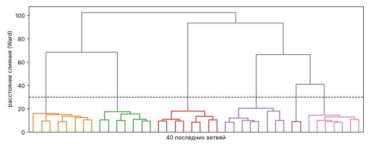
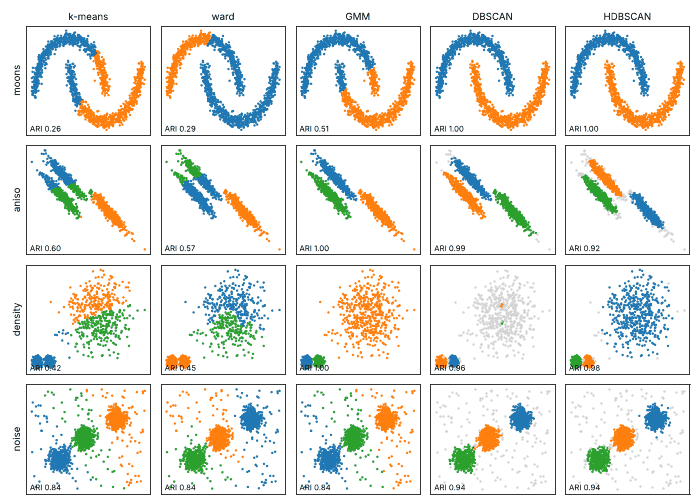

# Урок 3.3.2: Иерархическая кластеризация, DBSCAN, HDBSCAN

> **Модуль 3:** Classical ML: Algorithms & Production Thinking · **Тема 3.3:** Кластеризация и сегментация
> **Тип:** теория · **Время:** 150 минут + 120 минут на домашнее задание

## Цели урока

После урока вы сможете:

- объяснить алгоритм агломеративной кластеризации и выбрать тип связи под форму кластеров;
- построить дендрограмму и выбрать по ней число кластеров;
- оценить, на каком объёме данных иерархическая кластеризация перестаёт помещаться в память;
- настроить DBSCAN: подобрать `eps` по графику k-расстояний и объяснить, когда единого `eps` нет;
- применить HDBSCAN и прочитать его результат: метки, шум, вероятности принадлежности;
- выбрать алгоритм под задачу по форме кластеров, объёму данных и требованиям к результату.

## Зачем это нужно

В уроке 3.3.1 k-means разрезал полумесяцы прямой линией, поделил большое облако на три части и отдал
выбросам отдельный центр. Все три ошибки — следствие одного допущения: кластер — это шар вокруг центра.
Алгоритмы этого урока определяют кластер иначе:

- **иерархические** строят дерево вложенных разбиений и не требуют заранее знать число кластеров;
- **плотностные** (DBSCAN, HDBSCAN) считают кластером область, где точек много, какой бы формы она
  ни была, а точки в разреженных областях объявляют шумом.

За гибкость приходится платить: памятью, временем, чувствительностью к параметрам. К концу урока вы
увидите, что на клиентских данных с семью признаками «продвинутые» алгоритмы проигрывают k-means,
и поймёте почему.

## 1. Агломеративная кластеризация

Алгоритм: в начале каждый объект — отдельный кластер; на каждом шаге два ближайших кластера объединяются;
через $n - 1$ шаг остаётся один кластер. Результат — не одно разбиение, а вся история слияний.

Расстояние между объектами задано (обычно евклидово). Расстояние между **кластерами** нужно определить,
и от этого определения — **типа связи** (linkage) — зависит результат:

| Связь | Расстояние между кластерами A и B | Склонность |
|---|---|---|
| `single` | между двумя ближайшими точками | вытянутые цепочки; один мостик из точек склеивает кластеры |
| `complete` | между двумя самыми далёкими точками | компактные кластеры близкого диаметра |
| `average` | среднее по всем парам | компромисс; устойчивее к шуму, чем `single` |
| `ward` | прирост суммы квадратов отклонений от центров при слиянии | шары близкого размера, как у k-means |

Метод Уорда на каждом шаге выбирает слияние, которое меньше всего увеличивает инерцию из урока 3.3.1, —
это «жадный k-means». Он определён только для евклидова расстояния.

Пять точек на прямой показывают формат результата и различие связей:

```python
import time

import numpy as np
import pandas as pd
from scipy.cluster.hierarchy import dendrogram, fcluster, linkage
from sklearn.metrics import adjusted_rand_score

points = np.array([[0.0], [1.0], [5.0], [6.5], [12.0]])
linkage(points, method="average")
```

```
[[ 0.    1.    1.    2.  ]     точки 0 и 1 слились на расстоянии 1.0, в кластере 2 точки; его номер — 5
 [ 2.    3.    1.5   2.  ]     точки 2 и 3 — на расстоянии 1.5; новый кластер получил номер 6
 [ 5.    6.    5.25  4.  ]     кластеры 5 и 6 — на расстоянии 5.25
 [ 4.    7.    8.88  5.  ]]    точка 4 присоединилась последней
```

Каждая строка — одно слияние: номера двух кластеров, расстояние между ними, размер результата. Новые
кластеры нумеруются с $n$. Первые два слияния одинаковы для всех связей. Третьим шагом `single`,
`complete` и `average` объединяют пары {0, 1} и {5, 6.5} — на расстоянии 4.0, 6.5 и 5.25 соответственно,
а метод Уорда присоединяет одиночную точку 12 к паре {5, 6.5}: слияние двух пар увеличило бы сумму
квадратов сильнее. Высота последнего слияния — 5.5, 12.0, 8.88 и 11.36.

## 2. Какие формы находит каждая связь

Наборы — из [`shapes_data.py`](shapes_data.py), клиенты — из [`customers_data.py`](customers_data.py)
с той же подготовкой, что в уроке 3.3.1.

```python
from customers_data import FEATURES, make_customers
from shapes_data import make_shapes
from sklearn.cluster import DBSCAN, HDBSCAN, AgglomerativeClustering, KMeans
from sklearn.preprocessing import StandardScaler

LOG_FEATURES = ["recency_days", "frequency", "avg_check", "account_age_days"]


def prepare(customers):
    X = customers[FEATURES].astype(float)
    X[LOG_FEATURES] = np.log1p(X[LOG_FEATURES])
    return StandardScaler().fit_transform(X)


customers, segment = make_customers()
Z = prepare(customers)
datasets = make_shapes() | {"customers": (Z, segment.to_numpy())}

rows = {}
for name, (X, truth) in datasets.items():
    k = len(set(truth) - {-1})  # метка -1 в наборе noise — шум, а не кластер
    rows[name] = {
        method: adjusted_rand_score(truth, AgglomerativeClustering(k, linkage=method).fit_predict(X))
        for method in ["single", "complete", "average", "ward"]
    }
pd.DataFrame(rows).T.round(3)
```

| Набор | `single` | `complete` | `average` | `ward` |
|---|---|---|---|---|
| `blobs`: три круглых облака | 0.571 | 0.996 | 0.996 | **0.998** |
| `moons`: два полумесяца | **1.000** | 0.434 | 0.309 | 0.294 |
| `aniso`: вытянутые облака | 0.000 | 0.359 | 0.568 | **0.572** |
| `variance`: разный разброс | 0.000 | 0.644 | **0.880** | 0.871 |
| `sizes`: большое и два маленьких | 0.629 | 0.059 | **0.996** | 0.251 |
| `density`: разная плотность | **0.570** | 0.444 | 0.544 | 0.447 |
| `noise`: облака и 10 % шума | 0.005 | 0.771 | 0.483 | **0.841** |
| клиенты, 6 сегментов | 0.000 | 0.806 | 0.640 | **0.955** |

Что видно:

- `single` — единственная связь, которая нашла полумесяцы: она идёт вдоль цепочки близких точек.
  По той же причине она проваливается везде, где кластеры соприкасаются или есть шум: на `blobs` размеры
  кластеров 998, 500 и 2, на клиентах — 2 994 клиента в одном кластере и пять кластеров из одного-двух
  человек. Это **цепочечный эффект**: достаточно нескольких точек между облаками, чтобы они склеились;
- `ward` повторяет k-means и в достоинствах, и в недостатках: на клиентах ARI 0.955 (у k-means 0.953),
  на полумесяцах и на облаках разного размера — те же ошибки;
- `average` справляется с разным размером и разбросом, но чувствительна к шуму: на клиентах она
  выделила два кластера из 7 и 6 выбросов и склеила настоящие сегменты;
- `complete` на клиентах тоже отдала выбросам кластер из 12 человек.

Для табличных данных с компактными сегментами выбор по умолчанию — `ward`; `single` — инструмент для
поиска выбросов и нитевидных структур, а не для сегментации.

## 3. Дендрограмма и выбор числа кластеров

Дендрограмма рисует историю слияний: по вертикали — расстояние, на котором слились кластеры.

```python
import matplotlib.pyplot as plt

tree = linkage(Z, method="ward")  # 2 999 слияний для 3 000 клиентов
fig, ax = plt.subplots(figsize=(9, 3.6))
dendrogram(tree, truncate_mode="lastp", p=40, no_labels=True, color_threshold=30, ax=ax)
ax.axhline(30, linestyle="--", color="black")
```



Параметр `truncate_mode="lastp"` показывает только последние 40 ветвей: дендрограмму на 3 000 листьев
прочитать нельзя. Число кластеров выбирают по **высоте слияний**: длинные вертикальные отрезки означают,
что объединяются далёкие группы. Высоты последних слияний — третий столбец матрицы:

```python
heights = tree[::-1, 2]  # heights[0] — слияние двух последних кластеров в один
{k: round(heights[k - 2], 1) for k in range(2, 11)}  # высота, на которой k кластеров превращаются в k - 1
```

| Было кластеров | 2 | 3 | 4 | 5 | 6 | 7 | 8 | 9 | 10 |
|---|---|---|---|---|---|---|---|---|---|
| Высота слияния | 102.5 | 93.5 | 68.4 | 66.2 | 40.9 | 20.2 | 18.0 | 18.0 | 17.2 |

Чтобы из семи кластеров сделать шесть, нужно слияние на высоте 20.2; чтобы из шести пять — уже 40.9,
вдвое выше. Это самый большой относительный разрыв, и горизонталь между 20.2 и 40.9 (пунктир на рисунке)
разрезает дерево на шесть кластеров. Разрез делает `fcluster`:

```python
by_height = fcluster(tree, t=30, criterion="distance")  # разрезать на высоте 30
by_count = fcluster(tree, t=6, criterion="maxclust")  # или сразу попросить 6 кластеров
len(set(by_height)), adjusted_rand_score(by_height, by_count)  # (6, 1.0)
adjusted_rand_score(segment, by_count)  # 0.955
```

Одно дерево отвечает сразу на все k — пересчитывать ничего не нужно. И разбиения **вложены**: пять
кластеров получаются из шести слиянием двух, а не перекройкой всех границ, как у k-means.

```python
for k in [5, 4, 3]:
    merged = pd.crosstab(segment, fcluster(tree, t=k, criterion="maxclust"))
    print(k, [list(merged.index[merged[c] > 100]) for c in merged.columns])
```

| Кластеров | Что объединилось на этом шаге | ARI с истинными сегментами |
|---|---|---|
| 6 | — | 0.955 |
| 5 | ценители + оптовики | 0.923 |
| 4 | спящие + «дорогие» (ценители и оптовики) | 0.740 |
| 3 | лояльные + охотники за скидками | 0.574 |

Заказчику такая иерархия полезна сама по себе: «дорогие» клиенты делятся на оптовиков и ценителей,
«активные» — на лояльных и охотников за скидками. Число сегментов можно менять, не теряя связи между
вариантами.

## 4. Цена: память и время

Алгоритму нужны расстояния между всеми парами объектов: $n(n-1)/2$ чисел по 8 байт.

```python
big, _ = make_customers(n=20_000, seed=1)
Z_big = prepare(big)
for n in [2_500, 5_000, 10_000, 20_000]:
    started = time.perf_counter()
    linkage(Z_big[:n], method="ward")
    print(n, round(time.perf_counter() - started, 2), "с;", round(n * (n - 1) / 2 * 8 / 1e6), "МБ")
```

| Клиентов | Время, с | Матрица расстояний |
|---|---|---|
| 2 500 | 0.1 | 25 МБ |
| 5 000 | 0.7 | 100 МБ |
| 10 000 | 3.5 | 400 МБ |
| 20 000 | 17.1 | 1.6 ГБ |
| 100 000 | — | 40 ГБ |

Удвоение выборки увеличивает память вчетверо, время — в 5–6 раз: сложность $O(n^2)$ по памяти и от
$O(n^2)$ по времени. K-means на миллионе клиентов в уроке 3.3.1 отработал за полсекунды. Практический
предел иерархической кластеризации — десятки тысяч объектов. Если данных больше:

- построить иерархию на случайной выборке в 5–10 тысяч объектов, а остальных отнести к ближайшему центру
  найденных кластеров;
- сначала сжать данные k-means до нескольких сотен центров, затем кластеризовать иерархически центры.

## 5. DBSCAN

DBSCAN определяет кластер через плотность. Два параметра: радиус `eps` и число соседей `min_samples`.

- **Основная точка** (core): в радиусе `eps` от неё не меньше `min_samples` точек, считая её саму.
- **Граничная точка** (border): сама не основная, но лежит в радиусе `eps` от основной.
- **Шум** (noise): не основная и не граничная. Получает метку −1.

Кластер — это основные точки, связанные цепочкой шагов не длиннее `eps`, плюс их граничные точки.
Число кластеров не задаётся: сколько связных плотных областей, столько и кластеров.

```python
X, truth = datasets["moons"]
model = DBSCAN(eps=0.1, min_samples=5).fit(X)
is_core = np.zeros(len(X), dtype=bool)
is_core[model.core_sample_indices_] = True
is_core.sum(), (~is_core & (model.labels_ != -1)).sum(), (model.labels_ == -1).sum()  # (1489, 9, 2)
adjusted_rand_score(truth, model.labels_)  # 0.997
```

Полумесяцы, на которых k-means получил ARI 0.255, найдены почти безошибочно: 1 489 основных точек,
9 граничных, 2 объявлены шумом.

### Как выбрать `eps`

`min_samples` выбирают из соображений размерности: не меньше числа признаков плюс один, часто вдвое
больше числа признаков; для двумерных данных обычно 4–5. Чем больше значение, тем устойчивее результат
к шуму. Для `eps` строят **график k-расстояний**: для каждой точки считают расстояние до k-го соседа
(k = `min_samples`), сортируют по возрастанию и ищут излом — место, где расстояния начинают быстро расти.
Точки левее излома живут в плотных областях, правее — шум.

```python
from sklearn.neighbors import NearestNeighbors


def k_distances(X, k):
    distances, _ = NearestNeighbors(n_neighbors=k + 1).fit(X).kneighbors(X)  # первый сосед — сама точка
    return np.sort(distances[:, -1])


np.quantile(k_distances(X, 5), [0.5, 0.9, 0.95, 0.99, 1.0]).round(3)  # [0.037 0.061 0.074 0.102 0.174]
```

У 95 % точек пятый сосед ближе 0.074, дальше расстояния растут быстро: излом около 0.07–0.10.

```python
def describe(labels, truth):
    n_clusters = len(set(labels) - {-1})
    return n_clusters, round((labels == -1).mean(), 3), round(adjusted_rand_score(truth, labels), 3)


for eps in [0.03, 0.05, 0.07, 0.1, 0.3]:
    print(eps, describe(DBSCAN(eps=eps, min_samples=5).fit_predict(X), truth))
```

При `eps=0.03` получается 86 кластеров и 37 % шума (ARI 0.012), при 0.05 — пять кластеров и 5 % шума
(0.884), от 0.07 до 0.3 — два кластера и ARI от 0.979 до 1.000. Слишком маленький `eps` дробит кластеры
и объявляет шумом треть данных. Здесь повезло: полумесяцы разделены широким зазором, и подходит любой
`eps` от 0.07 до 0.3. Так бывает не всегда.

### Слабое место 1: разная плотность

В наборе `density` два плотных облака стоят рядом, третье — разреженное — в стороне.

```python
X, truth = datasets["density"]
np.quantile(k_distances(X, 5), [0.25, 0.5, 0.75, 0.9, 0.99]).round(2)  # [0.04 0.07 0.31 0.46 1.14]
for eps in [0.1, 0.15, 0.3, 0.5, 0.8, 1.2]:
    labels = DBSCAN(eps=eps, min_samples=5).fit_predict(X)
    print(eps, describe(labels, truth), (labels[truth == 2] == -1).mean())
```

| `eps` | Кластеров | Доля шума | Доля разреженного облака в шуме | Плотные облака |
|---|---|---|---|---|
| 0.10 | 2 | 37 % | 100 % | разделены |
| 0.15 | 4 | 34 % | 97 % | разделены |
| 0.30 | 16 | 14 % | 42 % | слились |
| 0.50 | 5 | 4.5 % | 14 % | слились |
| 0.80 | 5 | 0.9 % | 3 % | слились |
| 1.20 | 2 | 0.1 % | 0 % | слились |

На графике k-расстояний два излома: до 0.07 (плотные облака) и около 0.3–0.5 (разреженное). Единого
`eps` нет: при маленьком разреженное облако целиком уходит в шум, при большом плотные облака сливаются
в одно. Осторожно с метриками: при `eps=0.15` ARI равен 0.958, потому что «кластер» с меткой −1 почти
совпал с третьим облаком. ARI не знает, что −1 означает «кластера нет», — долю шума нужно смотреть
отдельно.

### Слабое место 2: много признаков и нечёткие границы

Клиенты: семь признаков, сегменты разной плотности, границы размыты.

```python
np.quantile(k_distances(Z, 10), [0.1, 0.5, 0.9, 0.99]).round(2)  # [0.65 0.84 1.17 1.7 ]
for eps in [0.7, 0.8, 0.9, 1.0, 1.2]:
    print(eps, describe(DBSCAN(eps=eps, min_samples=10).fit_predict(Z), segment))
```

| `eps` | Кластеров | Доля шума | ARI с истинными сегментами |
|---|---|---|---|
| 0.7 | 10 | 54 % | 0.205 |
| 0.8 | 5 | 28 % | 0.561 |
| 0.9 | 5 | 12 % | 0.743 |
| 1.0 | 2 | 5 % | 0.058 |
| 1.2 | 1 | 1.6 % | 0.003 |

График k-расстояний излома не показывает: расстояние до десятого соседа плавно растёт от 0.65 до 1.2.
Лучший результат — ARI 0.743 при 12 % клиентов без сегмента, а сдвиг `eps` на 0.1 в любую сторону
его разрушает: при 1.0 пять сегментов сливаются в один кластер из 2 702 клиентов.

Одна из причин — размерность. Плотностные методы опираются на различие «близко» и «далеко», а с ростом
числа признаков оно стирается. Для 2 000 равномерно распределённых точек отношение среднего расстояния
до ближайшего соседа к среднему расстоянию между точками равно 0.02 при двух признаках, 0.36 при десяти,
0.72 при пятидесяти и 0.87 при двухстах: в двумерном пространстве ближайший сосед в 50 раз ближе
случайной точки, в 200-мерном — почти на том же расстоянии. Перед DBSCAN размерность снижают (PCA, UMAP
из урока 2.4.2) — с оговорками из урока 3.3.3.

## 6. HDBSCAN

HDBSCAN отвечает на главный недостаток DBSCAN — единый `eps` для всех кластеров. Идея в четырёх шагах:

1. Для каждой точки считается **расстояние до ядра** — до `min_samples`-го соседа: оценка локальной
   плотности.
2. Расстояние между точками заменяется на **взаимную достижимость**: максимум из обычного расстояния
   и расстояний до ядра обеих точек. Точки в разреженных областях «отодвигаются» от всех остальных.
3. По этим расстояниям строится иерархия, как при связи `single`: это DBSCAN сразу для всех `eps`.
4. Дерево упрощается: ветви меньше `min_cluster_size` считаются не кластерами, а осыпающимся шумом.
   Из оставшихся ветвей выбираются самые **устойчивые** — те, что дольше всего существуют при изменении
   порога плотности. Разные кластеры могут быть выбраны на разных уровнях плотности.

Главный параметр — `min_cluster_size`: наименьшая группа, которую вы готовы считать кластером. Он имеет
предметный смысл («сегмент меньше 50 клиентов нам не нужен»), в отличие от `eps`. Параметр `min_samples`
(по умолчанию равен `min_cluster_size`) управляет осторожностью: чем он больше, тем больше точек уходит
в шум.

В scikit-learn алгоритм доступен как `sklearn.cluster.HDBSCAN` начиная с версии 1.3. В версии 1.9
конструктор без параметра `copy` выдаёт `FutureWarning` — указывайте `copy=True` явно.

```python
X, truth = datasets["density"]
for min_cluster_size in [5, 15, 50]:
    labels = HDBSCAN(min_cluster_size=min_cluster_size, copy=True).fit_predict(X)
    print(min_cluster_size, describe(labels, truth))
```

При всех трёх значениях найдено ровно три кластера, шума от 0.4 % до 4.9 %, ARI 0.994, 0.979 и 0.925.
Набор, для которого у DBSCAN не нашлось ни одного `eps`, разобран при любом разумном значении параметра.

Кроме меток модель возвращает `probabilities_` — силу принадлежности точки своему кластеру: 1 у точек
в самой плотной части, меньше — на периферии, 0 у шума. Теперь клиенты:

```python
for min_cluster_size in [10, 25, 50, 100]:
    model = HDBSCAN(min_cluster_size=min_cluster_size, copy=True).fit(Z)
    found = model.labels_ >= 0
    inside = adjusted_rand_score(segment[found], model.labels_[found])
    print(min_cluster_size, describe(model.labels_, segment), round(inside, 3))
```

| `min_cluster_size` | Кластеров | Доля шума | ARI по всем клиентам | ARI без шума |
|---|---|---|---|---|
| 10 | 5 | 29 % | 0.529 | 0.898 |
| 25 | 5 | 35 % | 0.445 | 0.913 |
| 50 | 5 | 47 % | 0.294 | 0.958 |
| 100 | 4 | 56 % | 0.189 | 0.985 |

Результат поучительный и для «лучшего плотностного алгоритма» неожиданный:

- от трети до половины клиентов объявлены шумом. Те, кому метка присвоена, разделены почти безошибочно
  (ARI без шума 0.90–0.99): алгоритм нашёл плотные **ядра** сегментов и отказался гадать про остальных;
- сегмент ценителей не найден ни при одном значении: он самый разреженный, и при `min_cluster_size=50`
  87 % его клиентов оказались в шуме (у новичков — 28 %);
- все 20 клиентов с чеком больше 60 000 рублей попали в шум — как детектор аномалий алгоритм сработал.

Отделу маркетинга нужен сегмент для каждого клиента, и здесь HDBSCAN как единственный инструмент
не подходит. Но он полезен как разведка: показывает, сколько в данных плотных групп, и находит выбросы,
которые стоит убрать перед k-means.

## 7. Сравнение алгоритмов

Для DBSCAN взят лучший `eps` по ARI с истинными метками — в настоящей задаче так подобрать его нельзя,
это оценка сверху. HDBSCAN везде запущен с `min_cluster_size=20`, k-means, Ward и GMM получили истинное
число кластеров.

```python
from sklearn.mixture import GaussianMixture


def best_dbscan(X, truth, eps_grid, min_samples):
    runs = [DBSCAN(eps=eps, min_samples=min_samples).fit_predict(X) for eps in eps_grid]
    return max(runs, key=lambda labels: adjusted_rand_score(truth, labels))


comparison = {}
for name, (X, truth) in datasets.items():
    k = len(set(truth) - {-1})
    grid = np.arange(0.6, 1.21, 0.05) if name == "customers" else np.arange(0.05, 1.51, 0.05)
    results = {
        "k-means": KMeans(k, n_init=10, random_state=0).fit_predict(X),
        "ward": AgglomerativeClustering(k, linkage="ward").fit_predict(X),
        "GMM": GaussianMixture(k, n_init=5, random_state=0).fit(X).predict(X),
        "DBSCAN": best_dbscan(X, truth, grid, min_samples=10 if name == "customers" else 5),
        "HDBSCAN": HDBSCAN(min_cluster_size=20, copy=True).fit_predict(X),
    }
    comparison[name] = {algo: adjusted_rand_score(truth, labels) for algo, labels in results.items()}
pd.DataFrame(comparison).T.round(3)
```

| Набор | k-means | Ward | GMM | DBSCAN, лучший `eps` | HDBSCAN |
|---|---|---|---|---|---|
| `blobs` | 0.998 | 0.998 | 0.998 | 0.990 | 0.988 |
| `moons` | 0.255 | 0.294 | 0.505 | **1.000** | **1.000** |
| `aniso` | 0.605 | 0.572 | **1.000** | 0.987 | 0.920 |
| `variance` | 0.778 | 0.871 | **0.939** | 0.784 (шум 35 %) | 0.819 (шум 18 %) |
| `sizes` | 0.177 | 0.251 | **1.000** | 0.969 | 0.806 |
| `density` | 0.424 | 0.447 | **1.000** | 0.958 (шум 34 %) | 0.980 |
| `noise` | 0.842 | 0.841 | 0.842 | **0.942** | 0.941 |
| клиенты | 0.953 | **0.955** | 0.776 | 0.743 (шум 12 %) | 0.448 (шум 35 %) |



На рисунке серым показаны точки, объявленные шумом. Время работы на пяти двумерных облаках, секунды:

| Точек | k-means (`n_init=10`) | GMM (`n_init=5`) | DBSCAN | HDBSCAN | Ward |
|---|---|---|---|---|---|
| 20 000 | 1.0 | 0.7 | 0.2 | 1.9 | 12.7 |
| 100 000 | 1.2 | 1.6 | 2.0 | 54 | не хватит памяти |

Выводы:

- универсального победителя нет: каждый алгоритм выигрывает там, где его определение кластера совпадает
  с устройством данных;
- плотностные методы незаменимы на невыпуклых формах и при шуме, GMM — на эллипсах разного размера;
- на клиентских данных выиграли самые простые алгоритмы. Сегменты там — перекрывающиеся облака в семи
  измерениях, а не острова плотности, и определение «кластер — это шар вокруг центра» оказалось
  ближе всего к правде.

## 8. Когда что выбирать

| Ситуация | Алгоритм | Почему |
|---|---|---|
| Табличные данные, нужен сегмент каждому объекту, объектов много | k-means | быстро, просто объяснить, легко применить к новым объектам |
| То же, но кластеры — эллипсы разного размера; нужны вероятности | GMM | гибкая форма, мягкая принадлежность |
| До 10–20 тысяч объектов, важна структура «сегменты и подсегменты» | агломеративная, `ward` | дендрограмма; число кластеров выбирается после обучения |
| Кластеры произвольной формы одной плотности, есть шум; геоданные | DBSCAN | форма любая, шум отделяется, число кластеров не задаётся |
| Плотность кластеров разная, шум, число кластеров неизвестно | HDBSCAN | один понятный параметр вместо `eps` |
| Поиск аномалий и плотных ядер перед основной сегментацией | HDBSCAN, DBSCAN | точки с меткой −1 — кандидаты в выбросы |
| Много признаков (десятки и больше) | k-means или GMM после снижения размерности | плотностные методы теряют различие «близко — далеко» |
| Новые объекты нужно относить к кластерам каждый день | k-means, GMM | есть `predict`; у остальных — только через отдельный классификатор |

У `AgglomerativeClustering`, `DBSCAN` и `HDBSCAN` в scikit-learn нет метода `predict`: они размечают
только те объекты, на которых обучались. Чтобы отнести нового клиента к сегменту, поверх меток обучают
классификатор (например, ближайших соседей) — приём разбирается в уроке 3.3.3.

## Типичные ошибки

| Симптом | Причина | Решение |
|---|---|---|
| Один огромный кластер и несколько из одного-двух объектов | связь `single` или `average` при наличии выбросов | `ward`; убрать выбросы |
| `MemoryError` при иерархической кластеризации | матрица расстояний растёт как $n^2$ | выборка или предварительное сжатие k-means |
| DBSCAN вернул один кластер | `eps` слишком велик | график k-расстояний; уменьшить `eps` |
| DBSCAN объявил шумом большую часть данных | `eps` слишком мал или признаки не масштабированы | масштабировать; увеличить `eps` |
| При любом `eps` либо шум, либо слияние | кластеры разной плотности | HDBSCAN |
| ARI высокий, а трети объектов метка не присвоена | метка −1 посчитана как обычный кластер | всегда смотреть долю шума отдельно |
| HDBSCAN оставил половину клиентов без сегмента | сегменты перекрываются, плотных границ нет | k-means или GMM; HDBSCAN — для разведки и выбросов |
| `FutureWarning` про параметр `copy` у HDBSCAN | изменение умолчания в scikit-learn 1.10 | `HDBSCAN(..., copy=True)` |
| У модели нет метода `predict` | алгоритм не строит правила для новых объектов | классификатор поверх меток кластеров |

## Контрольные вопросы

1. Опишите алгоритм агломеративной кластеризации. Что хранит каждая строка матрицы `linkage`?
2. Чем различаются связи `single`, `complete`, `average` и `ward`? Какая из них ближе всего к k-means?
3. Что такое цепочечный эффект и на каких данных он проявляется?
4. Как по дендрограмме выбрать число кластеров? Что делает `fcluster` с `criterion="distance"`?
5. Дайте определения основной, граничной и шумовой точки в DBSCAN.
6. Как строится график k-расстояний и что на нём ищут?
7. Почему для набора с кластерами разной плотности не существует подходящего `eps`?
8. Что такое взаимная достижимость и зачем она нужна HDBSCAN? Что задаёт `min_cluster_size`?
9. Почему ARI может быть высоким, когда треть объектов объявлена шумом?

## Домашнее задание

Работайте в ноутбуке `homework/m03/hw_3_3_2.ipynb` с данными `make_shapes()` и `make_customers()`.

1. **Связи на картинке.** Для наборов `moons`, `sizes` и `noise` нарисуйте результат четырёх связей.
   Для `single` на `noise` найдите точки, через которые склеились облака.
2. **Дендрограмма.** Постройте дендрограммы клиентов для `ward` и `average`. По каждой выберите число
   кластеров и объясните выбор. Совпали ли ответы?
3. **Большие данные.** Для `make_customers(n=200_000)` постройте иерархию на выборке из 5 000 клиентов,
   остальных отнесите к ближайшему центру. Сравните ARI с k-means на всех данных и время работы.
4. **График k-расстояний.** Постройте его для `moons`, `density` и клиентов при k = 5 и k = 10.
   Отметьте на каждом, где вы бы выбрали `eps`, и проверьте выбор.
5. **Параметры HDBSCAN.** Для клиентов постройте таблицу: `min_cluster_size` из 10, 25, 50
   и `min_samples` из 1, 5, 10 — число кластеров, доля шума, ARI без шума.
6. **Шум в дело.** Удалите клиентов, которых HDBSCAN с `min_cluster_size=25` объявил шумом, обучите
   k-means на оставшихся и отнесите удалённых к ближайшему центру. Изменился ли ARI по всем клиентам
   по сравнению с обычным k-means? Объясните результат.

**Критерии приёмки:**

- [ ] в задании 2 число кластеров обосновано высотами слияний, а не только видом рисунка;
- [ ] в задании 3 ARI отличается от k-means на всех данных не больше чем на 0.05;
- [ ] в задании 4 для набора `density` письменно объяснено, почему единого `eps` нет;
- [ ] во всех таблицах с DBSCAN и HDBSCAN доля шума указана отдельным столбцом;
- [ ] `HDBSCAN` вызывается с `copy=True`, ноутбук выполняется без предупреждений;
- [ ] в задании 6 есть вывод, подтверждённый числами, даже если улучшения нет.

## Дополнительные материалы

- Руководство scikit-learn по кластеризации (иерархическая, DBSCAN, HDBSCAN, сравнение алгоритмов):
  https://scikit-learn.org/stable/modules/clustering.html
- Документация SciPy, модуль иерархической кластеризации:
  https://docs.scipy.org/doc/scipy/reference/cluster.hierarchy.html
- M. Ester, H.-P. Kriegel, J. Sander, X. Xu. A Density-Based Algorithm for Discovering Clusters in Large
  Spatial Databases with Noise (1996).
- R. Campello, D. Moulavi, J. Sander. Density-Based Clustering Based on Hierarchical Density Estimates
  (2013).

**Следующий урок:** 3.3.3 — Метрики качества кластеризации, интерпретация кластеров.
