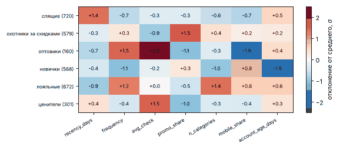

# Урок 3.3.3: Метрики качества кластеризации, интерпретация кластеров

> **Модуль 3:** Classical ML: Algorithms & Production Thinking · **Тема 3.3:** Кластеризация и сегментация
> **Тип:** теория · **Время:** 150 минут + 120 минут на домашнее задание

## Цели урока

После урока вы сможете:

- объяснить, что измеряют силуэт, индексы Calinski–Harabasz и Davies–Bouldin и в чью пользу они предвзяты;
- сравнить кластеризацию с разметкой метриками ARI, AMI, однородностью и полнотой и объяснить, почему
  для этого не годится accuracy;
- оценить устойчивость разбиения бутстрепом;
- проверить, есть ли в данных кластеры вообще;
- превратить номера кластеров в сегменты: профили, названия, правила, проверка на артефакты;
- оценить сегментацию по главному критерию — можно ли на её основе действовать.

## Зачем это нужно

В темах 3.1 и 3.2 качество модели было числом: посчитали ROC-AUC на отложенной выборке и сравнили
варианты. У кластеризации отложенных ответов нет, и соблазн — заменить их одной внутренней метрикой:
«силуэт 0.52, значит, сегментация хорошая». В этом уроке вы увидите, что равномерный шум получает силуэт
выше, чем настоящие сегменты клиентов, а заведомо неправильное разбиение — выше правильного.

Сегментацию оценивают с четырёх сторон, и ни одна не заменяет остальные:

| Вопрос | Инструмент | Раздел |
|---|---|---|
| Компактны ли и разделены ли кластеры? | внутренние метрики | 1 |
| Совпадают ли кластеры с известной разметкой? | внешние метрики | 2 |
| Получим ли мы те же кластеры на других данных? | устойчивость | 3 |
| Понятны ли сегменты и можно ли с ними работать? | профили, правила, проверка заказчиком | 5–8 |

## 1. Внутренние метрики и их предвзятость

Внутренние метрики используют только признаки и метки кластеров. Все три знакомы по уроку 3.3.1:

| Метрика | Что сравнивает | Диапазон | Лучше |
|---|---|---|---|
| Силуэт | расстояние объекта до своего кластера и до ближайшего чужого | от −1 до 1 | больше |
| Calinski–Harabasz | разброс центров кластеров и разброс объектов вокруг своих центров | от 0 | больше |
| Davies–Bouldin | размер кластера и расстояние до самого похожего соседа | от 0 | меньше |

Все три определяют «хороший кластер» одинаково: плотный шар, далёкий от других шаров. То есть они
измеряют не качество кластеризации вообще, а соответствие предположениям k-means.

```python
import numpy as np
import pandas as pd
from customers_data import FEATURES, NOISE_FEATURES, make_customers
from shapes_data import make_shapes
from sklearn.cluster import DBSCAN, KMeans
from sklearn.metrics import adjusted_rand_score, calinski_harabasz_score, davies_bouldin_score
from sklearn.metrics import silhouette_score
from sklearn.preprocessing import StandardScaler


def internal_metrics(X, labels):
    return {
        "silhouette": silhouette_score(X, labels),
        "calinski_harabasz": calinski_harabasz_score(X, labels),
        "davies_bouldin": davies_bouldin_score(X, labels),
    }


moons, moons_truth = make_shapes()["moons"]
by_kmeans = KMeans(2, n_init=10, random_state=0).fit_predict(moons)
by_dbscan = DBSCAN(eps=0.15).fit_predict(moons)
internal_metrics(moons, by_kmeans), internal_metrics(moons, by_dbscan)
```

| Разбиение полумесяцев | ARI с истиной | Силуэт | Calinski–Harabasz | Davies–Bouldin |
|---|---|---|---|---|
| k-means: оба полумесяца разрезаны | 0.255 | **0.491** | **2 219** | **0.781** |
| DBSCAN: полумесяцы найдены точно | 1.000 | 0.335 | 996 | 1.152 |

Все три метрики единогласно предпочли **неправильное** разбиение. Выбирая алгоритм по силуэту, вы
всегда выберете k-means — даже там, где он ошибается. Отсюда правила:

- внутренними метриками сравнивают варианты **одного** алгоритма на **одних и тех же** признаках
  (например, разные k);
- сравнивать ими алгоритмы с разным определением кластера нельзя;
- сравнивать значения, посчитанные на разных признаках, тоже нельзя (пример — в разделе 8);
- у DBSCAN и HDBSCAN метки шума перед подсчётом нужно исключать, иначе шум считается кластером.

## 2. Внешние метрики: сравнение с разметкой

Иногда разметка есть: синтетические данные с известными сегментами, как в этой теме; небольшая выборка,
размеченная экспертами; старая сегментация, с которой сравнивают новую. Тогда разбиение можно сравнить
с эталоном — но не через accuracy. Номера кластеров произвольны: кластер 0 не обязан соответствовать
классу 0, а число кластеров может не совпадать с числом классов.

Метрики сравнения разбиений не зависят от нумерации:

| Метрика | Идея | Поправка на случайность |
|---|---|---|
| Индекс Рэнда | доля пар объектов, по которым разбиения согласны: оба вместе или оба врозь | нет |
| ARI | индекс Рэнда, из которого вычтено ожидаемое значение для случайных разбиений | да |
| NMI | взаимная информация меток, нормированная на энтропию | нет |
| AMI | взаимная информация с вычтенным ожидаемым значением | да |
| Однородность | в каждом кластере объекты только одного класса | нет |
| Полнота | все объекты одного класса лежат в одном кластере | нет |
| V-мера | гармоническое среднее однородности и полноты; совпадает с NMI | нет |

Посчитаем их для осмысленных и бессмысленных разбиений клиентов:

```python
from scipy.optimize import linear_sum_assignment
from sklearn.metrics import (
    accuracy_score,
    adjusted_mutual_info_score,
    homogeneity_completeness_v_measure,
    normalized_mutual_info_score,
    rand_score,
)
from sklearn.metrics.cluster import contingency_matrix

LOG_FEATURES = ["recency_days", "frequency", "avg_check", "account_age_days"]


def prepare(customers, columns=FEATURES):
    X = customers[columns].astype(float)
    X[LOG_FEATURES] = np.log1p(X[LOG_FEATURES])
    return StandardScaler().fit_transform(X)


def matched_accuracy(truth, labels):
    table = contingency_matrix(truth, labels)
    rows, columns = linear_sum_assignment(-table)  # лучшее соответствие «кластер — класс»
    return table[rows, columns].sum() / table.sum()


customers, segment = make_customers()
Z = prepare(customers)
truth = pd.Categorical(segment).codes
model = KMeans(6, n_init=10, random_state=0).fit(Z)
rng = np.random.default_rng(0)
variants = {
    "k-means, k=6": model.labels_,
    "k-means, k=3": KMeans(3, n_init=10, random_state=0).fit_predict(Z),
    "k-means, k=12": KMeans(12, n_init=10, random_state=0).fit_predict(Z),
    "случайные, 6": rng.integers(0, 6, len(Z)),
    "случайные, 300": rng.integers(0, 300, len(Z)),
    "каждый сам по себе": np.arange(len(Z)),
    "все вместе": np.zeros(len(Z), dtype=int),
}
rows = {}
for name, labels in variants.items():
    homogeneity, completeness, _ = homogeneity_completeness_v_measure(truth, labels)
    rows[name] = {
        "accuracy": matched_accuracy(truth, labels),
        "rand": rand_score(truth, labels),
        "ari": adjusted_rand_score(truth, labels),
        "nmi": normalized_mutual_info_score(truth, labels),
        "ami": adjusted_mutual_info_score(truth, labels),
        "homogeneity": homogeneity,
        "completeness": completeness,
    }
pd.DataFrame(rows).T.round(3)
accuracy_score(truth, model.labels_)  # 0.004 — «наивная» accuracy без сопоставления номеров
```

| Разбиение | Accuracy после сопоставления | Рэнд | ARI | NMI | AMI | Однородность | Полнота |
|---|---|---|---|---|---|---|---|
| k-means, k = 6 | 0.979 | 0.985 | 0.953 | 0.930 | 0.930 | 0.931 | 0.929 |
| k-means, k = 3 | 0.648 | 0.818 | 0.561 | 0.693 | 0.692 | 0.562 | 0.904 |
| k-means, k = 12 | 0.549 | 0.886 | 0.540 | 0.759 | 0.758 | 0.930 | 0.641 |
| случайные метки, 6 кластеров | 0.190 | 0.704 | 0.000 | 0.003 | 0.000 | 0.003 | 0.002 |
| случайные метки, 300 кластеров | 0.013 | 0.804 | 0.000 | 0.078 | 0.001 | 0.170 | 0.051 |
| каждый клиент — свой кластер | 0.002 | 0.806 | 0.000 | 0.349 | 0.000 | 1.000 | 0.212 |
| все в одном кластере | 0.241 | 0.194 | 0.000 | 0.000 | 0.000 | 0.000 | 1.000 |

Что видно:

- «наивная» accuracy хорошего разбиения равна 0.004: кластеры найдены верно, но пронумерованы иначе.
  Сопоставление номеров венгерским алгоритмом (`linear_sum_assignment`) даёт 0.979, но работает
  только при равном числе кластеров и классов;
- **индекс Рэнда** у случайных меток — 0.70–0.80. Большинство пар клиентов лежит в разных сегментах,
  и любое мелкое разбиение «угадывает» это. Без поправки на случайность метрика бесполезна;
- **NMI** растёт с числом кластеров: 0.349 у разбиения, где каждый клиент сам по себе. **AMI** и **ARI**
  у всех бессмысленных разбиений равны нулю — используйте их;
- однородность и полнота показывают **тип ошибки**. При k = 3 полнота высокая (0.904), однородность
  низкая (0.562): сегменты слиты. При k = 12 наоборот: сегменты раздроблены. Вырожденные разбиения
  получают единицу по одной из метрик, поэтому по отдельности их не читают.

На практике достаточно ARI и пары «однородность — полнота». ARI равен 1 при полном совпадении, около 0
при случайном и может быть слегка отрицательным.

## 3. Устойчивость

Настоящая структура не должна зависеть от того, какие именно клиенты попали в выгрузку. Проверка
бутстрепом: много раз набираем выборку с возвращением, обучаем модель, размечаем ею **всех** клиентов
и сравниваем разметки между собой.

```python
from itertools import combinations


def bootstrap_stability(X, k, n_boot=20, seed=0):
    rng = np.random.default_rng(seed)
    runs = []
    for _ in range(n_boot):
        sample = rng.integers(0, len(X), len(X))
        runs.append(KMeans(k, n_init=10, random_state=seed).fit(X[sample]).predict(X))
    scores = [adjusted_rand_score(a, b) for a, b in combinations(runs, 2)]
    return np.mean(scores), np.min(scores)


{k: bootstrap_stability(Z, k) for k in range(3, 10)}
```

| k | 3 | 4 | 5 | 6 | 7 | 8 | 9 |
|---|---|---|---|---|---|---|---|
| Средний ARI между запусками | 0.990 | 0.831 | 0.983 | **0.994** | 0.903 | 0.841 | 0.785 |
| Худшая пара запусков | 0.970 | 0.562 | 0.959 | **0.986** | 0.818 | 0.694 | 0.621 |

Как читать:

- при k = 6 любые две выборки дают почти одно и то же разбиение — это сильный довод в пользу шести
  сегментов, которого внутренние метрики в уроке 3.3.1 не дали (они выбрали пять);
- при k = 4 устойчивость проваливается, хотя при k = 3 и k = 5 она высокая: четыре кластера можно
  получить из пяти несколькими равноценными слияниями, и разные выборки выбирают разные. Устойчивость
  не обязана быть монотонной;
- при k ≥ 7 алгоритму приходится дробить настоящие сегменты, а дробить их можно по-разному;
- порогов «из учебника» нет. Ориентир: выше 0.9 — разбиение воспроизводимо, ниже 0.7 — границы
  проведены случайно.

Подготовка признаков тоже влияет: без логарифма (только стандартизация) устойчивость при k = 6 падает
с 0.994 до 0.912. Неустойчивость — частый спутник плохой предобработки.

## 4. А есть ли кластеры вообще

K-means вернёт k кластеров на любых данных. Возьмём данные, в которых структуры нет по построению:

```python
rng = np.random.default_rng(100)
no_structure = {
    "равномерный шум, 2 признака": rng.uniform(size=(3000, 2)),
    "равномерный шум, 7 признаков": rng.uniform(size=(3000, 7)),
    "одно нормальное облако, 2 признака": rng.normal(size=(3000, 2)),
    "одно нормальное облако, 7 признаков": rng.normal(size=(3000, 7)),
}
for name, X in no_structure.items():
    labels = KMeans(4, n_init=10, random_state=0).fit_predict(X)
    print(name, np.bincount(labels), round(silhouette_score(X, labels), 3), bootstrap_stability(X, 4))
```

| Данные | Размеры четырёх кластеров | Силуэт | Устойчивость |
|---|---|---|---|
| равномерный шум, 2 признака | 724, 786, 791, 699 | 0.406 | 0.933 |
| равномерный шум, 7 признаков | 762, 751, 792, 695 | 0.104 | 0.209 |
| одно нормальное облако, 2 признака | 805, 823, 700, 672 | 0.314 | 0.530 |
| одно нормальное облако, 7 признаков | 730, 733, 785, 752 | 0.091 | 0.217 |
| клиенты, k = 6 | от 160 до 720 | 0.384 | 0.994 |

Равномерный шум на плоскости получил силуэт **0.406 — выше, чем настоящие сегменты клиентов** (0.384):
четыре ровных квадранта компактны и хорошо отделены друг от друга в среднем. Более того, это разбиение
устойчиво (0.933) — квадрат делится на четверти одним и тем же способом при любой выборке. Устойчивость
ловит отсутствие структуры в трёх случаях из четырёх, силуэт на плоскости — ни в одном. Абсолютное
значение силуэта ничего не говорит о том, есть ли в данных кластеры; а в семимерных данных силуэт 0.1
у шума против 0.38 у клиентов — уже содержательная разница.

**Статистика Хопкинса** проверяет гипотезу «точки разбросаны равномерно». Сравниваются расстояния
до ближайшего соседа от настоящих точек ($w_i$) и от случайных точек, брошенных равномерно в ту же
область ($u_i$); $d$ — число признаков:

$$H = \frac{\sum u_i^d}{\sum u_i^d + \sum w_i^d}$$

Если данные равномерны, расстояния одного порядка и $H \approx 0.5$. Если точки собраны в сгустки,
настоящие соседи близко, случайная точка обычно попадает в пустоту, и $H \to 1$.

```python
from sklearn.neighbors import NearestNeighbors


def hopkins(X, n_probe=200, seed=0):
    rng = np.random.default_rng(seed)
    neighbors = NearestNeighbors(n_neighbors=2).fit(X)
    sample = X[rng.choice(len(X), n_probe, replace=False)]
    w = neighbors.kneighbors(sample)[0][:, 1]  # ближайший сосед, не считая самой точки
    uniform = rng.uniform(X.min(axis=0), X.max(axis=0), size=(n_probe, X.shape[1]))
    u = neighbors.kneighbors(uniform, n_neighbors=1)[0][:, 0]
    d = X.shape[1]
    return (u**d).sum() / ((u**d).sum() + (w**d).sum())


{name: np.mean([hopkins(X, seed=s) for s in range(10)]) for name, X in no_structure.items()}
np.mean([hopkins(Z, seed=s) for s in range(10)])  # 1.000
```

| Данные | Статистика Хопкинса (среднее по 10 запускам) |
|---|---|
| равномерный шум, 2 признака | 0.513 |
| равномерный шум, 7 признаков | 0.490 |
| одно нормальное облако, 2 признака | 0.974 |
| одно нормальное облако, 7 признаков | 0.999 |
| полумесяцы | 0.992 |
| клиенты | 1.000 |

Равномерный шум статистика распознаёт уверенно. Но одно нормальное облако — данные без единого кластера —
получает 0.97–1.0: оно тоже не равномерно. Статистика Хопкинса отвечает на вопрос «равномерны ли
данные», а не «есть ли в них несколько групп». Значение около 0.5 — веский довод не кластеризовать;
значение около 1 ничего не доказывает. Отличить «одно облако» от «нескольких» помогают gap statistic
(в уроке 3.3.1 она сравнивала с k = 1), устойчивость и профили кластеров.

## 5. Профили кластеров

Числа 0–5 заказчику ничего не говорят. Первый шаг интерпретации — **профиль**: типичные значения
признаков в каждом кластере **в исходных единицах**, а не в стандартизованных.

```python
labels = pd.Series(model.labels_, index=customers.index, name="cluster")
profiles = customers.groupby(labels)[FEATURES].median()
profiles.insert(0, "size", labels.value_counts().sort_index())
revenue = customers["frequency"] * customers["avg_check"]
profiles["revenue_share"] = revenue.groupby(labels).sum() / revenue.sum()
```

| Кластер | Клиентов | Давность, дней | Заказов | Средний чек, руб. | По акции | Категорий | С телефона | Возраст, дней | Доля выручки |
|---|---|---|---|---|---|---|---|---|---|
| 0 | 720 | 259 | 3 | 2 446 | 0.28 | 2 | 0.39 | 678 | 2 % |
| 1 | 579 | 20 | 10 | 1 436 | 0.83 | 4 | 0.60 | 476 | 3 % |
| 2 | 160 | 9 | 38 | 28 655 | 0.05 | 2 | 0.11 | 608 | 65 % |
| 3 | 568 | 18 | 2 | 2 584 | 0.44 | 1 | 0.77 | 43 | 1 % |
| 4 | 672 | 6 | 29 | 3 206 | 0.23 | 6 | 0.72 | 744 | 22 % |
| 5 | 301 | 53 | 5 | 11 281 | 0.07 | 2 | 0.48 | 535 | 7 % |
| все | 3 000 | 23 | 6 | 2 677 | 0.33 | 3 | 0.58 | 530 | 100 % |

Медиана устойчивее среднего к выбросам; для скошенных признаков среднее вводит в заблуждение.

Абсолютные значения трудно сравнивать между признаками, поэтому рядом показывают **отклонение от общего
среднего в стандартных отклонениях**. Для k-means на стандартизованных признаках это просто координаты
центров:

```python
deviations = pd.DataFrame(model.cluster_centers_, columns=FEATURES).round(1)
```



По двум таблицам кластеры получают названия:

| Кластер | Отличительные признаки, σ | Название |
|---|---|---|
| 0 | давность +1.4, мало заказов и категорий | спящие |
| 1 | доля покупок по акции +1.5, низкий чек −0.9 | охотники за скидками |
| 2 | чек +2.5, заказов +1.5, с телефона −1.9 | оптовики |
| 3 | возраст аккаунта −1.9, заказов −1.1 | новички |
| 4 | заказов +1.2, категорий +1.4, давность −0.9 | лояльные |
| 5 | чек +1.5, по акции −1.0, заказов мало | ценители: редкие дорогие покупки |

Названия совпали с сегментами, заложенными в генератор, — но в настоящей задаче сверить их не с чем,
и название остаётся гипотезой аналитика. Проверьте её: откройте 10–20 случайных клиентов каждого
кластера и убедитесь, что название к ним подходит.

Признаки, не связанные с сегментами (`survey_score`, `profile_update_days`), между кластерами почти
не различаются: средняя оценка в опросе — от 6.9 до 7.2. Признак, одинаковый во всех кластерах,
в описании сегментов не нужен.

## 6. Объяснение кластеров деревом решений

Профиль описывает центр кластера, но не его границы. Чтобы получить правила вида «если…, то сегмент…»,
обучают классификатор предсказывать номер кластера по исходным признакам. Удобнее всего **дерево
решений** — модель, которая последовательно делит данные по порогам признаков (подробно — в модуле 4).

```python
from sklearn.model_selection import cross_val_score
from sklearn.tree import DecisionTreeClassifier, export_text

X_all = customers[FEATURES + NOISE_FEATURES]
tree = DecisionTreeClassifier(max_depth=3, random_state=0).fit(X_all, labels)
cross_val_score(tree, X_all, labels, cv=5).mean()  # 0.839
print(export_text(tree, feature_names=list(X_all.columns), decimals=1))
```

```
|--- recency_days <= 121.5
|   |--- account_age_days <= 136.5
|   |   |--- n_categories <= 3.5
|   |   |   |--- class: 3                    новички
|   |   |--- n_categories >  3.5
|   |   |   |--- class: 1
|   |--- account_age_days >  136.5
|   |   |--- promo_share <= 0.6
|   |   |   |--- class: 4                    лояльные
|   |   |--- promo_share >  0.6
|   |   |   |--- class: 1                    охотники за скидками
|--- recency_days >  121.5
|   |--- avg_check <= 7111.4
|   |   |--- promo_share <= 0.7
|   |   |   |--- class: 0                    спящие
|   |   |--- promo_share >  0.7
|   |   |   |--- class: 1
|   |--- avg_check >  7111.4
|   |   |--- promo_share <= 0.4
|   |   |   |--- class: 5                    ценители
|   |   |--- promo_share >  0.4
|   |   |   |--- class: 0
```

Названия справа добавлены вручную. Дерево глубины 3 воспроизводит
кластеры с точностью 0.84 на кросс-валидации, глубины 4 — 0.90, глубины 5 — 0.95. Чем проще правила,
тем хуже они повторяют кластеры: компромисс выбирают под задачу. Дерево глубины 3 не нашло оптовиков —
им не хватило листьев; о редких, но важных сегментах простые правила молчат.

Второе применение классификатора — **важность признаков**. Перестановочная важность (насколько падает
точность, если перемешать значения признака) для случайного леса из 200 деревьев:

| Признак | `recency_days` | `account_age_days` | `promo_share` | `avg_check` | `frequency` | `n_categories` | `mobile_share` | шумовые |
|---|---|---|---|---|---|---|---|---|
| Важность | 0.263 | 0.200 | 0.171 | 0.142 | 0.071 | 0.014 | 0.008 | 0.000 |

Сегменты определяются несколькими признаками сопоставимой важности — это признак здоровой сегментации
(сравните с разделом 8). Третье применение — тот же классификатор относит к сегментам новых клиентов,
когда у алгоритма кластеризации нет метода `predict` (урок 3.3.2).

## 7. Визуализация и её ограничения

Показать кластеры на плоскости помогают методы урока 2.4.2: PCA, t-SNE, UMAP.

```python
from sklearn.decomposition import PCA

pca = PCA().fit(Z)
pca.explained_variance_ratio_.cumsum().round(3)  # [0.349 0.629 0.807 0.899 0.951 0.985 1.   ]
plane = pca.transform(Z)[:, :2]
on_plane = KMeans(6, n_init=10, random_state=0).fit_predict(plane)
adjusted_rand_score(segment, on_plane)  # 0.685 против 0.953 на семи признаках
```

Две главные компоненты сохраняют 63 % разброса. Этого мало: кластеризация по проекции даёт ARI 0.685
вместо 0.953. Для каждого клиента найдём ближайшего соседа и проверим, из того же ли он кластера:

| Кластер | спящие | охотники | оптовики | новички | лояльные | ценители |
|---|---|---|---|---|---|---|
| Сосед из своего кластера, 7 признаков | 0.99 | 0.98 | 0.96 | 0.98 | 0.99 | 0.95 |
| Сосед из своего кластера, проекция на плоскость | 0.79 | 0.85 | 0.91 | 0.90 | 0.94 | 0.54 |

На картинке ценители наполовину перемешаны с другими сегментами, хотя в исходном пространстве отделены
хорошо. Вывод «сегменты пересекаются», сделанный по рисунку, был бы ошибкой. Правила чтения проекций:

- кластеризуйте в исходном пространстве признаков, проекцию используйте только для рисунка;
- перекрытие на рисунке не доказывает перекрытия в данных — проекция теряет информацию;
- у t-SNE и UMAP расстояния между группами и размеры групп не несут смысла, а результат зависит
  от параметров; раздельные «острова» на рисунке — не доказательство кластеров (урок 2.4.2);
- рисунок — иллюстрация для заказчика и способ заметить грубую ошибку, но не метрика качества.

## 8. Главный критерий и типичные провалы

Сегментацию заказывают, чтобы с группами клиентов **действовать по-разному**. Поэтому итоговая проверка —
не метрика, а таблица «сегмент — действие»:

| Сегмент | Доля клиентов | Доля выручки | Что делать |
|---|---|---|---|
| оптовики | 5 % | 65 % | персональный менеджер, оптовые условия; не рассылать массовые акции |
| лояльные | 22 % | 22 % | программа лояльности, ранний доступ к новинкам |
| ценители | 10 % | 7 % | подборки дорогих товаров, сервис; скидки не нужны |
| охотники за скидками | 19 % | 3 % | акции с контролем маржи; не тратить на них дорогие каналы |
| новички | 19 % | 1 % | приветственная цепочка, подтолкнуть ко второй покупке |
| спящие | 24 % | 2 % | реактивация; при отсутствии отклика — перестать тратить бюджет |

Требования к рабочей сегментации: сегменты **различимы** (описываются простыми правилами), **достаточно
крупны** или достаточно ценны, чтобы под них строить кампанию, **устойчивы** во времени и **ведут
к разным действиям**. Два сегмента, с которыми маркетинг будет работать одинаково, — это один сегмент,
каким бы ни был силуэт. Вспомните урок 3.3.1: метрики компактности советовали пять кластеров и слияние
оптовиков с ценителями — сегмента на 65 % выручки с сегментом на 7 %.

Три провала, которые метрики не ловят или даже поощряют:

**Сегменты по одному доминирующему признаку.** K-means на немасштабированных признаках (урок 3.3.1):

```python
raw = KMeans(6, n_init=10, random_state=0).fit(customers[FEATURES])
silhouette_score(customers[FEATURES], raw.labels_)  # 0.763 — вдвое выше, чем у правильного разбиения
check_tree = DecisionTreeClassifier(max_depth=3, random_state=0).fit(customers[FEATURES], raw.labels_)
dict(zip(FEATURES, check_tree.feature_importances_.round(3)))  # avg_check: 1.0, остальные: 0.0
```

Силуэт 0.763 против 0.384, а ARI с истинными сегментами — 0.130 против 0.953. Силуэт посчитан в другом
пространстве признаков, и сравнивать эти числа нельзя. Диагностика — важность признаков: если один
признак объясняет все кластеры, вместо кластеризации достаточно было разбить его на интервалы.

**Сегменты-артефакты.** Добавим к семи признакам два шумовых и один случайный бинарный:

```python
with_noise = KMeans(6, n_init=10, random_state=0).fit(prepare(customers, FEATURES + NOISE_FEATURES))
adjusted_rand_score(segment, with_noise.labels_)  # 0.791
customers.groupby(with_noise.labels_)["profile_update_days"].mean().round(0)  # 286, 184, 188, 190, 185, 98

flag = np.random.default_rng(0).integers(0, 2, (len(Z), 1)).astype(float)
with_flag = KMeans(6, n_init=10, random_state=0).fit(np.hstack([Z, StandardScaler().fit_transform(flag)]))
adjusted_rand_score(segment, with_flag.labels_)  # 0.786
```

В обоих случаях спящие распались на два кластера — «давно обновляли профиль» и «недавно»,
«флаг 0» и «флаг 1», — а оптовики слились с частью ценителей. Бинарный признак после стандартизации принимает
два значения на расстоянии двух σ и создаёт идеально разделённые группы; равномерный шумовой признак —
самый «широкий» в данных. Каждый признак в кластеризации голосует с равным весом, даже бессмысленный.
Отбирайте признаки по смыслу задачи, а не «все, что есть».

**Неустойчивые сегменты.** С двумя шумовыми признаками результат зависит от `random_state`: три запуска
из четырёх дают ARI 0.79, один — 0.95. При k = 8 устойчивость равна 0.84 (раздел 3). Кампания, построенная
на сегменте, который исчезнет при следующем пересчёте, — выброшенные деньги.

## Типичные ошибки

| Симптом | Причина | Решение |
|---|---|---|
| «Силуэт 0.4, сегментация хорошая» | абсолютное значение силуэта ни о чём не говорит: у шума на плоскости столько же | сравнивать варианты между собой; проверять устойчивость и профили |
| По силуэту k-means всегда лучше DBSCAN | внутренние метрики предвзяты к шарообразным кластерам | не сравнивать ими разные алгоритмы |
| Accuracy кластеризации близка к нулю | номера кластеров не совпадают с номерами классов | ARI, AMI; либо сопоставление номеров |
| Статистика Хопкинса 0.99, а сегменты бессмысленны | она проверяет равномерность, а не наличие групп | устойчивость, gap statistic, профили |
| Профили в «сигмах» непонятны заказчику | показаны стандартизованные значения | медианы в исходных единицах; сигмы — как дополнение |
| Сегменты перекрываются на рисунке UMAP или PCA | проекция теряет информацию | судить по исходному пространству |
| Кластеры описываются одним признаком | масштаб; доминирующий признак | масштабировать; проверить важность признаков |
| Кластер делится по техническому или бинарному признаку | лишние признаки в кластеризации | отбирать признаки по смыслу |
| Сегменты меняются при каждом пересчёте | неустойчивое k или шумовые признаки | бутстреп; уменьшить k; убрать шум |

## Контрольные вопросы

1. Почему внутренние метрики предпочитают разбиение k-means на полумесяцах правильному?
2. В каких случаях сравнение по силуэту корректно, а в каких нет?
3. Почему accuracy не подходит для сравнения кластеризации с разметкой?
4. Чем AMI отличается от NMI? Какое значение NMI получает разбиение «каждый объект — отдельный кластер»?
5. Разбиение имеет однородность 0.93 и полноту 0.64. Что с ним не так?
6. Как оценить устойчивость бутстрепом? Почему при k = 4 она оказалась ниже, чем при k = 3 и k = 5?
7. Что показывает статистика Хопкинса? Какой вывод можно сделать из значения 0.5, а какой — из 0.99?
8. Зачем обучать дерево решений на метках кластеров? Что означает точность такого дерева 0.84?
9. Сегменты на рисунке PCA перекрываются. Что из этого следует?
10. Назовите четыре требования к сегментации, пригодной для маркетинга.

## Домашнее задание

Работайте в ноутбуке `homework/m03/hw_3_3_3.ipynb` с данными `make_customers()` и `make_shapes()`.

1. **Предвзятость метрик.** Для наборов `moons`, `aniso` и `sizes` посчитайте три внутренние метрики
   для истинных меток и для меток k-means. На скольких наборах метрики предпочли неправильный ответ?
2. **Внешние метрики своими руками.** Реализуйте индекс Рэнда и ARI через таблицу сопряжённости
   и сверьте со scikit-learn.
3. **Устойчивость по кластерам.** Для k = 6 и k = 8 посчитайте устойчивость каждого кластера отдельно:
   для кластера исходного разбиения найдите наиболее похожий кластер в бутстреп-запуске по коэффициенту
   Жаккара и усредните по запускам. Какие кластеры при k = 8 неустойчивы?
4. **Профили.** Постройте профили сегментов для k = 5 и k = 6: медианы, отклонения в сигмах, доля
   выручки. Что теряет заказчик при k = 5?
5. **Правила.** Подберите глубину дерева, при которой оно воспроизводит кластеры с точностью не ниже 0.9
   на кросс-валидации. Запишите правило для оптовиков словами.
6. **Артефакт.** Добавьте к признакам `survey_score` и `profile_update_days`, обучите k-means пять раз
   с разными `random_state`. Найдите артефакт по профилям и по важности признаков, не используя
   истинные сегменты.

**Критерии приёмки:**

- [ ] в задании 2 результаты совпадают со scikit-learn (`np.isclose`);
- [ ] в задании 3 названы неустойчивые кластеры при k = 8;
- [ ] в задании 4 профили показаны в исходных единицах, сегментам даны названия;
- [ ] в задании 5 правило записано в виде, понятном человеку без подготовки;
- [ ] в задании 6 артефакт найден без обращения к переменной `segment`;
- [ ] истинные сегменты используются только там, где это прямо сказано в задании.

## Дополнительные материалы

- Руководство scikit-learn, оценка качества кластеризации:
  https://scikit-learn.org/stable/modules/clustering.html#clustering-performance-evaluation
- Руководство scikit-learn, деревья решений: https://scikit-learn.org/stable/modules/tree.html
- L. Hubert, P. Arabie. Comparing partitions (1985).
- N. X. Vinh, J. Epps, J. Bailey. Information Theoretic Measures for Clusterings Comparison (2010).

**Следующий урок:** 3.3.4 — ПРАКТИКА: Сегментация пользователей для маркетинга.
