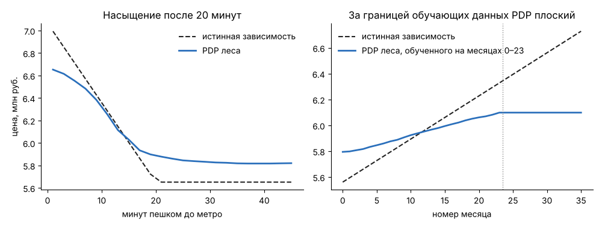
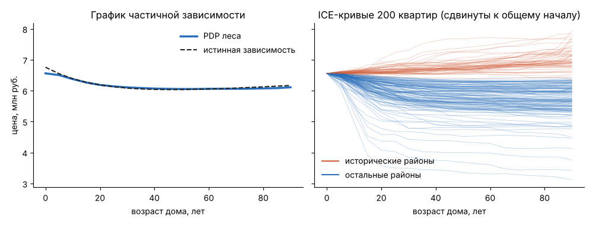
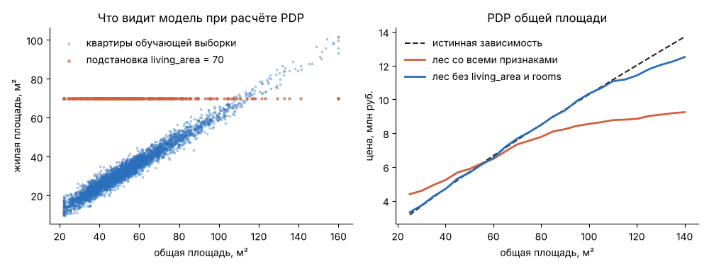

# Урок 4.2.3: Интерпретируемость RF: partial dependence plots

> **Модуль 4:** Ensemble Mastery & Hyperparameter Optimization · **Тема 4.2:** Random Forest
> **Тип:** теория · **Время:** 120 минут + 90 минут на домашнее задание

## Цели урока

После урока вы сможете:

- объяснить, что показывает график частичной зависимости (PDP), и посчитать его вручную;
- построить PDP, ICE-кривые и двумерные PDP средствами scikit-learn и прочитать их;
- распознать три ситуации, в которых PDP вводит в заблуждение: взаимодействия, коррелирующие признаки,
  границы обучающих данных;
- объяснить, почему PDP описывает модель, а не мир, и не является оценкой причинного эффекта;
- выбрать подходящий инструмент объяснения: PDP, перестановочная важность, SHAP, суррогатное дерево.

## Зачем это нужно

Лес из 300 деревьев по 2000 листьев нельзя прочитать, как дерево глубины 3 из урока 4.1.1. Но вопросы
к модели остаются теми же, что к линейной регрессии в уроке 3.1.2. Заказчик спрашивает, как цена зависит
от расстояния до метро; клиент — почему его квартиру оценили именно так; вы сами — выучила модель
закономерность или артефакт данных.

Методы интерпретации отвечают на них приближённо. Чего от них ждать можно: увидеть, **как ведёт себя
модель** — какие признаки она использует, в какую сторону и насколько сильно. Чего ждать нельзя:
узнать, как устроен мир. Объяснение точной модели, обученной на данных со скрытыми связями, точно
воспроизведёт эти связи — и не скажет, что произойдёт, если вмешаться. Весь урок построен вокруг этого
различия, и у нас есть редкая возможность его увидеть: истинная зависимость цены известна.

## 1. График частичной зависимости

Идея: чтобы узнать, как предсказание зависит от признака $j$, **принудительно подставим всем объектам
одно и то же значение** $v$ этого признака, остальные признаки оставим как есть и усредним предсказания:

$$PD_j(v) = \frac{1}{n}\sum_{i=1}^{n} f(x_{i1}, \dots, x_{i,j-1},\ v,\ x_{i,j+1}, \dots, x_{ip})$$

Повторив это для сетки значений $v$, получим кривую — график частичной зависимости (partial dependence
plot, PDP; Фридман, 2001). Он отвечает на вопрос: «каким было бы среднее предсказание, если бы у всех
квартир до метро было $v$ минут?»

Данные и модель — из урока 4.2.1.

```python
import numpy as np
import pandas as pd
from housing_data import DISTRICT_COEF, FEATURES, HISTORIC_DISTRICTS, TARGET, make_housing, true_price
from sklearn.ensemble import RandomForestRegressor
from sklearn.inspection import PartialDependenceDisplay, partial_dependence
from sklearn.model_selection import train_test_split

DISTRICTS = sorted(DISTRICT_COEF)
flats = make_housing()
X = flats[FEATURES].copy()
X["district"] = X["district"].map({name: code for code, name in enumerate(DISTRICTS)})
X = X.astype(float)  # partial_dependence в scikit-learn 1.9 не принимает целочисленные столбцы
y = flats[TARGET]
X_train, X_test, y_train, y_test = train_test_split(X, y, test_size=0.3, random_state=0)
forest = RandomForestRegressor(300, max_features=0.5, random_state=0, n_jobs=-1).fit(X_train, y_train)


def pdp(predict, X, feature, grid):
    values = []
    for v in grid:
        X_mod = X.copy()
        X_mod[feature] = v  # всем объектам подставляем одно и то же значение
        values.append(predict(X_mod).mean())
    return np.array(values)


grid = np.array([1.0, 5, 10, 15, 20, 25, 30, 40])
mine = pdp(forest.predict, X_train, "metro_min", grid)
theirs = partial_dependence(forest, X_train, ["metro_min"], custom_values={"metro_min": grid}, method="brute")
np.abs(mine - theirs["average"][0]).max()
```

Расхождение равно нулю: восемь строк кода воспроизводят библиотечную функцию.

Три особенности `sklearn.inspection.partial_dependence`, о которые легко споткнуться:

- **целочисленные столбцы запрещены.** Без строки `X.astype(float)` функция завершается ошибкой
  `ValueError: The column 'metro_min' contains integer data. Partial dependence plots are not supported
  for integer data`. Деревья от преобразования типа не меняются;
- **метод по умолчанию для леса — не определение.** `method="auto"` выбирает для деревьев и лесов
  быстрый алгоритм `"recursion"`: вместо подстановки значений он проходит по деревьям и взвешивает ветви
  долями обучающих объектов. Он в 12 раз быстрее (0.07 с против 0.82 с на нашей сетке), но результат
  немного другой: расхождение с `"brute"` до 0.05 млн руб. Определению соответствует `"brute"`;
- **сетка по умолчанию обрезана**: 100 точек между 5-м и 95-м перцентилями признака (если уникальных
  значений меньше ста — все уникальные значения). Свою сетку задаёт `custom_values`.

Цена расчёта: число точек сетки × предсказание для всей выборки. Для больших данных PDP считают
по случайной подвыборке в несколько тысяч объектов.

## 2. Сверка с истиной

В генераторе цена метра падает линейно на 20 % за первые 20 минут пути до метро, дальше не меняется.
Функция `true_price` позволяет посчитать «PDP истины» тем же кодом:

```python
def true_model(X):
    """Истинная зависимость как функция от закодированной таблицы признаков."""
    names = np.array(DISTRICTS)[X["district"].to_numpy().astype(int)]
    return true_price(X.assign(district=names, renovation=X["renovation"].astype(int)))


pdp(true_model, X_train, "metro_min", grid)
```

| Минут до метро | 1 | 5 | 10 | 15 | 20 | 25 | 30 | 40 |
|---|---|---|---|---|---|---|---|---|
| Истина, млн руб. | 6.99 | 6.71 | 6.36 | 6.01 | 5.65 | 5.65 | 5.65 | 5.65 |
| PDP леса | 6.65 | 6.55 | 6.32 | 6.03 | 5.89 | 5.85 | 5.83 | 5.82 |



- **Форму лес восстановил**: падение до двадцати минут и плато после. Линейная модель без ручных
  признаков показала бы прямую.
- **Размах занижен**: по модели от 1 до 20 минут цена падает на 11.5 %, на самом деле — на 19 %.
  Лес сглаживает слабые эффекты: признак спорит за место в узлах с более сильными, а в глубине дерева
  данных для точного порога уже мало. В лесе без шумовых и дублирующих признаков падение составляет 14 %.
  PDP надёжнее передаёт направление и форму зависимости, чем её величину.

## 3. ICE-кривые: что скрывает среднее

PDP — среднее по объектам. Если усреднение убрать, для каждого объекта получится своя кривая:
как менялось бы предсказание для *этой* квартиры при изменении признака. Это **ICE-кривые**
(individual conditional expectation). PDP — их среднее.

Возраст дома. В генераторе в исторических районах («Центр», «Старый город», 29 % квартир) старый фонд
ценится и цена растёт с возрастом; в остальных районах дом дешевеет и выходит на плато.

```python
ages = np.array([0.0, 5, 10, 20, 40, 60, 80])
result = partial_dependence(forest, X_train, ["age"], custom_values={"age": ages}, method="brute", kind="both")
ice = result["individual"][0]  # форма (3500, 7): строка — квартира, столбец — значение возраста
historic = X_train["district"].isin([DISTRICTS.index(name) for name in HISTORIC_DISTRICTS]).to_numpy()
ice.mean(axis=0), ice[historic].mean(axis=0), ice[~historic].mean(axis=0)
```

| Возраст дома, лет | 0 | 5 | 10 | 20 | 40 | 60 | 80 |
|---|---|---|---|---|---|---|---|
| PDP леса | 6.56 | 6.50 | 6.37 | 6.18 | 6.07 | 6.06 | 6.07 |
| PDP истины | 6.76 | 6.55 | 6.39 | 6.19 | 6.04 | 6.05 | 6.12 |
| Среднее ICE, исторические районы | 8.78 | 8.81 | 8.82 | 8.89 | 9.03 | 9.16 | 9.29 |
| то же по истине | 8.48 | 8.57 | 8.66 | 8.84 | 9.20 | 9.55 | 9.91 |
| Среднее ICE, остальные районы | 5.64 | 5.55 | 5.36 | 5.07 | 4.85 | 4.78 | 4.75 |
| то же по истине | 6.05 | 5.71 | 5.45 | 5.09 | 4.74 | 4.61 | 4.56 |



PDP совпадает с истинным и говорит: «после сорока лет возраст на цену не влияет». Это верно в среднем
и неверно для каждой отдельной квартиры. У 98 % квартир исторических районов ICE-кривая растёт
(предсказание для 80 лет выше, чем для 5), у остальных растущих кривых — 0.1 %. Плоский участок PDP —
результат сложения роста у трети квартир и падения у двух третей.

Как читать ICE:

- кривые параллельны — эффект признака одинаков для всех объектов, PDP можно доверять;
- кривые расходятся веером или пересекаются — есть **взаимодействие** с другим признаком, и PDP
  описывает квартиру, которой не существует;
- чтобы найти, с чем взаимодействует признак, кривые раскрашивают по другим признакам;
- сотни кривых сливаются: рисуют подвыборку (`subsample`) и сдвигают кривые к общему началу
  (`centered=True`), чтобы различия в уровне не мешали видеть различия в наклоне.

Истинные наклоны лес снова занизил: в исторических районах рост от 0 до 80 лет по модели — 0.51 млн руб.,
по истине — 1.43.

## 4. Двумерные PDP

Подставлять можно два признака сразу — получится поверхность. Возраст и район:

```python
pair = partial_dependence(
    forest,
    X_train,
    ["age", "district"],
    custom_values={"age": np.array([0.0, 20, 80]), "district": np.arange(6.0)},
    categorical_features=["district"],
    method="brute",
)
pd.DataFrame(pair["average"][0].T, index=DISTRICTS, columns=["0 лет", "20 лет", "80 лет"]).round(2)
```

Среднее предсказание леса и, через косую черту, истинное значение:

| Район | 0 лет | 20 лет | 80 лет |
|---|---|---|---|
| Заводской | 4.77 / 4.95 | 4.26 / 4.17 | 3.97 / 3.74 |
| Заречье | 6.13 / 6.88 | 5.52 / 5.79 | 5.12 / 5.19 |
| Северный | 6.02 / 6.19 | 5.36 / 5.21 | 4.98 / 4.67 |
| Южный | 5.49 / 5.85 | 5.03 / 4.92 | 4.81 / 4.41 |
| Старый город | 8.30 / 7.84 | 8.39 / 8.17 | 8.82 / 9.17 |
| Центр | 9.47 / 9.48 | 9.59 / 9.88 | 9.94 / 11.07 |

Взаимодействие видно сразу: в четырёх районах значения убывают слева направо, в двух — растут. Если бы
взаимодействия не было, строки отличались бы только сдвигом. Величины лес стягивает к среднему:
новостройка в Заречье — 6.13 вместо 6.88, старый дом в Центре — 9.94 вместо 11.07.

Для двух числовых признаков `PartialDependenceDisplay` рисует карту с линиями уровня.

## 5. Главная ловушка: коррелирующие признаки

В данных `living_area` почти точно равна 0.62 · `area` (корреляция 0.98) и в формулу цены не входит.
Истинный PDP жилой площади — горизонтальная прямая. PDP леса:

| Жилая площадь, м² | 15 | 25 | 35 | 50 | 70 | 90 |
|---|---|---|---|---|---|---|
| Истина | 6.21 | 6.21 | 6.21 | 6.21 | 6.21 | 6.21 |
| PDP леса | 5.63 | 5.78 | 6.15 | 6.97 | 7.60 | 7.80 |
| Доля квартир, для которых подстановка даёт невозможное сочетание | 83 % | 55 % | 56 % | 84 % | 97 % | 99.6 % |

Невозможным считается сочетание, в котором жилая площадь отличается от 0.62 · `area` больше чем на 7.5 м²
(три стандартных отклонения в генераторе).

Здесь две проблемы сразу.

**Модель использует дублёра.** Лес не знает, какой из двух почти одинаковых признаков «настоящий»,
и делит между ними работу (урок 4.2.1). Поэтому жилая площадь «влияет» на предсказание, а влияние общей
площади занижено:

| Общая площадь, м² | 25 | 40 | 55 | 70 | 100 | 140 |
|---|---|---|---|---|---|---|
| Истина | 3.17 | 4.73 | 6.19 | 7.60 | 10.30 | 13.70 |
| PDP леса со всеми признаками | 4.39 | 5.24 | 6.21 | 7.34 | 8.55 | 9.24 |
| PDP леса без `living_area` и `rooms` | 3.32 | 4.71 | 6.14 | 7.69 | 10.34 | 12.51 |
| Согласованная подстановка: `area`, `living_area`, `rooms` вместе | 3.18 | 4.70 | 6.13 | 7.65 | 10.42 | 13.21 |

По PDP полной модели квартира в 140 м² стоит 9.2 млн руб. вместо 13.7 — ошибка в полтора раза,
хотя сама модель на реальных квартирах такой площади ошибается гораздо меньше.

**PDP спрашивает модель о том, чего она не видела.** Подставляя всем квартирам `living_area = 70`,
мы создаём квартиры общей площадью 30 м² с жилой площадью 70 м². Таких в данных нет, и ответ модели
в этой области — результат случайного устройства деревьев, а не выученная закономерность:

| `area` | `living_area` | Сочетание | Предсказание | Истина |
|---|---|---|---|---|
| 40 | 25 | обычное | 4.65 | 4.64 |
| 40 | 60 | невозможное | 6.31 | 4.64 |
| 100 | 62 | обычное | 9.79 | 10.11 |
| 100 | 25 | невозможное | 7.38 | 10.11 |



На реальных сочетаниях модель точна, на невозможных ошибается на треть — и PDP усредняет в основном
вторые: для `living_area = 70` невозможны 97 % подстановок.

Что делать:

1. **проверять корреляции до построения PDP.** Для признака, сильно связанного с другими, график
   читать нельзя;
2. **убрать дублёров** и переобучить модель: PDP площади в лесе без `living_area` и `rooms` близок
   к истине, а качество не пострадало (RMSE 0.842 против 0.850);
3. **подставлять согласованно**: менять связанные признаки вместе, по известному правилу связи —
   последняя строка таблицы;
4. использовать **ALE-графики** (accumulated local effects; Апли и Чжу, 2020). Они считают изменение
   предсказания при малом сдвиге признака только по объектам, у которых значение признака лежит рядом,
   и накапливают эти локальные изменения. Невозможные сочетания при этом не создаются. В scikit-learn
   метода нет; он реализован в сторонних пакетах, например `alibi`.

## 6. PDP не экстраполирует

PDP наследует ограничение деревьев. Обучим лес на объявлениях первых 24 месяцев и построим PDP номера
месяца на сетке до 35 (истина — рост на 0.6 % базового уровня в месяц):

| Месяц | 0 | 6 | 12 | 18 | 23 | 26 | 30 | 35 |
|---|---|---|---|---|---|---|---|---|
| Истина | 5.56 | 5.76 | 5.96 | 6.16 | 6.33 | 6.43 | 6.56 | 6.73 |
| PDP леса, обученного на месяцах 0–23 | 5.80 | 5.86 | 5.95 | 6.04 | 6.10 | 6.10 | 6.10 | 6.10 |

За границей обучающих данных кривая плоская: модель не знает о росте цен после 23-го месяца, и её график
«утверждает», что рост прекратился. То же с площадью: наибольшая в данных — 160 м², и PDP для 200 и 250 м²
равен 9.35 млн руб. при истинных 18.6 и 22.4.

Внутри диапазона тренд тоже занижен (рост 0.30 вместо 0.77 млн руб. за 23 месяца) — слабый эффект
на фоне шума, как и с метро.

Правило: **PDP можно читать только там, где есть данные.** Поэтому сетка по умолчанию обрезана
5-м и 95-м перцентилями, а `PartialDependenceDisplay` рисует на оси метки-децили распределения признака.
Плоский хвост графика — чаще свойство модели, чем мира.

## 7. PDP — не причинный эффект

Соблазнительно прочитать PDP как «что будет, если изменить признак». Таблица жилой площади показывает,
почему нельзя: по графику увеличение жилой площади с 25 до 70 м² поднимает цену на 1.8 млн руб.,
а в действительности — ни на рубль. Модель права в том, что квартиры с большой жилой площадью дороже;
неправ тот, кто читает это как эффект перепланировки.

PDP совпадает с причинным эффектом только при выполнении условий, которые сами данные проверить
не позволяют:

- модель точна;
- признак не связан с неучтёнными причинами целевой переменной. В уроке 3.1.2 автоплатёж выглядел
  сильным фактором удержания, потому что и он, и отток зависели от скрытой лояльности. Лес и его PDP
  повторили бы ту же ошибку — гибкость модели от неё не спасает;
- подстановка не уводит в область, где данных нет (раздел 5).

Корректные формулировки для отчёта: «модель предсказывает меньшую цену для квартир дальше от метро»,
«при прочих равных признаках предсказание снижается на …». Некорректная: «приближение метро повысит
цену на …» — для этого нужен эксперимент или причинный анализ.

## 8. Инструменты scikit-learn

`PartialDependenceDisplay.from_estimator` считает и рисует за один вызов:

```python
import matplotlib.pyplot as plt

fig, axes = plt.subplots(1, 3, figsize=(12, 3.6))
PartialDependenceDisplay.from_estimator(
    forest,
    X_train,
    ["metro_min", "district", "age"],
    categorical_features=["district"],
    kind=["average", "average", "both"],  # для возраста — PDP вместе с ICE-кривыми
    subsample=100,  # сколько ICE-кривых рисовать
    random_state=0,
    ax=axes,
)
```

| Параметр | Назначение |
|---|---|
| `features` | список признаков; пара в кортеже `("age", "metro_min")` даёт двумерный график |
| `kind` | `"average"` — PDP, `"individual"` — ICE, `"both"` — вместе |
| `centered`, `subsample` | сдвинуть кривые к нулю в начале сетки; сколько ICE-кривых рисовать |
| `custom_values`, `grid_resolution`, `percentiles` | управление сеткой |
| `method` | `"brute"` или `"recursion"`; для ICE — только `"brute"` |

### Категориальные признаки

Район закодирован числами от 0 до 5 в алфавитном порядке. Без `categorical_features` PDP нарисует
линию через шесть точек, как будто между «Заречьем» и «Северным» есть промежуточные значения
и порядок районов что-то означает. С параметром получается столбчатая диаграмма по категориям:

| Район | PDP леса | Истина | Средняя цена в районе по данным |
|---|---|---|---|
| Заводской | 4.26 | 4.13 | 4.13 |
| Южный | 5.04 | 4.87 | 4.79 |
| Северный | 5.34 | 5.16 | 5.19 |
| Заречье | 5.48 | 5.73 | 5.79 |
| Старый город | 8.48 | 8.37 | 8.12 |
| Центр | 9.65 | 10.11 | 10.35 |

Порядок районов восстановлен верно, крайние значения стянуты к среднему. Третий столбец — напоминание,
чем PDP отличается от группового среднего: PDP выравнивает остальные признаки, среднее по группе — нет.
Здесь они близки, потому что в генераторе состав квартир по районам одинаков; в реальных данных, где
в центре квартиры меньше и старше, они разойдутся.

## 9. Другие методы объяснения

| Метод | Вопрос | Уровень | Главное ограничение |
|---|---|---|---|
| Перестановочная важность (урок 4.2.1) | какие признаки нужны модели? | вся модель | делится между коррелирующими признаками |
| PDP | как предсказание в среднем зависит от признака? | вся модель | взаимодействия, корреляции |
| ICE | как оно зависит для отдельных объектов? | объект | корреляции |
| SHAP | какой вклад внёс каждый признак в это предсказание? | объект | корреляции, время расчёта |
| Суррогатное дерево | какими простыми правилами описать модель? | вся модель | точность приближения |

### SHAP

SHAP (Лундберг и Ли, 2017) раскладывает отдельное предсказание на вклады признаков: среднее предсказание
модели плюс сумма вкладов в точности равны предсказанию для объекта. Вклады — значения Шепли
из теории кооперативных игр: вклад признака усредняется по всем порядкам, в которых признаки можно
«добавлять» к модели. Для деревьев есть точный быстрый алгоритм — `TreeExplainer`.

```python
import shap

explainer = shap.TreeExplainer(forest)
sample = X_test.iloc[:100]
shap_values = explainer.shap_values(sample)  # форма (100, 14): объект × признак
base = float(np.ravel(explainer.expected_value)[0])
np.abs(base + shap_values.sum(axis=1) - forest.predict(sample)).max()
```

Проверено на shap 0.54.1 со scikit-learn 1.9.1 и NumPy 2.5.4. Сумма сходится с точностью $2 \cdot 10^{-13}$,
расчёт для 100 квартир занял 18 секунд. Первая квартира выборки: 63.6 м², Центр, дом 40 лет, 20 минут
до метро, без ремонта, 28-й месяц. Предсказание — 10.30 млн руб. (фактическая цена 10.27):

| Слагаемое | Вклад, млн руб. |
|---|---|
| Среднее предсказание (`expected_value`) | 6.19 |
| `district` = Центр | +3.66 |
| `area` = 63.6 | +0.72 |
| `metro_min` = 20 | −0.43 |
| `month` = 28 | +0.25 |
| `renovation` = 0 | −0.19 |
| `rooms` = 3 | +0.18 |
| остальные восемь признаков | −0.07 |
| **Итого** | **10.30** |

Такую таблицу можно показать клиенту: «район добавил к средней цене 3.7 млн, площадь выше средней —
0.7 млн, удалённость от метро отняла 0.4 млн».

Среднее абсолютное значение вкладов по объектам — ещё одна мера важности признаков: `district` 1.80,
`area` 1.04, `living_area` 0.55, `metro_min` 0.30; шумовые признаки — не больше 0.015.

Ограничения те же, что у остальных методов. Вклад площади поделён с дублёрами: `rooms` получила +0.18,
`living_area` в среднем 0.55, хотя в формуле цены их нет. Вклады описывают модель, а не причины.
И расчёт дорог: время растёт с числом деревьев, листьев и квадратом глубины, поэтому для глубокого леса
объясняют выборку, а не все данные.

### Суррогатное дерево

Идея: обучить простую интерпретируемую модель не на ответах, а **на предсказаниях** сложной модели,
и прочитать её вместо оригинала.

```python
from sklearn.metrics import r2_score
from sklearn.tree import DecisionTreeRegressor

surrogate = DecisionTreeRegressor(max_depth=3, random_state=0).fit(X_train, forest.predict(X_train))
r2_score(forest.predict(X_test), surrogate.predict(X_test))
```

| Глубина суррогата | Листьев | $R^2$ относительно предсказаний леса | $R^2$ относительно цен |
|---|---|---|---|
| 2 | 4 | 0.519 | 0.438 |
| 3 | 8 | 0.770 | 0.668 |
| 4 | 16 | 0.890 | 0.778 |
| 6 | 64 | 0.940 | 0.855 |
| 8 | 245 | 0.954 | 0.878 |

Первое число — **точность приближения** (fidelity): какую долю поведения леса объясняет суррогат.
Дерево из восьми листьев, которое помещается на слайд (разбиения по площади 66 м² и по району),
объясняет 77 % разброса предсказаний леса; из шестнадцати — 89 %. Правила суррогата — это грубое описание
модели, и вместе с ними всегда сообщают точность приближения. Суррогат с точностью 0.5 не объясняет
ничего.

## 10. Порядок работы

Убедиться, что модель точна на отложенных данных → проверить корреляции признаков, дублёров убрать →
перестановочная важность → PDP вместе с ICE для значимых признаков, для расходящихся ICE — двумерный
PDP → сверить графики со знанием предметной области (неожиданная форма чаще означает утечку или
артефакт данных, чем открытие) → для отдельных предсказаний — SHAP. В отчёте писать «модель
предсказывает», а не «признак вызывает».

## Типичные ошибки

| Симптом | Причина | Решение |
|---|---|---|
| `ValueError: ... contains integer data` | scikit-learn не строит PDP по целочисленным столбцам | привести числовые признаки к `float` до обучения |
| PDP из `partial_dependence` не совпадает с ручным расчётом | для леса по умолчанию используется `method="recursion"` | указать `method="brute"` |
| PDP плоский, вывод «признак не влияет» | разнонаправленные эффекты в подгруппах погасили друг друга | построить ICE-кривые, раскрасить по подгруппам |
| PDP признака, не имеющего смысла отдельно от другого, показывает сильный эффект | модель использует признак как дублёра; подстановка создаёт невозможные объекты | убрать дублёров, согласованная подстановка, ALE |
| График обрывается плато на краю | за пределами данных лес не экстраполирует | не читать график вне диапазона данных; смотреть на децили |
| Линия PDP соединяет коды категорий | категориальный признак обработан как числовой | `categorical_features` |
| «Если сократить время до метро, цена вырастет на X» | PDP прочитан как причинный эффект | формулировать как свойство модели; для эффекта — эксперимент |
| Суррогатное дерево выдано за объяснение модели без оговорок | не измерена точность приближения | сообщать $R^2$ суррогата относительно предсказаний модели |

## Контрольные вопросы

1. Как вычисляется значение PDP в одной точке сетки? Что при этом происходит с остальными признаками?
2. Что показывает ICE-кривая и как она связана с PDP?
3. PDP признака горизонтален. Следует ли из этого, что модель не использует признак? Как проверить?
4. Как по ICE-кривым и по двумерному PDP увидеть взаимодействие признаков?
5. Почему PDP для сильно коррелирующих признаков ненадёжен? Назовите обе причины.
6. В чём идея ALE-графиков и какую проблему PDP они решают?
7. Почему нельзя читать PDP за пределами диапазона обучающих данных?
8. При каких условиях PDP можно считать оценкой причинного эффекта? Можно ли проверить их по данным?
9. Чем объяснение SHAP для одного объекта отличается от PDP?

## Домашнее задание

Работайте в ноутбуке `homework/m04/hw_4_2_3.ipynb`.

1. **Сверка с истиной.** Постройте PDP леса и PDP `true_price` для `metro_min`, `age`, `month`
   и `renovation`. Для каждого признака укажите, восстановлены ли направление, форма и величина эффекта.
   Повторите для Extra Trees: какой метод ближе к истине?
2. **Взаимодействие.** Постройте ICE-кривые для `floor` и раскрасьте их по `floors_total`. Объясните
   картину, пользуясь описанием генератора. Какое невозможное сочетание создаёт подстановка?
3. **Коррелирующие признаки.** Реализуйте согласованную подстановку для группы
   {`area`, `living_area`, `rooms`} и воспроизведите таблицу раздела 5. Затем обучите лес с
   `max_features=1.0`: изменился ли PDP жилой площади и почему?
4. **ALE вручную.** Реализуйте ALE для одного признака: разбейте его значения на 20 интервалов
   по квантилям; для объектов каждого интервала посчитайте среднюю разность предсказаний при подстановке
   правой и левой границ интервала; накопите разности и вычтите среднее. Сравните ALE и PDP для `area`
   и `living_area` с истиной.
5. **Отчёт.** Для трёх квартир из теста (дешёвой, средней, дорогой) составьте объяснение предсказания
   на русском языке для клиента: таблица вкладов SHAP и два-три предложения. Проверьте каждое
   предложение: не утверждает ли оно причинную связь?

**Критерии приёмки:**

- [ ] в задании 1 выводы сведены в таблицу «признак — направление — форма — величина»;
- [ ] в задании 2 названо невозможное сочетание значений;
- [ ] в задании 4 ALE жилой площади сравнён с PDP и с истиной, результат описан как есть;
- [ ] в задании 5 нет формулировок вида «если изменить признак, цена изменится».

## Дополнительные материалы

- Руководство scikit-learn, раздел «Partial Dependence and Individual Conditional Expectation plots»:
  https://scikit-learn.org/stable/modules/partial_dependence.html
- J. Friedman. Greedy Function Approximation: A Gradient Boosting Machine (2001) — о PDP.
- A. Goldstein и др. Peeking Inside the Black Box (2015) — об ICE-кривых.
- D. Apley, J. Zhu. Visualizing the Effects of Predictor Variables in Black Box Supervised Learning
  Models (2020) — об ALE.
- S. Lundberg, S.-I. Lee. A Unified Approach to Interpreting Model Predictions (2017).
- C. Molnar. Interpretable Machine Learning — главы о PDP, ICE, ALE и SHAP.

**Следующий урок:** 4.2.4 — ПРАКТИКА: Random Forest для задачи регрессии.
